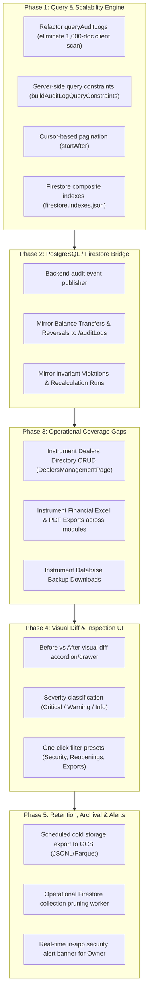

# Implementation Plan: Audit Log System Enhancements

## Executive Summary
This implementation plan outlines the architectural improvements, feature instrumentations, performance optimizations, and UX enhancements for the Franchise Audit Log System. It is staged in five modular phases to be queued and executed without disrupting active daily operations.

---

## Architecture & Work Breakdown



---

## Phase 1: Query Engine & Server-Side Scalability (High Priority)

### Objective
Replace the in-memory scan of 1,000 documents with genuine server-side Firestore queries and cursor pagination.

### Key Tasks
1. **Refactor [`src/lib/auditLogService.ts`](file:///home/hanzlaahmad/PersonalProjects/Franchise/src/lib/auditLogService.ts):**
   - Replace the hardcoded `limit(1000)` with server-side composite queries:
     ```typescript
     export async function queryAuditLogs(
       filters: AuditLogFilters,
       pageCursor?: QueryDocumentSnapshot<DocumentData>
     ): Promise<{ logs: SystemAuditLog[]; lastDoc: QueryDocumentSnapshot<DocumentData> | null }> {
       const constraints = buildAuditLogQueryConstraints(filters);
       constraints.push(limit(PAGE_SIZE));
       if (pageCursor) constraints.push(startAfter(pageCursor));
       const snap = await getDocs(query(auditLogCollection(), ...constraints));
       return {
         logs: snap.docs.map((d) => d.data() as SystemAuditLog),
         lastDoc: snap.docs[snap.docs.length - 1] ?? null
       };
     }
     ```
   - Ensure keyword search operates either over loaded records or against prefix tokens (`searchTokens` array).
2. **Deploy Composite Indexes in [`firestore.indexes.json`](file:///home/hanzlaahmad/PersonalProjects/Franchise/firestore.indexes.json):**
   - `collectionGroup: "auditLogs"`, fields: `module ASC, createdAt DESC`
   - `collectionGroup: "auditLogs"`, fields: `monthId ASC, createdAt DESC`
   - `collectionGroup: "auditLogs"`, fields: `actorUid ASC, createdAt DESC`
   - `collectionGroup: "auditLogs"`, fields: `action ASC, createdAt DESC`
3. **Verify UI Pagination in [`src/components/AuditLogsView.tsx`](file:///home/hanzlaahmad/PersonalProjects/Franchise/src/components/AuditLogsView.tsx):**
   - Ensure "Load more" smoothly appends pages without triggering full collection scans.

---

## Phase 2: PostgreSQL & Firestore Audit Unification

### Objective
Eliminate the split-brain between backend PostgreSQL transactions and client-side Firestore audit trails.

### Key Tasks
1. **Backend Event Emitter ([`backend/src/transactions/audit.ts`](file:///home/hanzlaahmad/PersonalProjects/Franchise/backend/src/transactions/audit.ts)):**
   - Add a lightweight secondary publisher or webhook that mirrors `audit_logs` table inserts to Firestore `/auditLogs` for owner visibility.
2. **Transfer & Reversal Auditing:**
   - In [`TransferBalanceModal.tsx`](file:///home/hanzlaahmad/PersonalProjects/Franchise/src/modules/stock/components/TransferBalanceModal.tsx) and [`ReverseTransferModal.tsx`](file:///home/hanzlaahmad/PersonalProjects/Franchise/src/modules/stock/components/ReverseTransferModal.tsx):
     - Emit a unified audit log:
       ```typescript
       await writeAuditLog({
         module: "stock",
         action: "TRANSFER",
         summary: `Transferred ${formatMoney(amount)} from ${sourceName} to ${destName}. Reason: ${reason}`,
         actorUid: user.uid,
         actorEmail: user.email,
         actorRole: role,
         monthId,
         targetType: "transfer",
         targetId: transferId,
         after: { sourceId, destId, amount, reason }
       });
       ```

---

## Phase 3: Instrument Missing Audit Triggers

### Objective
Close remaining audit blindspots across dealer management and sensitive data exports.

### Key Tasks
1. **Dealers Management Audit ([`src/components/DealersManagementPage.tsx`](file:///home/hanzlaahmad/PersonalProjects/Franchise/src/components/DealersManagementPage.tsx)):**
   - Log dealer profile registration (`"dealer-created"`).
   - Log profile edits (name, line MSISDN, active status) (`"dealer-updated"`).
   - Log cross-module link reconciliation (`"dealer-reconciled"`).
2. **Financial Data Export Audit ([`src/lib/exporters.ts`](file:///home/hanzlaahmad/PersonalProjects/Franchise/src/lib/exporters.ts)):**
   - Instrument helper `auditReportExport(reportType, details)` inside `exportMonthlyXlsx`, `exportDailyXlsx`, `exportJazzLoadXlsx`, `exportStockMonthlyXlsx`.
   - Logs who downloaded the financial package and when (`"export-report"`).
3. **Dealers CSV & Full Backup Export:**
   - Record user, timestamp, and row count whenever an operator downloads the dealer roster or database backup.

---

## Phase 4: State Diff Inspection & Visual Triage UX

### Objective
Empower the owner to understand *what* changed with one click, accompanied by clear visual severity indicators.

### Key Tasks
1. **Visual Before/After Diff Drawer in [`AuditLogsView.tsx`](file:///home/hanzlaahmad/PersonalProjects/Franchise/src/components/AuditLogsView.tsx):**
   - Clicking any audit row opens a side drawer displaying:
     - Target details (`targetType`, `targetId`, `sourcePath`).
     - State Diff viewer: comparing `before` and `after` objects with highlight colors (red for removed/changed old values, green for new values).
2. **Severity Tagging & Visual Badges:**
   - `CRITICAL` (Red / Alert): `"reopen-month"`, `"user-delete"`, `"role-change"`, `"BALANCE_MISMATCH_DETECTED"`.
   - `WARNING` (Amber / Alert): `"reopen-day"`, `"close-month"`, `"lock-day"`, `"catalog-delete"`, `"backup-restore"`.
   - `INFO` (Blue/Emerald): `"RAW_ENTRY_SAVED"`, `"export-report"`, `"catalog-upsert"`.
3. **One-Click Quick Filter Bar:**
   - Pill chips: `[ All Logs ]` `[ 🚨 Security & Roles ]` `[ 🔓 Day/Month Reopenings ]` `[ 💸 Balance Transfers ]` `[ 📥 Financial Exports ]`.

---

## Phase 5: Retention, Cold Storage Archival & Real-Time Alerts

### Objective
Prevent indefinite growth of Firestore operational collections and proactively alert the owner on critical security events.

### Key Tasks
1. **Cold Storage Archival Worker (`functions/src/archiveAuditLogs.ts`):**
   - Monthly cron job scanning logs where `createdAt < NOW() - 180 days`.
   - Exports batch records to Google Cloud Storage as `audit-archives/audit-log-YYYY-MM.jsonl.gz`.
   - Prunes operational Firestore `/auditLogs` collection using Firebase Admin SDK.
2. **Historical Download in UI:**
   - Add an "Archived Logs" tab in `AuditLogsView` allowing the owner to download annual/quarterly JSONL archives.
3. **Real-Time Security Notifications:**
   - Subscribed hook listening for `severity === "critical"` events.
   - Triggers an instant in-app banner for logged-in owners whenever an admin reopens an accounting month or modifies access privileges.

---

## Verification & Testing Matrix

| Test Scope | Verification Procedure | Expected Outcome |
| :--- | :--- | :--- |
| **Server-Side Pagination** | Query 200 mock logs with composite filters (`module`, `monthId`, `createdAt`). | Firestore performs indexed query; exactly 50 docs returned per page without in-memory scan. |
| **Dealer CRUD Auditing** | Create, edit, and deactivate a dealer in `DealersManagementPage`. | 3 discrete audit entries generated with actor email and snapshot states. |
| **Report Export Auditing** | Click "Export Monthly Excel" on Dashboard. | An `"export-report"` audit log record is created with user ID and month label. |
| **Before/After Diff UI** | Click a row with before/after state in `AuditLogsView`. | Drawer slides open displaying side-by-side key-value differences. |
| **Security Rules Check** | Attempt to delete or edit an `/auditLogs` entry via client SDK. | Request rejected with Firestore `permission-denied`. |
