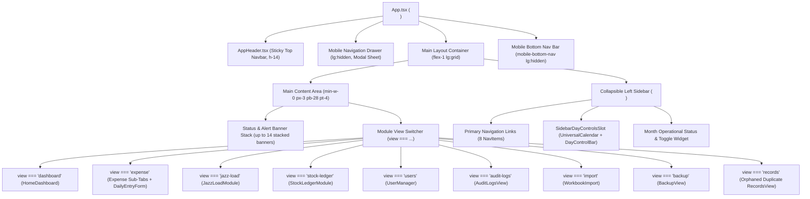
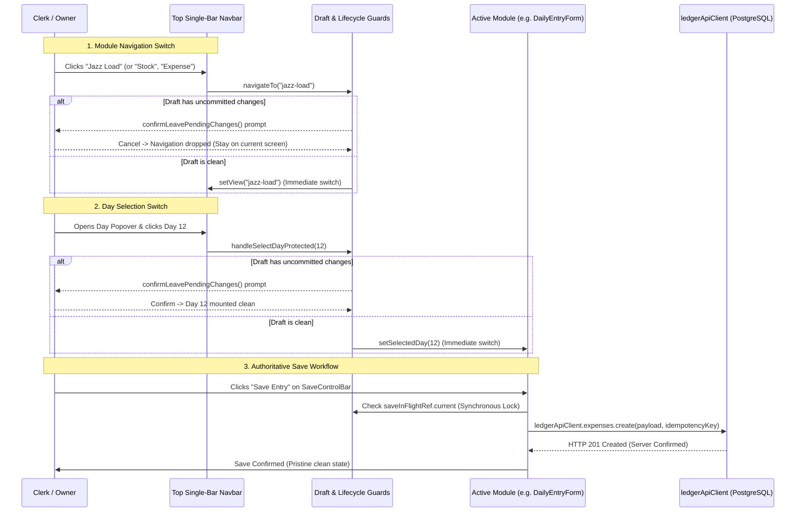

# Franchise System — Read-Only Audit: Single-Bar Navigation Cleanup

> **SAFETY STATUS:** STRICTLY READ-ONLY AUDIT COMPLETE  
> **DISCOVERY & ARCHITECTURAL PROPOSAL ONLY — NO CODE, DATABASE, OR PERSISTENCE MODIFICATIONS.**  
> **Audit Date:** October 28, 2026  
> **Repository:** `/home/hanzlaahmad/PersonalProjects/Franchise`  
> **Active Branch:** `v2_partial`  
> **Target Release:** Phase 4 Preparation (Pre-Jazz Load Redesign)  

---

## Executive Summary

Phase 1 (Shell responsive foundations), Phase 2 (Shared component library), and Phase 3 (Expense module redesign) successfully modernized the visual design and isolated persistence boundaries. However, the overarching application shell continues to suffer from a **fragmented, two-headed navigation model**:

1. **Split-Brain Desktop Navigation:** Primary module navigation (`Dashboard`, `Expense`, `Jazz Load`, `Stock Ledger`) is locked in a collapsible left sidebar, while essential operational controls (`Active Month`, `Day Quick Selector`, `Sync Status`, `Theme Toggle`, `User Profile`) reside in the sticky top navbar (`AppHeader`).
2. **Extreme Control Duplication:** Day selection, day status chips, month toggles, export buttons, and save controls are repeated across 3 to 5 simultaneous locations per view.
3. **Ghost & Unsupported Legacy Actions:** Controls like `"Reopen All Days"` and `"Close All Previous Days Except Today"` exist in the UI but are non-functional in the authoritative PostgreSQL ledger architecture. Similarly, permanently disabled buttons (`"Send Email"`) and orphaned views (`view === "records"`) create cognitive friction and visual clutter.
4. **Horizontal Viewport Waste:** On 1080p and laptop screens, the 224px (14rem) left sidebar consumes valuable horizontal real estate needed for wide financial and inventory ledger tables, causing unnecessary horizontal scrolling.

This audit details every control in the application shell and proposes a **Single-Bar Navigation Architecture** ("Clear Ledger, Focused Day") that unifies all primary navigation into a single, sleek top navigation bar, retires the permanent left sidebar, centralizes month and day selection, and eliminates dead and unsupported bulk actions.

---

## 1. Current Application Shell & Component Hierarchy

The application layout is currently assembled in [`src/App.tsx`](file:///home/hanzlaahmad/PersonalProjects/Franchise/src/App.tsx#L3949-L4678) using a mixed-paradigm shell that combines a top navbar, a collapsible left sidebar, dynamic warning banners, and a mobile bottom bar:



### Component Rendering Boundaries

| Container Component | File Location | Rendered Controls & Content | Viewport Visibility |
| :--- | :--- | :--- | :--- |
| **`AppHeader`** | [`src/components/AppHeader.tsx`](file:///home/hanzlaahmad/PersonalProjects/Franchise/src/components/AppHeader.tsx#L47-L398) | Brand logo, Franchise Name, v2.0 badge, Mobile menu toggle (`lg:hidden`), Desktop sidebar collapse toggle (`lg:flex`), Active Month selector (`<select>`), Month Close Required badge, Day Quick Indicator button & Day Switcher Popover (1..31 + Day 32 FINAL), Sync Status pill, Theme Toggle (Sun/Moon), User Menu dropdown (Name, Email, Role badge, Sign Out). | Visible on all viewports (`sticky top-0 z-40`). |
| **Mobile Drawer** | [`src/App.tsx:3996-4032`](file:///home/hanzlaahmad/PersonalProjects/Franchise/src/App.tsx#L3996-L4032) | 2-column grid of 8 module navigation buttons (`Dashboard`, `Expense`, `Jazz Load`, `Stock Ledger`, `Users`, `Audit Logs`, `Excel Import`, `Backup`), Month status text, User summary, Mobile "Sign Out" button. | Visible only on mobile/tablet when `mobileMenuOpen === true` (`lg:hidden`). |
| **Left Sidebar** | [`src/App.tsx:4034-4115`](file:///home/hanzlaahmad/PersonalProjects/Franchise/src/App.tsx#L4034-L4115) | Vertical list of 8 module navigation buttons with icons and labels, Sidebar collapse rail toggle button, Contextual slot (`expenseSidebarControls` or `SidebarDayControlsSlot`), Month Operational Status & Toggle widget (`Close Month` / `Reopen Month`). | Visible only on desktop (`hidden lg:flex`, width `w-56` when expanded, `w-[4.5rem]` when collapsed). |
| **Banner Stack** | [`src/App.tsx:4117-4265`](file:///home/hanzlaahmad/PersonalProjects/Franchise/src/App.tsx#L4117-L4265) | Transient status messages, Month Close Required banner (`Close Month`), Next Period Uninitialized banner (`Initialize & Open Day 1`), Uninitialized Period banner, Auth Required banner, Balance Mismatch warnings, Carry-Forward Opening warnings, LedgerV2 Shadow Read notices, Closed Month notice, Closed Day notice, Reopened Day notice. | Main content area, visible on all viewports. |
| **Mobile Bottom Bar** | [`src/App.tsx:4648-4674`](file:///home/hanzlaahmad/PersonalProjects/Franchise/src/App.tsx#L4648-L4674) | Fixed bottom bar with 4 primary destinations (`Dashboard`, `Expense`, `Jazz`, `Stock`) + `More` button (toggles mobile drawer). | Visible only on mobile/tablet (`lg:hidden fixed bottom-0`). |

---

## 2. Complete Navbar / Sidebar / Module Control Inventory

### 2.1 Top Navbar (`AppHeader.tsx`)
1. **Mobile Menu Toggle** ([`AppHeader.tsx:137-147`](file:///home/hanzlaahmad/PersonalProjects/Franchise/src/components/AppHeader.tsx#L137-L147)): Toggles `mobileMenuOpen` state for narrow viewports (`lg:hidden`).
2. **Sidebar Rail Collapse Toggle** ([`AppHeader.tsx:150-157`](file:///home/hanzlaahmad/PersonalProjects/Franchise/src/components/AppHeader.tsx#L150-L157)): Toggles `sidebarOpen` state for desktop viewports (`lg:flex`).
3. **Brand & Version Chip** ([`AppHeader.tsx:159-171`](file:///home/hanzlaahmad/PersonalProjects/Franchise/src/components/AppHeader.tsx#L159-L171)): Displays franchise branding and `v2.0` pill.
4. **Active Month Select** ([`AppHeader.tsx:179-192`](file:///home/hanzlaahmad/PersonalProjects/Franchise/src/components/AppHeader.tsx#L179-L192)): Native select dropdown bound to `onMonthChange(nextMonthId)`.
5. **Month Close Required Chip** ([`AppHeader.tsx:194-201`](file:///home/hanzlaahmad/PersonalProjects/Franchise/src/components/AppHeader.tsx#L194-L201)): Static amber warning pill shown when `isMonthCloseRequired === true`.
6. **Day Quick Indicator Button** ([`AppHeader.tsx:207-238`](file:///home/hanzlaahmad/PersonalProjects/Franchise/src/components/AppHeader.tsx#L207-L238)): Displays current day number, status pill (`open`, `closed`, `reopened`), and triggers popover.
7. **Day Switcher Popover Grid** ([`AppHeader.tsx:241-301`](file:///home/hanzlaahmad/PersonalProjects/Franchise/src/components/AppHeader.tsx#L241-L301)): 7-column grid of days 1..31 + full-width Day 32 FINAL button, bound to `handleSelectDayProtected(d)`.
8. **Sync Status Pill** ([`AppHeader.tsx:309-334`](file:///home/hanzlaahmad/PersonalProjects/Franchise/src/components/AppHeader.tsx#L309-L334)): Visual network/sync indicator with animated dot.
9. **Theme Toggle Button** ([`AppHeader.tsx:336-343`](file:///home/hanzlaahmad/PersonalProjects/Franchise/src/components/AppHeader.tsx#L336-L343)): Switches theme between `dark` and `light`.
10. **User Menu Trigger Button** ([`AppHeader.tsx:347-363`](file:///home/hanzlaahmad/PersonalProjects/Franchise/src/components/AppHeader.tsx#L347-L363)): Avatar icon, user name, role badge.
11. **User Menu Dropdown** ([`AppHeader.tsx:365-394`](file:///home/hanzlaahmad/PersonalProjects/Franchise/src/components/AppHeader.tsx#L365-L394)): User name, email, role badge, and "Sign Out" button.

### 2.2 Left Sidebar & Sidebar Day Controls (`src/App.tsx`)
1. **Sidebar Collapse Toggle** ([`src/App.tsx:4044-4050`](file:///home/hanzlaahmad/PersonalProjects/Franchise/src/App.tsx#L4044-L4050)): Duplicate toggle button inside sidebar header.
2. **8 Navigation Item Buttons** ([`src/App.tsx:4054-4084`](file:///home/hanzlaahmad/PersonalProjects/Franchise/src/App.tsx#L4054-L4084)):
   - `Dashboard` (`LayoutDashboard`)
   - `Expense` (`Tags`)
   - `Jazz Load` (`FileSpreadsheet`)
   - `Stock Ledger` (`PackageOpen`)
   - `Users` (`Users`, owner/admin only)
   - `Audit Logs` (`ScrollText`, owner only)
   - `Excel Import` (`FileSpreadsheet`, owner only)
   - `Backup` (`FileDown`, owner/admin only)
3. **UniversalCalendar (Mini Grid)** ([`src/App.tsx:3851-3862`](file:///home/hanzlaahmad/PersonalProjects/Franchise/src/App.tsx#L3851-L3862), [`JazzLoadModule.tsx:2476`](file:///home/hanzlaahmad/PersonalProjects/Franchise/src/modules/jazzLoad/components/JazzLoadModule.tsx#L2476), [`StockLedgerModule.tsx:2418`](file:///home/hanzlaahmad/PersonalProjects/Franchise/src/modules/stock/components/StockLedgerModule.tsx#L2418)): Mini month calendar showing all days 1..31 + Day 32 FINAL with status colors.
4. **UniversalDayControlBar** ([`src/App.tsx:3863-3935`](file:///home/hanzlaahmad/PersonalProjects/Franchise/src/App.tsx#L3863-L3935), [`UniversalDayControlBar.tsx:47-122`](file:///home/hanzlaahmad/PersonalProjects/Franchise/src/shared/dayControls/UniversalDayControlBar.tsx#L47-L122)):
   - Status chip: Selected day status (`open`, `closed`, `reopen`).
   - Autosave status chip: (`Saved`, `Typing...`, `Saving...`, `Pending sync`, `Closed day`, `Unsaved changes`).
   - Action: `Master Refresh Calculations` button.
   - Action: `Reopen Selected Day` button.
   - Action: `Reopen All Days` button.
   - Action: `Close All Previous Days Except Today` button.
   - Action: `Close Day` / `Verify & Close FINAL` button.
   - Extra Actions (Expense): `Export Daily Excel`, `Export Daily PDF`.
   - Extra Actions (Jazz Load): `Apply Current Rates To This Day`, `Export Daily Excel`, `Export Daily PDF`.
   - Extra Actions (Stock): `Save`, `Save Now & Verify`, `Export Daily Excel`, `Export Daily PDF`.
5. **Month Operational Status & Toggle Widget** ([`src/App.tsx:4097-4112`](file:///home/hanzlaahmad/PersonalProjects/Franchise/src/App.tsx#L4097-L4112)): "Month: OPEN / CLOSED" display and "Close Month" / "Reopen Month" button.

### 2.3 Module-Level Sub-Navigation Bars
1. **Expense Module Tab Bar** ([`src/App.tsx:4325-4367`](file:///home/hanzlaahmad/PersonalProjects/Franchise/src/App.tsx#L4325-L4367)):
   - `Daily Entry`
   - `Monthly Summary & Ledger` (`RecordsView`)
   - `Dashboard` (`HomeDashboard`)
   - `Expense Categories` (`CatalogManager`)
   - `Credit Parties` (`CatalogManager`)
   - `Commissions Catalog` (`CatalogManager`)
2. **Jazz Load Module Button Bar** ([`JazzLoadModule.tsx:2644-2665`](file:///home/hanzlaahmad/PersonalProjects/Franchise/src/modules/jazzLoad/components/JazzLoadModule.tsx#L2644-L2665)):
   - `Dashboard`
   - `Daily Entry`
   - `Reports`
   - `Settings`
   - `Backup`
3. **Stock Ledger Module Section Tabs** ([`StockLedgerModule.tsx:2642-2696`](file:///home/hanzlaahmad/PersonalProjects/Franchise/src/modules/stock/components/StockLedgerModule.tsx#L2642-L2696)):
   - Entries Group: `Daily Entry`, `Stock In (DO)`
   - Reports Group: `Stock Dashboard`, `Reports Center`
   - Secondary: `Settings`, `Backup`

---

## 3. Duplicate-Control Map

The following controls exist in multiple locations across the application simultaneously:

| Functional Capability | Instance 1 (Primary) | Instance 2 (Duplicate) | Instance 3 (Duplicate) | Instance 4 (Duplicate) | Evaluation & Verdict |
| :--- | :--- | :--- | :--- | :--- | :--- |
| **Month Selection** | `AppHeader.tsx:179` (`<select title="Active Month">`) | `src/App.tsx:4274` (`<p>Active Month: August 2026</p>`) | `src/App.tsx:4099` (Sidebar Month widget) | `src/App.tsx:4559` (Excel Import month picker) | **Keep in `AppHeader` only.** Remove sidebar widget and content sub-headers. |
| **Day Selection** | `AppHeader.tsx:241` (Header Day Popover) | `UniversalCalendar.tsx` (Sidebar Expense) | `UniversalCalendar.tsx` (Sidebar Jazz Load) | `UniversalCalendar.tsx` (Sidebar Stock) | **Keep in `AppHeader` popover.** Remove all 3 redundant sidebar calendars. |
| **Selected Day Status** | `AppHeader.tsx:227` (Header status pill) | `UniversalDayControlBar.tsx:70` (Sidebar chip) | `DailyEntryForm.tsx:1115` (`StatusBadge`) | `DailyEntryForm.tsx:1104` (Text status span) | **Keep in `AppHeader` and Form Title.** Remove sidebar chips. |
| **Save & Verify Action** | Form Header (`"Save Now & Verify"`) | Form Sticky Bar ([`SaveControlBar.tsx`](file:///home/hanzlaahmad/PersonalProjects/Franchise/src/shared/components/SaveControlBar.tsx)) | `StockLedgerModule.tsx:2464` (Sidebar Save) | `StockLedgerModule.tsx:2480` (Sidebar Save & Verify) | **Keep inside active Form.** Remove all save buttons from global sidebar. |
| **Save Status / In-Flight Indicator** | `DailyEntryForm.tsx:1093` (Header status) | `DailyEntryForm.tsx:1150` (Mobile status) | `SaveControlBar.tsx:88` (Bottom bar status) | `UniversalDayControlBar.tsx:74` (Sidebar chip) | **Keep in `SaveControlBar` and Form Header.** Remove sidebar chip. |
| **Month Close Action** | `GuidedMonthCloseModal.tsx:42` (Modal prompt) | `src/App.tsx:4134` (Close Month banner) | `src/App.tsx:4103` (Sidebar Close Month button) | `AppHeader.tsx:194` (Close Required badge) | **Merge into Guided Modal & Banner.** Remove sidebar toggle button. |
| **Master Recalculation Refresh** | `App.tsx:3887` (Sidebar Expense) | `JazzLoadModule.tsx:2521` (Sidebar Jazz) | `StockLedgerModule.tsx:2458` (Sidebar Stock) | Banner warning prompt ([`App.tsx:4222`](file:///home/hanzlaahmad/PersonalProjects/Franchise/src/App.tsx#L4222)) | **Move to Secondary Settings / Maintenance menu.** Remove from daily entry bars. |
| **Sidebar Collapse Toggle** | `AppHeader.tsx:150` (Top rail toggle) | `src/App.tsx:4044` (Sidebar header toggle) | — | — | **Remove both with sidebar elimination.** |
| **Sign Out Button** | `AppHeader.tsx:381` (User dropdown) | `src/App.tsx:4027` (Mobile drawer footer) | — | — | **Keep in `AppHeader` User Menu** (accessible on mobile via header). |
| **Theme Toggle** | `AppHeader.tsx:336` (Sun/Moon button) | — | — | — | **Keep in `AppHeader`.** Clean, centralized single instance. |
| **Financial Dashboard** | Top-level `view === "dashboard"` ([`App.tsx:4281`](file:///home/hanzlaahmad/PersonalProjects/Franchise/src/App.tsx#L4281)) | Expense sub-tab `expense-dashboard` ([`App.tsx:4429`](file:///home/hanzlaahmad/PersonalProjects/Franchise/src/App.tsx#L4429)) | Jazz Load `dashboard` ([`JazzLoadModule.tsx:2667`](file:///home/hanzlaahmad/PersonalProjects/Franchise/src/modules/jazzLoad/components/JazzLoadModule.tsx#L2667)) | Stock `dashboard` ([`StockLedgerModule.tsx:3247`](file:///home/hanzlaahmad/PersonalProjects/Franchise/src/modules/stock/components/StockLedgerModule.tsx#L3247)) | **Eliminate duplicate `expense-dashboard` sub-tab.** Consolidate global vs module-specific KPIs. |
| **Daily Report Exports** | Module Reports tab / view | `UniversalDayControlBar.tsx` (Sidebar Daily Excel) | `UniversalDayControlBar.tsx` (Sidebar Daily PDF) | — | **Move to Module Reports tab.** Remove from global sidebar. |
| **Backup / Export Package** | Top-level `view === "backup"` ([`App.tsx:4522`](file:///home/hanzlaahmad/PersonalProjects/Franchise/src/App.tsx#L4522)) | Jazz Load sub-tab `backup` ([`JazzLoadModule.tsx:3238`](file:///home/hanzlaahmad/PersonalProjects/Franchise/src/modules/jazzLoad/components/JazzLoadModule.tsx#L3238)) | Stock Ledger sub-tab `backup` ([`StockLedgerModule.tsx:4877`](file:///home/hanzlaahmad/PersonalProjects/Franchise/src/modules/stock/components/StockLedgerModule.tsx#L4877)) | — | **Consolidate under secondary System Backup destination.** Remove module-level backup tabs. |

---

## 4. Unsupported, Unused, and Irrelevant Action Findings

### 4.1 "Reopen All Days" & "Close All Previous Days Except Today"
- **Rendered In:** [`src/shared/dayControls/UniversalDayControlBar.tsx:95-110`](file:///home/hanzlaahmad/PersonalProjects/Franchise/src/shared/dayControls/UniversalDayControlBar.tsx#L95-L110) across Expense, Jazz Load, and Stock sidebar day control bars.
- **Handler Implementation:**
  - Expense: [`src/App.tsx:2757-2823`](file:///home/hanzlaahmad/PersonalProjects/Franchise/src/App.tsx#L2757-L2823) (`reopenMonthDays`) and [`src/App.tsx:2825-2880`](file:///home/hanzlaahmad/PersonalProjects/Franchise/src/App.tsx#L2825-L2880) (`closeAllDaysExceptToday`).
- **Audit Findings:**
  Lines 2758-2761 and 2826-2829 explicitly evaluate:
  ```ts
  if (isPostgreSqlPeriod(monthId)) {
    setStatus("Bulk day actions for PostgreSQL operational periods are managed through PostgreSQL governance workflows.");
    return;
  }
  ```
  - **PostgreSQL Ledger Reality:** The server-authoritative PostgreSQL API ([`src/services/api/ledgerApiClient.ts`](file:///home/hanzlaahmad/PersonalProjects/Franchise/src/services/api/ledgerApiClient.ts#L770-L777)) provides individual endpoints (`/api/v1/periods/:periodId/days/:dayNo/close` and `/reopen`). There is **zero backend support** for bulk day state manipulation. The server enforces sequential accounting integrity.
  - **Verdict:** **UNSUPPORTED IN AUTHORITATIVE ARCHITECTURE.** The buttons are misleading relics from legacy Firestore batch-writes. In PostgreSQL mode, clicking them does nothing except display an error message.
  - **Recommendation:** **Remove both buttons from UI affordances.** Do not change underlying day governance rules.

### 4.2 Permanently Disabled Email Buttons
- **Rendered In:**
  1. [`src/components/DailyEntryForm.tsx:1153-1158`](file:///home/hanzlaahmad/PersonalProjects/Franchise/src/components/DailyEntryForm.tsx#L1153-L1158): `"Send Email"` button in daily entry header.
  2. [`src/App.tsx:4291-4301`](file:///home/hanzlaahmad/PersonalProjects/Franchise/src/App.tsx#L4291-L4301): `"Send Email"` button on Dashboard.
- **Audit Findings:**
  - In `App.tsx:4409`, prop `canSendEmail={false}` is hardcoded to `false`.
  - Both buttons are hardcoded `disabled` with tooltip:
    `"Email sending is disabled until Firebase Functions deployment is available."`
  - The Firebase Functions email infrastructure does not exist in the active PostgreSQL architecture.
  - **Verdict:** **PERMANENTLY DEAD AFFORDANCE.**
  - **Recommendation:** **Remove both buttons.** Eliminate dead code and clutter.

### 4.3 Orphaned Top-Level View: `view === "records"`
- **Rendered In:** [`src/App.tsx:4306-4314`](file:///home/hanzlaahmad/PersonalProjects/Franchise/src/App.tsx#L4306-L4314):
  ```tsx
  {view === "records" && (
    <RecordsView monthId={monthId} selectedDay={selectedDay} days={days} computed={computed} loading={loading} />
  )}
  ```
- **Audit Findings:**
  - `type View` defines `"records"`.
  - However, `navItems` does **not** include `"records"`.
  - No button, link, or router in the entire codebase ever calls `setView("records")` or `navigateTo("records")`.
  - `RecordsView` is already properly rendered inside `view === "expense"` under `expenseSection === "previous-records"`.
  - **Verdict:** **DEAD / ORPHANED CODE BRANCH.**
  - **Recommendation:** **Remove `view === "records"` from `App.tsx`.**

### 4.4 Global vs Report-Specific Export Actions
- **Rendered In:**
  - Sidebar `UniversalDayControlBar`: `Export Daily Excel`, `Export Daily PDF` (Expense, Jazz Load, Stock).
  - Main Dashboard: `Export Monthly Excel`, `Export Monthly PDF`.
  - Module Reports tabs: Jazz Load Reports tab, Stock Reports Center.
- **Audit Findings:**
  - Daily report export functions (`exportDailyXlsx`, `exportDailyPdf`, `exportStockDayXlsx`, `exportJazzLoadXlsx`) work correctly when called with a valid computed day.
  - However, displaying 2 to 4 export buttons in a narrow vertical sidebar rail clutters day-to-day data entry.
  - **Verdict:** **MISPLACED EXPORT AFFORDANCES.**
  - **Recommendation:** Keep report-specific exports inside their respective module **Reports / Summary** tabs. Remove export buttons from the daily data-entry sidebar.

---

## 5. Handler, Dependency, and Permission Traces



### Trace Summary of Key Workflows

1. **Pending-Draft Protection Guard (`confirmLeavePendingChanges`):**
   - **File & Lines:** [`src/App.tsx:3520-3525`](file:///home/hanzlaahmad/PersonalProjects/Franchise/src/App.tsx#L3520-L3525) (`navigateTo`) and [`src/App.tsx:3838-3844`](file:///home/hanzlaahmad/PersonalProjects/Franchise/src/App.tsx#L3838-L3844) (`handleSelectDayProtected`).
   - **Dependencies:** `hasPendingDayChanges` state, wired via `onPendingStateChange` in `DailyEntryForm`, `JazzLoadModule`, and `StockLedgerModule`.
   - **Invariant:** Must be preserved on **all** top-bar navigation clicks and day-selection events.

2. **Sequential Day Close & Reopen Permissions:**
   - **File & Lines:** [`src/services/api/dayLifecycleService.ts:18-80`](file:///home/hanzlaahmad/PersonalProjects/Franchise/src/services/api/dayLifecycleService.ts#L18-L80) and [`src/services/api/periodDayService.ts:140-190`](file:///home/hanzlaahmad/PersonalProjects/Franchise/src/services/api/periodDayService.ts#L140-L190).
   - **Dependencies:** `ledgerApiClient.periods.closeDay` and `reopenDay`.
   - **Role Rules:**
     - Operational Day Close: Allowed for `owner` and `admin` on current/past open days.
     - Operational Day Reopen: Restricted strictly to `owner`.
     - FINAL Month-End (Day 32): Restricted strictly to `owner`. Reopen is forbidden by accounting rule; corrections must be made on operational days (e.g. Day 31).

3. **Master Calculation Refresh (`recalc` / `triggerMasterRefresh`):**
   - **File & Lines:** [`src/App.tsx:2931-3046`](file:///home/hanzlaahmad/PersonalProjects/Franchise/src/App.tsx#L2931-L3046) and [`src/shared/services/masterRecalculationService.ts:40-120`](file:///home/hanzlaahmad/PersonalProjects/Franchise/src/shared/services/masterRecalculationService.ts#L40-L120).
   - **Dependencies:** Requires `owner` or `admin` (`MASTER_REFRESH_ACCESS`).
   - **Purpose:** Maintenance recalculation of carry-forward opening balances across days and months.

---

## 6. Recommended Minimal Navigation Structure

### Preferred Architecture: "Clear Ledger, Focused Day" Single-Bar Shell

Replace the dual Navbar + Sidebar structure with **one unified horizontal navigation bar (`AppHeader`)** that provides all primary destinations, global controls, and status indicators in a compact, highly organized hierarchy.

```
+--------------------------------------------------------------------------------------------------------------------------+
| BRAND LOGO | [Dashboard] [Expense Ledger] [Jazz Load] [Stock Ledger] | Aug 2026 (open) v | Day 5 [open] v | [Synced] [*] [User v] |
+--------------------------------------------------------------------------------------------------------------------------+
```

### Layout Components & Responsibilities

1. **Top Single-Bar Navbar (`AppHeader.tsx`):**
   - **Left Zone:** Brand logo + Franchise Name (`Jazz Franchise - 7301`).
   - **Center-Left Zone (Primary Navigation):** 4 clean segmented pill tabs:
     - `Dashboard`
     - `Expense Ledger`
     - `Jazz Load`
     - `Stock Ledger`
   - **Center-Right Zone (Temporal Context):**
     - **Active Month Selector:** Compact dropdown with open/closed status indicator and "Close Required" badge.
     - **Active Day Selector & Popover:** Prominently shows selected day (`Day 5`, `Day 32 FINAL`) with status badge; clicking opens the quick 31-day switcher popover.
   - **Right Zone (Utilities & Profile):**
     - **Sync Status Badge:** Pill indicator with animated dot showing live synchronization state.
     - **Theme Toggle:** Dark/Light theme switch button.
     - **User & Administration Menu (Overflow Dropdown):**
       - User profile info (`displayName`, `email`, role badge).
       - Secondary administrative destinations:
         - `Users & Permissions` (owner/admin)
         - `Audit Logs` (owner)
         - `Excel Import` (owner)
         - `System Backup & Restore` (owner/admin)
         - `Recalculate Balances / Master Refresh` (owner/admin)
       - `Sign Out` button.

2. **Complete Removal of Left Sidebar:**
   - Eliminate `<aside className="lg:flex">` in `src/App.tsx`.
   - Remove `SidebarDayControlsContext` and `SidebarDayControlsSlot`.
   - Reclaim 224px (14rem) of horizontal space, enabling wide ledger tables to display with full column clarity without horizontal truncation.

3. **Module-Internal Workflow Structure:**
   - **Expense:** Retain sleek segmented sub-tab bar (`Daily Entry`, `Monthly Summary & Ledger`, `Expense Categories`, `Credit Parties`, `Commissions Catalog`). Remove duplicate `Dashboard` sub-tab.
   - **Jazz Load:** Consolidate sub-navigation into 4 focused tabs (`Daily Lifting & Issuance`, `Monthly Reports`, `DO Profiles & Rates`, `Formulas & Reference`). Remove duplicate `Dashboard` and module `Backup` tabs.
   - **Stock Ledger:** Consolidate into 4 focused tabs (`Daily Issuance & Recovery`, `Stock In (DO)`, `Monthly Reports Center`, `Products & Accounts`). Remove duplicate `Dashboard` and module `Backup` tabs.

---

## 7. Exact Keep / Remove / Move / Merge Matrix

| Control (Visible Label) | Current Location | Handler / Action | Purpose | Dependencies / Permissions | Classification | Justification / Evidence | Regression Risk & Mitigation |
| :--- | :--- | :--- | :--- | :--- | :---: | :--- | :--- |
| **Brand Identity** | Navbar Left | Presentation | Franchise branding | None | **KEEP** | Essential branding context. | Low risk. |
| **Sidebar Toggle** | Navbar Left & Sidebar Header | `onToggleSidebar` | Expands/collapses sidebar | None | **REMOVE** | Sidebar is eliminated in single-bar architecture. | Low risk. Remove associated state. |
| **Mobile Menu Toggle** | Navbar Left | `onToggleMobileMenu` | Toggles mobile drawer | Screen width `< 1024px` | **KEEP / MERGE** | Keep for mobile viewports to open secondary drawer. | Low risk. |
| **Primary Nav: Dashboard** | Sidebar Link | `navigateTo("dashboard")` | Navigates to Home Dashboard | None | **MOVE** | Move to Top Navbar primary segmented tabs. | Must preserve `confirmLeavePendingChanges()`. |
| **Primary Nav: Expense** | Sidebar Link | `navigateTo("expense")` | Navigates to Expense Ledger | None | **MOVE** | Move to Top Navbar primary segmented tabs. | Must preserve `confirmLeavePendingChanges()`. |
| **Primary Nav: Jazz Load** | Sidebar Link | `navigateTo("jazz-load")` | Navigates to Jazz Load Ledger | None | **MOVE** | Move to Top Navbar primary segmented tabs. | Must preserve `confirmLeavePendingChanges()`. |
| **Primary Nav: Stock Ledger**| Sidebar Link | `navigateTo("stock-ledger")` | Navigates to Stock Ledger | None | **MOVE** | Move to Top Navbar primary segmented tabs. | Must preserve `confirmLeavePendingChanges()`. |
| **Active Month Dropdown** | Navbar Center | `onMonthChange(id)` | Switches active accounting month | `loadMonth` | **KEEP** | Authoritative month switcher. Already in header. | Safe. Existing tests pass. |
| **Month Status & Toggle** | Sidebar Box | `handleMonthToggle` | Toggles month open/closed | `role === "owner"` | **REMOVE** | Duplicates Guided Month Close Modal and header status. | Safe. Month close is guided by Day 32 workflow. |
| **Close Month Banner** | Content Top Banner | `handleGuidedCloseMonth` | Direct month close action | `isMonthCloseRequired` | **KEEP** | Critical prompt when FINAL is verified but month open. | Safe. Keep `data-testid="month-close-required-banner"`. |
| **Day Indicator & Popover**| Navbar Center | `handleSelectDayProtected` | Quick day selection 1..31 + FINAL | `UniversalCalendar` | **KEEP** | Centralized day selection with pending-draft guard. | Critical. Preserved by DEF-01 fix and tests. |
| **UniversalCalendar (Mini)**| Sidebar (all 3 modules) | `onSelect(dayNo)` | Mini calendar day selector | Same as header popover | **REMOVE** | 100% redundant with Header Day Popover. | Safe. Centralizes day selection in header. |
| **Close Day Button** | Sidebar DayControlBar | `closeSelectedDay` | Closes selected operational day | `role === "owner" \|\| role === "admin"` | **MOVE** | Move to form header next to day title in all modules. | Must preserve confirmation prompt and permissions. |
| **Reopen Selected Day** | Sidebar DayControlBar | `reopenDay(dayNo)` | Reopens closed operational day | `role === "owner"` | **MOVE** | Move to form header next to day title in all modules. | Must preserve confirmation prompt and permissions. |
| **Reopen All Days** | Sidebar DayControlBar | `reopenMonthDays("all")` | Legacy bulk reopen | Non-functional in PostgreSQL | **REMOVE** | Unsupported in PostgreSQL ledger. Misleading relic. | Zero risk to accounting. Cleans up dead code. |
| **Close All Previous Days** | Sidebar DayControlBar | `closeAllDaysExceptToday`| Legacy bulk close | Non-functional in PostgreSQL | **REMOVE** | Unsupported in PostgreSQL ledger. Misleading relic. | Zero risk to accounting. Cleans up dead code. |
| **Master Refresh Calculations**| Sidebar DayControlBar| `recalc` / `triggerRefresh` | Recalculates carry-forwards | `roleCan(role, MASTER_REFRESH_ACCESS)` | **MOVE** | Move to User Menu → Maintenance / Settings dropdown. | Low risk. Administrative action, not daily ledger. |
| **Export Daily Excel / PDF** | Sidebar DayControlBar | `exportDailyXlsx` / `Pdf` | Exports current day report | None | **MOVE** | Move to Module Reports / Summary tabs. | Low risk. Preserves report generation. |
| **Send Email (Header)** | Form Header | `sendDailyEmail` | Sends daily report email | Permanently disabled (`false`)| **REMOVE** | Permanently disabled. No backend infrastructure. | Zero risk. Remove dead button. |
| **Send Email (Dashboard)** | Dashboard Bottom | `sendMonthEmail` | Sends monthly report email | Permanently disabled (`false`)| **REMOVE** | Permanently disabled. No backend infrastructure. | Zero risk. Remove dead button. |
| **Sync Status Pill** | Navbar Right | Presentation | Live sync status | `syncState` | **KEEP** | Authoritative network/sync feedback. | Safe. |
| **Theme Toggle** | Navbar Right | `onToggleTheme` | Dark / light theme switch | LocalStorage | **KEEP** | Clean, centralized. | Safe. |
| **User Profile Dropdown** | Navbar Right | `setUserMenuOpen` | Displays user and sign out | Auth state | **KEEP / EXPAND**| Expand into unified User & Secondary Admin menu. | Safe. Accessible keyboard escape restoration. |
| **Secondary Nav: Users** | Sidebar Link | `navigateTo("users")` | User role administration | `canManageUsers` | **MOVE** | Move to User / Administration overflow dropdown. | Safe. Preserves role guard. |
| **Secondary Nav: Audit Logs**| Sidebar Link | `navigateTo("audit-logs")` | System audit trail | `role === "owner"` | **MOVE** | Move to User / Administration overflow dropdown. | Safe. Preserves owner guard. |
| **Secondary Nav: Import** | Sidebar Link | `navigateTo("import")` | Excel workbook import | `canUseExcelImport` | **MOVE** | Move to User / Administration overflow dropdown. | Safe. Preserves owner guard. |
| **Secondary Nav: Backup** | Sidebar Link | `navigateTo("backup")` | System JSON backup/restore | `canUseBackup` | **MOVE** | Move to User / Administration overflow dropdown. | Safe. Preserves backup capability. |
| **Expense Sub-Nav: Dashboard**| Expense Sub-Tab | `setExpenseSection("dashboard")`| Embedded HomeDashboard | Redundant | **REMOVE** | 100% duplicate of top-level Dashboard view. | Safe. Cleans up duplicate sub-view. |
| **Orphaned View: "records"**| App View Router | None | Orphaned RecordsView | None | **REMOVE** | Unreachable dead branch in `App.tsx:4306`. | Safe. RecordsView is inside Expense module. |

---

## 8. Desktop, Tablet, and Mobile Behavior

```mermaid
graph TD
    subgraph Desktop [Desktop Viewport: >= 1024px]
        D_Nav["Single Top Bar (h-14): Brand | 4 Primary Tabs | Month Dropdown | Day Popover | Sync | Theme | User Menu"]
        D_Body["Full-Width Ledger Content Area (max-w-7xl mx-auto px-6) - No Sidebar"]
        D_Nav --> D_Body
    end

    subgraph Tablet [Tablet Viewport: 768px - 1023px]
        T_Nav["Single Top Bar (h-14): Brand | Month | Day Popover | Compact Module Icons | Sync | User Menu"]
        T_Body["Responsive Content Area with Horizontal Scroll on Wide Tables"]
        T_Nav --> T_Body
    end

    subgraph Mobile [Mobile Viewport: < 768px]
        M_Nav["Top Bar (h-14): Brand | Month (Compact) | Day Popover | Sync Dot | Menu Toggle"]
        M_Body["Mobile Card Lists & Touch-Optimized Vertical Stacks"]
        M_Bottom["Fixed Bottom Bar (h-16): 4 Primary Module Tabs + 'More' (Secondary Sheet)"]
        M_Nav --> M_Body
        M_Body --> M_Bottom
    end
```



### Viewport Breakdown & Mechanics

1. **Desktop Viewports ($\ge$ 1024px):**
   - **Top Navbar:**
     - Left: Brand icon + Franchise name.
     - Center-Left: Segmented tab pill group (`Dashboard`, `Expense`, `Jazz Load`, `Stock`).
     - Center-Right: Compact Active Month dropdown + Day Popover button.
     - Right: Sync status pill + Theme toggle + User avatar menu.
   - **Content Area:** Consumes 100% of the viewport width (no sidebar). Wide tables (Owner dues, DO matrices, Stock balances) breathe naturally without horizontal crowding.
   - **Keyboard Navigation:** Full Tab/Shift-Tab order, Enter/Space activation, Escape dismissal on day popover and user menu.

2. **Tablet Viewports (768px to 1023px):**
   - **Top Navbar:** Primary tabs condense to icon + abbreviated text (e.g. `Exp`, `Jazz`, `Stock`).
   - Month selector and Day popover remain accessible in header.
   - User menu holds all secondary destinations (`Users`, `Audit Logs`, `Import`, `Backup`).
   - Content area uses `overflow-x-auto` with clean scroll indicators for dense tables.

3. **Mobile Viewports (< 768px):**
   - **Top Navbar:** Brand icon | Compact month select | Day popover button | Sync status dot | User avatar.
   - **Bottom Navigation Bar:** Retains the 4 primary modules (`Dashboard`, `Expense`, `Jazz`, `Stock`) + `"More"` button.
   - Clicking `"More"` opens a bottom sheet with secondary destinations (`Users`, `Audit Logs`, `Import`, `Backup`, `Sign Out`).
   - **No duplicate buttons:** Eliminates top mobile action strips where bottom sticky bars already exist.

---

## 9. Regression Risks & Safety Invariants

During any future implementation of this navigation cleanup, the following non-negotiable safety rules must be maintained:

1. **Pending-Draft Navigation Invariant:**
   - Switching modules via the top bar must **never** bypass `confirmLeavePendingChanges()`.
   - Switching days via the Day popover must **never** bypass `handleSelectDayProtected()`.
   - If the user cancels the confirmation prompt, the application state, selected day, active tab, and draft data must remain 100% unchanged.

2. **Expense & Transaction Persistence Isolation:**
   - No autosave or explicit save may fire on navigation clicks or day switches.
   - Explicit saves must remain restricted to [`handleVerifiedSave()`](file:///home/hanzlaahmad/PersonalProjects/Franchise/src/components/DailyEntryForm.tsx#L711-L745) and [`SaveControlBar`](file:///home/hanzlaahmad/PersonalProjects/Franchise/src/shared/components/SaveControlBar.tsx).
   - Stable `idempotencyKey` lifecycle must remain intact across all retries.

3. **Day Lifecycle Integrity:**
   - Day Close and Day Reopen permissions (`owner` / `admin`) must remain strictly enforced.
   - Day 32 FINAL settlement must remain restricted to `owner` and cannot be reopened.
   - Removing the bulk buttons (`"Reopen All Days"`, `"Close All Previous Days"`) prevents inadvertent user confusion without changing single-day lifecycle rules.

4. **Test Query Compatibility:**
   - Automated tests rely on specific selectors:
     - Header month choices (`getByTitle("Active Month")`).
     - Header day selection (`getByTitle("Click to quickly switch days")`).
     - Form save button (`getByRole("button", { name: "Save Now & Verify" })`).
     - Guided month close (`getByTestId("month-close-required-banner")`).
   - These accessible attributes must remain intact.

---

## 10. Test and Verification Plan

When the navigation cleanup is authorized for implementation, verification must execute the following test phases:

### Phase A: Automated Test Suites
```bash
# 1. Header & Navigation Structure
npx vitest run src/components/AppHeader.test.tsx
npx vitest run src/shared/dayControls/universalWorkflowStructure.test.ts

# 2. Daily Entry & Day Protection Guard
npx vitest run src/components/DailyEntryForm.persistence.test.tsx
npx vitest run src/components/DailyEntryForm.idempotency.test.tsx

# 3. Lifecycle & Hydration Tests
npx vitest run src/components/GuidedMonthClose.test.tsx
npx vitest run src/components/PostgresPersistenceFix.test.tsx

# 4. Full Frontend Compilation
npm run build
```

### Phase B: Interactive Viewport & Keyboard Matrix
1. **Desktop Viewport (1920x1080 and 1440x900):** Verify single top bar displays Brand, 4 primary tabs, Month, Day, Sync, Theme, and User menu without overlapping. Confirm full-width ledger tables render cleanly without a sidebar rail.
2. **Tablet Viewport (768x1024):** Verify responsive truncation of tabs and day popover clamping.
3. **Mobile Viewport (375x667 and 320x568):** Verify top bar clamps cleanly; verify bottom bar provides primary tabs; verify `"More"` bottom sheet opens and closes on Escape.
4. **Keyboard Accessibility:** Verify Tab navigation through top bar tabs; verify Escape closes Day popover and restores focus to Day button; verify Escape closes User menu and restores focus to User button.

---

## 11. Final Product Decisions for User Alignment

Before implementation begins, the user's guidance is requested on the following 4 structural decisions:

1. **Placement of Master Calculation Refresh:**  
   *Current state:* Rendered directly on daily entry control bars in the sidebar.  
   *Recommendation:* Move to **User Menu → System Maintenance → Recalculate Balances** (owner/admin only), removing it from daily transaction entry views. *Do you approve?*

2. **Removal of Permanently Disabled Email Buttons:**  
   *Current state:* Hardcoded `disabled` in Expense header and Dashboard with tooltip mentioning missing Firebase Functions.  
   *Recommendation:* Remove the buttons entirely to eliminate non-functional clutter. *Do you approve?*

3. **Consolidation of Module Backup Tabs:**  
   *Current state:* Jazz Load and Stock Ledger both have dedicated `backup` sub-tabs, in addition to the global `Backup` view in `App.tsx`.  
   *Recommendation:* Remove module-level backup sub-tabs and consolidate all backup/restore under **User Menu → System Backup & Restore** (owner/admin only). *Do you approve?*

4. **Retirement of Duplicate Expense Dashboard Sub-Tab:**  
   *Current state:* Expense Ledger has a sub-tab `Dashboard` that renders the exact same `HomeDashboard` as top-level `Dashboard`.  
   *Recommendation:* Remove `Dashboard` from Expense sub-tabs, leaving `Daily Entry`, `Monthly Summary & Ledger`, `Expense Categories`, `Credit Parties`, and `Commissions Catalog`. *Do you approve?*

---

> **Audit Status:** Complete. Zero code, database, or test files were modified. Awaiting user direction on the product decisions above before proceeding.
