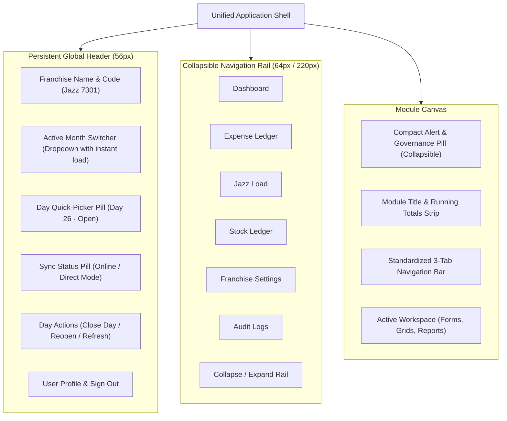
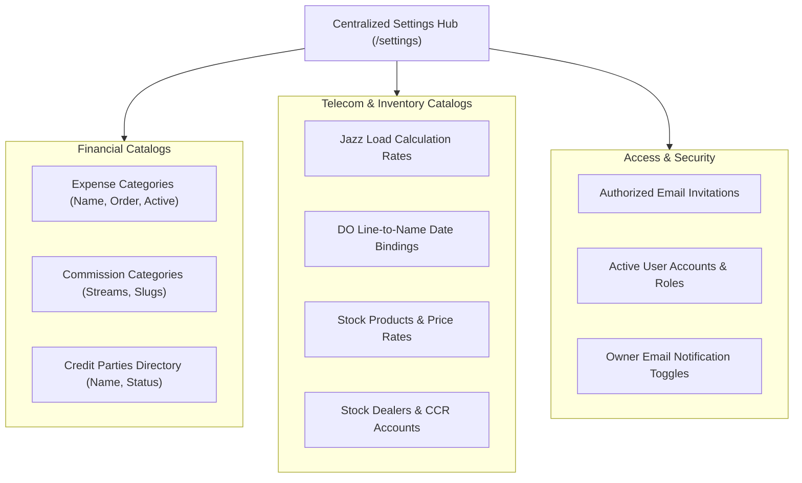

# Franchise — Unified UI Design System Proposal (Planning Only)

> **DOCUMENT STATUS:** PROPOSAL & DESIGN PLANNING ONLY  
> **NO APPLICATION CODE, CSS, DATABASE, PERSISTENCE, OR ACCOUNTING CHANGES MADE.**  
> **Baseline Reference:** [`docs/franchise-ui-ux-audit.md`](file:///home/hanzlaahmad/PersonalProjects/Franchise/docs/franchise-ui-ux-audit.md)  
> **Author:** Antigravity AI Engineering & UX Design  
> **Date:** October 27, 2026  
> **Target Audience:** Franchise Owners, Accountants, Front-Desk Clerks, System Developers

---

## 1. Executive Design Direction

The Franchise accounting platform is fundamentally robust in its mathematical engine, transaction immutability, and server-authoritative reconciliation across Expense, Jazz Load, and Stock domains. However, as documented in the comprehensive UI/UX audit ([`docs/franchise-ui-ux-audit.md`](file:///home/hanzlaahmad/PersonalProjects/Franchise/docs/franchise-ui-ux-audit.md)), the user interface has grown organically, resulting in:
- An **overloaded 2,200px+ vertical sidebar** mixing navigation, calendars, lifecycle actions, month pickers, and user cards.
- **Three divergent navigation patterns** across modules (horizontal pills, secondary button rows, and two-level accordion trees).
- **Banner fatigue** where up to 14 stacked alerts push ledger tables below the fold.
- A hardcoded **`min-width: 1280px` viewport lock** that completely breaks laptop, split-screen, and tablet usability.
- **Duplicated surfaces**, such as the entire `HomeDashboard` re-rendered inside Expense Previous Records.

### The Unified Direction: "Clear Ledger, Focused Day"

Rather than turning Franchise into a generic SaaS dashboard with decorative widgets, this proposal introduces **"Clear Ledger, Focused Day"**: a cohesive, high-efficiency design system tailored specifically for commercial telecom franchise accounting. 

```
                                  UNIFIED ARCHITECTURE
┌────────────────────────────────────────────────────────────────────────────────────────┐
│ GLOBAL HEADER: Franchise Context | Active Month (Fast-Switch) | Active Day Pill | User │
├──────────────┬─────────────────────────────────────────────────────────────────────────┤
│ SLIM SIDEBAR │ MODULE WORKSPACE                                                        │
│ Dashboard    │ ┌─────────────────────────────────────────────────────────────────────┐ │
│ Expense      │ │ Module Header: Title | Status Badge | Daily Summary Cards           │ │
│ Jazz Load    │ ├─────────────────────────────────────────────────────────────────────┤ │
│ Stock Ledger │ │ Standard 3-Tab Bar: [1. Daily Operations] [2. Reports] [3. Settings]│ │
│ Settings Hub │ ├─────────────────────────────────────────────────────────────────────┤ │
│ Audit Logs   │ │ Active Tab Content (Forms, Tables, Master Catalogs)                 │ │
│ [Collapse]   │ └─────────────────────────────────────────────────────────────────────┘ │
└──────────────┴─────────────────────────────────────────────────────────────────────────┘
```

The design system establishes:
1. **A Clean Shell Separation:** Navigation stays in a slim sidebar; context (Franchise, Active Month, Day Selector, Sync status) lives in a unified top header; data entry takes full center stage.
2. **A Standard 3-Tab Architecture inside Every Module:** `[Daily Operations]`, `[Reports & History]`, and `[Configuration]`.
3. **One Universal Save & Feedback Standard:** Identical visual cues for clean, dirty, in-flight, verified, and error states across Expense, Jazz Load, and Stock.
4. **Beginner-Proof Ergonomics:** Explicit differentiation between editable inputs, calculated fields, and locked historical seeds; elimination of raw technical UUIDs; and vertical keyboard traversal (`Tab`/`Enter`) for rapid data entry.
5. **Full Responsive Unlocking:** Removal of the 1280px lock and reinstatement of fluid responsive behavior for laptops, tablets, and split-screen counter workstations.

---

## 2. Design Principles

### Principle A: Beginner-Friendly & Jargon-Free
- **Human Labels over Database Terms:** Replace technical jargon (e.g. `period_key`, `seed_value`, `stockAccountProjections`) with familiar accounting terms (`Active Month`, `Opening Carry-Forward`, `Dealer Balance`).
- **Eliminate Raw Technical Identifiers:** Hide internal PostgreSQL UUIDs (`fb664952-0fe1-...`) from public tables; display sequential line numbers (`#1`, `#2`) or friendly names.
- **Self-Explaining Visual States:** Unexplained icons are prohibited. Every actionable icon button must have a clear text label or an immediately accessible tooltip with keyboard focus support.
- **Visual Distinction of Value Ownership:**
  - **Editable Input:** Bright white/slate background, explicit input border, high-contrast text.
  - **Auto-Calculated Field:** Shaded background (`bg-slate-900/50`), subtle `(Calculated)` badge, no cursor pointer.
  - **Locked Seed / Historical Due:** Padlock icon (`Lock`) with tooltip explaining: *"Carried forward from Day X closing due"*.

### Principle B: Compact & High-Efficiency Data Entry
- **Screen Real Estate Optimization:** Reduce unnecessary vertical padding and decorative cards. Data-entry clerks should be able to view their entry form, recent entries, and daily running totals without excessive page scrolling.
- **Speed-Optimized Keyboard Navigation:** In repetitive grids (Jazz Load DO distribution and Stock allotments), pressing `Enter` or `Tab` moves down the current input column rather than jumping across irrelevant read-only cells.
- **Zero Banner Stacking:** Collapse system status and non-blocking warnings into an expandable header notification pill. Only critical blocking invariants (e.g., uninitialized period) occupy a full-width banner.

### Principle C: Cross-Module Consistency
Expense, Jazz Load, and Stock will look and behave as integral parts of a single application:
- **Buttons:** Identical visual hierarchy (Primary, Secondary, Danger, Ghost).
- **Save Actions:** Identical placement, loading spinners, and server-confirmation badges.
- **Status Chips:** Uniform color coding: `Open` (Emerald), `Closed` (Rose/Red), `Reopen` (Sky/Blue), `Future` (Slate).
- **Numeric & Currency Displays:** Monospace tabular numbers (`font-mono`), standard thousands separators (`136,855.00 PKR`), negative values highlighted cleanly in rose.

### Principle D: Preserve Module-Specific Workflows
Standardize the **design patterns**, not the **business logic**.
- Expense keeps its multi-category entry structure (Commissions, Expenses, Owner, Credit).
- Jazz Load keeps its dual-margin rate engine (Base vs. ML) and daily DO table.
- Stock keeps its dealer-centric product allotment matrix and balance transfer modal.

### Principle E: Absolute Accounting Correctness
- Presentation-only redesign.
- No changes to calculations, formulas, database schemas, API contracts, PostgreSQL persistence, or historical seeds.
- The UI will **never** display a "Saved" confirmation until the PostgreSQL backend has returned an authoritative `200 OK` response with recalculated projections.

---

## 3. Application Shell & Navigation Proposal



### 3.1 The Global Top Header (`h-14` / `56px`)
The header becomes the command center for operational context, removing this responsibility from the sidebar:
1. **Franchise Brand Context:** `Jazz Franchise - 7301` with store status indicator.
2. **Active Month Selector:** Compact dropdown showing month label and status (`October 2026 · Open`). Selecting another month immediately triggers the transition—**eliminating the redundant "Load" button**.
3. **Active Day Quick-Picker:** Displays a pill: `📅 Day 26 (Mon) · Open`. Clicking the pill opens a compact 7-column calendar popover directly below it, allowing one-click day switching without pushing sidebar content.
4. **Day Lifecycle Action Button:** Displays the context-aware lifecycle button directly in the header (e.g. `[Close Day 26]` when open, or `[Reopen Day 26]` when closed for Owner/Admin).
5. **Sync Status & Queue Pill:** Persistent indicator (`Direct Mode · Connected` or `Syncing (2)`).
6. **User Menu:** Avatar with user name, role badge (`Owner`), display mode toggle, and one-click `Sign Out`.

### 3.2 The Slim Navigation Sidebar (`w-16` / `64px` collapsed; `w-56` / `224px` expanded)
Stripped of the 31-day calendar, day controls, month pickers, and user cards, the sidebar becomes a clean, lightweight navigation rail:
- `Dashboard` (Icon: `LayoutDashboard`)
- `Expense Ledger` (Icon: `ReceiptText`)
- `Jazz Load` (Icon: `FileSpreadsheet`)
- `Stock Ledger` (Icon: `PackageOpen`)
- `Settings Hub` (Icon: `Settings`)
- `Audit Logs` (Icon: `ScrollText`)
- `System Backup` (Icon: `Database`)

*Total sidebar height: ~360px. Fits on any laptop screen without vertical scrolling.*

### 3.3 Main Content Canvas & Viewport Responsiveness
- **Desktop ($\ge 1280\text{px}$):** Two-column layout with center entry workspace and right-side sticky summary cards.
- **Laptop / Half-Screen ($1024\text{px} - 1279\text{px}$):** Sidebar auto-collapses to 64px icon rail; right summary cards convert to a horizontal top KPI bar.
- **Tablet ($768\text{px} - 1023\text{px}$):** Sidebar collapses to an off-canvas slide-out drawer; tables enable horizontal touch scrolling with sticky frozen first columns.

---

## 4. Shared Component Inventory

```
┌────────────────────────────────────────────────────────────────────────────────────────┐
│                              SHARED COMPONENT LIBRARY                                  │
├─────────────────────────┬──────────────────────────┬───────────────────────────────────┤
│ 1. ACTION CONTROLS      │ 2. DATA ENTRY & INPUTS   │ 3. FEEDBACK & GOVERNANCE          │
│ • Primary Button        │ • Standard Text Input    │ • Universal Save Control Bar      │
│ • Secondary Button      │ • Tabular Numeric Input  │ • Status Badges & Chips           │
│ • Destructive Button    │ • Currency Input (PKR)   │ • Consolidated Alert Banner       │
│ • Compact Icon Button   │ • Searchable Select      │ • Confirmation Dialog Modal       │
│ • Segmented Tab Group   │ • Date / Month Popover   │ • Empty State Container           │
└─────────────────────────┴──────────────────────────┴───────────────────────────────────┘
```

### Component 1: Standard Buttons (`Button`)
- **Primary:** `bg-emerald-500 hover:bg-emerald-400 text-slate-950 font-semibold px-4 py-2 rounded-lg`. Used exclusively for the main forward action (e.g. Save, Add Entry, Confirm).
- **Secondary:** `bg-slate-800 hover:bg-slate-700 text-slate-200 border border-slate-700 px-4 py-2 rounded-lg`. Used for secondary actions (e.g. Export, Filter, Cancel).
- **Destructive:** `bg-rose-500/10 hover:bg-rose-500/20 text-rose-300 border border-rose-500/30 px-3 py-1.5 rounded-lg`. Used for Delete, Discard, Reverse Transfer.
- **Icon Button:** `h-8 w-8 flex items-center justify-center rounded-md hover:bg-slate-800 text-slate-400 hover:text-slate-100`. Must include `aria-label` and `title`.

### Component 2: Tabular Numeric & Currency Input (`CurrencyInput`)
- **Visuals:** `font-mono text-right text-slate-100 bg-slate-950 border border-slate-700 rounded-md px-2.5 py-1.5 focus:border-emerald-400 focus:ring-1 focus:ring-emerald-400`.
- **Behavior:** Auto-formats on blur with commas (`1,000.00`). Strips non-numeric characters on paste. Prevents negative inputs unless explicitly permitted (e.g., credit adjustments).

### Component 3: Universal Status Chip (`StatusBadge`)
- **Open:** `bg-emerald-500/10 text-emerald-400 border border-emerald-500/20 px-2 py-0.5 rounded-full text-xs font-medium`.
- **Closed:** `bg-rose-500/10 text-rose-400 border border-rose-500/20 px-2 py-0.5 rounded-full text-xs font-medium`.
- **Reopened:** `bg-blue-500/10 text-blue-400 border border-blue-500/20 px-2 py-0.5 rounded-full text-xs font-medium`.
- **Future / Locked:** `bg-slate-800 text-slate-400 border border-slate-700 px-2 py-0.5 rounded-full text-xs font-medium`.

### Component 4: Standard Table (`LedgerTable`)
- **Header:** Sticky top header with uppercase tracking (`text-xs font-bold uppercase tracking-wider text-slate-400 bg-slate-900/90 border-b border-slate-800`).
- **Row Styling:** Alternating rows (`hover:bg-slate-800/40 transition-colors border-b border-slate-800/60`).
- **Footer / Totals:** Highlighted summary row with double-top border (`border-t-2 border-slate-700 bg-slate-900/70 font-bold`).

### Component 5: Reusable Confirmation Dialog (`ConfirmModal`)
- Modal overlay (`bg-slate-950/80 backdrop-blur-sm z-50`).
- Clear visual warning icon (Amber for day reopen, Rose for day close/delete).
- Clear explanatory summary of the accounting consequence (e.g. *"Closing Day 26 locks all transactions. Authoritative calculations will run."*).
- Explicit `[Cancel]` and `[Confirm Action]` buttons.

---

## 5. Standardized Saving & Status Feedback

A major finding of the audit was inconsistent save mechanics and feedback across modules (Expense uses manual "Save Now & Verify", Jazz Load uses a 900ms auto-save hook, Stock uses draft state with inline saves).

### The Universal Save Control Pattern

Every daily entry screen will implement the **Universal Save Action Bar**:

```
┌────────────────────────────────────────────────────────────────────────────────────────┐
│ [● Unsaved changes]  Last saved: 1:42 PM (Server Verified)    [Discard] [Save Entry ↵] │
└────────────────────────────────────────────────────────────────────────────────────────┘
```

#### The 6 Standardized States:

| State | Indicator | Status Text | Primary Button State | Behavior / Trigger |
| :--- | :---: | :--- | :---: | :--- |
| **1. Pristine / Idle** | 🟢 Green Dot | `All entries verified with server` | Disabled (Neutral) | Initial load or clean state. Form is clean. |
| **2. Dirty / Editing** | 🟡 Amber Dot | `Unsaved entries in draft` | **Active Primary (`[Save Entry]` highlighted)** | User typed or altered a row. Keyboard shortcut `Ctrl+S` / `Cmd+S` armed. |
| **3. In-Flight** | 🔄 Blue Spinner | `Posting to PostgreSQL ledger...` | Disabled (`Saving...`) | Payload is in transit. Inputs locked to prevent double-submit. |
| **4. Server Confirmed** | ✅ Green Check | `Saved & verified (HTTP 200)` | Returns to Pristine | Server returns fresh authoritative projections; dues update cleanly. |
| **5. Validation Error** | ⚠️ Amber Alert | `Validation failed: [Field error]` | Active (`Fix Errors`) | Form invalid (e.g. negative quantity). Error field highlighted in rose. |
| **6. Server Error** | ❌ Red Alert | `Save failed: Server unreachable` | Active (`[Retry Save]`) | Network/database failure. Local facts preserved in memory. |

### Crucial Architectural Rules for Saving:
1. **Never Fake Success:** The UI is strictly forbidden from showing "Saved" based on client-side state alone. The green badge appears **only after** the HTTP response completes.
2. **Unsaved Navigation Guard:** If the user attempts to switch days, months, or modules while in State 2 (Dirty), a standard browser guard appears: *"You have unsaved entries on Day X. Discard changes or stay on page?"*
3. **Day Lifecycle vs. Transaction Save:** "Save Entry" writes facts to the open day. "Close Day" is an authoritative lifecycle transition. They are separate buttons with separate permissions and confirmations.

---

## 6. Module Layout Proposals

### 6.1 Expense Ledger Layout

```
┌────────────────────────────────────────────────────────────────────────────────────────┐
│ EXPENSE LEDGER — Day 26 (Monday, Oct 26, 2026)                      [Close Day 26 (Owner)] │
│ Status: [● Open]  |  Opening Cash: 11,392 PKR  |  Net Daily Return: 18,398 PKR         │
├────────────────────────────────────────────────────────────────────────────────────────┤
│ [1. Daily Entry]          [2. Monthly Summary & Ledger]          [3. Master Categories]│
├──────────────────────────────────────────────────────────┬─────────────────────────────┤
│ DAILY TRANSACTIONS ENTRY                                 │ TODAY'S FINANCIAL POSITION  │
│                                                          │ ┌─────────────────────────┐ │
│ 1. Commissions Earned (Issues)                           │ │ Opening Cash    11,392  │ │
│ ┌───────────────┬────────────┬──────────┐                │ │ + Commissions   14,806  │ │
│ │ Category [v]  │ Amount     │ [+ Add]  │                │ │ - Expenses       7,800  │ │
│ └───────────────┴────────────┴──────────┘                │ │ = Return Cash   18,398  │ │
│ • JazzLoad: 12,470 PKR   • Efics: 162 PKR                │ ├─────────────────────────┤ │
│                                                          │ │ Owner Dues     145,877  │ │
│ 2. Operational Expenses                                  │ │ Total Credit    56,904  │ │
│ ┌───────────────┬────────────┬──────────┬──────────┐     │ └─────────────────────────┘ │
│ │ Category [v]  │ Item Name  │ Amount   │ [+ Add]  │     │                             │
│ └───────────────┴────────────┴──────────┴──────────┘     │ QUICK ACTIONS               │
│ • Shop Rent: 45,000 PKR   • Tea: 880 PKR                 │ • Export Day PDF            │
│                                                          │ • Verify Credit Parties     │
│ 3. Franchise Owner Movements (Drawings/Investments)      │                             │
│ 4. Credit Parties (Borrowings & Debt Recovery)           │                             │
├──────────────────────────────────────────────────────────┴─────────────────────────────┤
│ [● All changes saved]                                            [Save Day 26 Entry]   │
└────────────────────────────────────────────────────────────────────────────────────────┘
```

#### Key Improvements:
- **Embedded Dashboard Removed:** "Previous Records" is replaced by `[2. Monthly Summary & Ledger]`, which displays purely tabular historical records without re-rendering the Home Dashboard.
- **Master Categories Consolidated:** Category and Credit Party tables are grouped under `[3. Master Categories]`.
- **Right Column Sticky Position:** The 5 key financial metrics (Opening, Commission, Expense, Balance, Credit) remain visible on all viewports $\ge 1024\text{px}$.

---

### 6.2 Jazz Load Ledger Layout

```
┌────────────────────────────────────────────────────────────────────────────────────────┐
│ JAZZ LOAD LEDGER — Day 26 (Monday, Oct 26, 2026)                    [Close Day 26 (Owner)] │
│ Rates: ML Rate 2.4% | Comm1 2.4% | Comm2 1.16%             Status: [● Open]            │
├────────────────────────────────────────────────────────────────────────────────────────┤
│ [1. Daily DO Distribution]          [2. Monthly Trend & Reports]       [3. Rate & Lines]│
├────────────────────────────────────────────────────────────────────────────────────────┤
│ 1. COMPANY BULK LIFTING                                                                │
│ Opening In-Hand: 697,684  |  + Today Lifting: [ 1,050,000 ]  |  Issuance: 1,077,629     │
│ = Closing In-Hand Balance: 670,055 PKR                                                 │
├────────────────────────────────────────────────────────────────────────────────────────┤
│ 2. DO (DISTRIBUTOR) ISSUANCE & PAYMENT GRID                                            │
│ ┌─────┬────────────────┬──────────────┬──────────────┬──────────────┬────────────────┐ │
│ │ #   │ DO Name & Line │ Opening Dues │ Issuance (↵) │ Payment (↵)  │ Closing Dues   │ │
│ ├─────┼────────────────┼──────────────┼──────────────┼──────────────┼────────────────┤ │
│ │ 01  │ Mirza (..9672) │ 0            │ [ 100,000 ]  │ [ 100,000 ]  │ 0              │ │
│ │ 02  │ Adnan (..1714) │ 0            │ [  55,000 ]  │ [  55,000 ]  │ 0              │ │
│ │ 03  │ Arslan (..0125)│ 0            │ [ 101,262 ]  │ [ 101,200 ]  │ 62             │ │
│ │ 04  │ Mubashir (.126)│ 0            │ [ 200,000 ]  │ [ 200,000 ]  │ 0              │ │
│ └─────┴────────────────┴──────────────┴──────────────┴──────────────┴────────────────┘ │
├────────────────────────────────────────────────────────────────────────────────────────┤
│ Total Issuance: 1,077,629  |  Total Payment: 1,024,166  |  Total Comm: 13,956 PKR      │
│ [● Auto-saved 1:42 PM]                                            [Save All DO Entries]│
└────────────────────────────────────────────────────────────────────────────────────────┘
```

#### Key Improvements:
- **Clean Table Hierarchy:** Human DO Names are primary; phone line digits are muted secondary.
- **Vertical Keyboard Traversal:** Pressing `Enter` in the Issuance column moves to the next DO's issuance, enabling high-speed data entry.
- **Legacy Profiles Archived:** "Legacy DO Profiles" removed from daily view and relegated to the archive tab.

---

### 6.3 Stock Ledger Layout

```
┌────────────────────────────────────────────────────────────────────────────────────────┐
│ STOCK LEDGER — Day 26 (Monday, Oct 26, 2026)                        [Close Day 26 (Owner)] │
│ Active Month: October 2026  |  Jazz Running Payable: 412,497 PKR   Status: [● Open]   │
├────────────────────────────────────────────────────────────────────────────────────────┤
│ [1. Stock Issuance]      [2. Inbound Stock Lifting]      [3. Reports]      [4. Catalog]│
├──────────────────────────────────────────────────────────┬─────────────────────────────┤
│ DEALER ALLOTMENT ENTRY                                   │ DEALER RUNNING ACCOUNT      │
│ Dealer / CCR Account: [ DO ARSLAN · DO (0302..)    [v] ] │ ┌─────────────────────────┐ │
│                                                          │ │ Opening Due    136,855  │ │
│ ALLOTMENT MATRIX (11 PRODUCTS)                           │ │ + Stock Taken   60,480  │ │
│ ┌─────┬────────────────┬──────────┬──────────┬─────────┐ │ │ - Payment Paid 118,160  │ │
│ │ #   │ Product Name   │ Rate     │ Quantity │ Total   │ │ │ = Closing Due    1,895  │ │
│ ├─────┼────────────────┼──────────┼──────────┼─────────┤ │ └─────────────────────────┘ │
│ │ 01  │ Retailer SIM   │ 280 PKR  │ [   0  ] │ 0       │ │                             │
│ │ 02  │ Franchise SIM  │ 350 PKR  │ [   0  ] │ 0       │ │ DEALER ACTIONS              │
│ │ 03  │ Load SIM       │ 1,000 PKR│ [ 100  ] │ 100,000 │ │ • [Transfer Balance]        │
│ │ 04  │ MBB SIM        │ 500 PKR  │ [   0  ] │ 0       │ │ • [Transfer History]        │
│ └─────┴────────────────┴──────────┴──────────┴─────────┘ │                             │
│ Total Quantity: 100 pcs  |  Total Value: 100,000 PKR     │                             │
│ Payment Received from Dealer: [ 100,000 PKR          ]   │                             │
├──────────────────────────────────────────────────────────┴─────────────────────────────┤
│ [● Unsaved changes]                                              [Save Dealer Entry]   │
└────────────────────────────────────────────────────────────────────────────────────────┘
```

#### Key Improvements:
- **Permanent Removal of Manual Carry-Forward:** Follows the verified user requirement—Opening Due is strictly read-only and server-derived.
- **Prominent Balance Transfer Actions:** "Transfer Balance" and "Transfer History" sit directly beside the dealer account card.
- **Compact Allotment Grid:** Clerks can toggle "Show Only Active Products" to eliminate visual noise from zero-allotment products.

---

## 7. Settings, Reports, and Notifications Architecture



### 7.1 Consolidated Settings Hub
Instead of hunting across 4 different modules:
- A dedicated **Settings Hub** in the sidebar provides categorized configuration tabs:
  1. `Expense & Credit`: Expense categories, Commission categories, Credit parties.
  2. `Jazz Load`: Rates, DO names, DO lines, Date bindings.
  3. `Stock Inventory`: Stock products, CCR/DO accounts.
  4. `Users & Access`: Authorized emails, User role management, Notification triggers.
- Module-level screens retain a direct link (`[3. Settings]`) that simply opens the relevant tab in the Settings Hub.

### 7.2 Reports & Historical Archive Architecture
- **Home Dashboard:** Reserved exclusively for high-level cross-module executive intelligence (Grand Turnover, Revenue, Net Cash Return, Monthly Charts).
- **Module Reports:** Each module's `[2. Reports]` tab contains its specific ledgers and print utilities:
  - **Expense Reports:** Day-by-day cash sheet, Category expense breakdown, Credit ledger.
  - **Jazz Load Reports:** DO balances sheet, Monthly issuance vs collection ledger, Daily trend.
  - **Stock Reports:** The 4 active reports from the Reports Center (Issuance summary, Lifting summary, Product flow, Cash vs Credit) with print/PDF export.

### 7.3 Notification & Banner Consolidation
To solve the top-area banner fatigue (where 14 banners previously stacked):
- **Level 1 (Blocking Modal):** Used only when data entry is physically impossible (e.g., Uninitialized Period).
- **Level 2 (Single Actionable Header Banner):** If an authoritative action is required (e.g. *"Month-end is finalized. Please close October 2026"*), one single banner renders with an action button.
- **Level 3 (Header Alert Pill):** Informational warnings (e.g., *"2 balance warnings detected"*) appear as an amber badge in the top header. Clicking expands a popover drawer with details.

---

## 8. Concrete Wireframes & Layout Mockups

### Mockup 1: Global Application Shell (Desktop View)
```
┌────────────────────────────────────────────────────────────────────────────────────────────────────────┐
│ ⚡ JAZZ FRANCHISE 7301  |  [ October 2026 · Open [v] ]  |  [ 📅 Day 26 · Open [v] ]  |  Hanzla (Owner) │
├──────┬─────────────────────────────────────────────────────────────────────────────────────────────────┤
│ [=]  │ EXPENSE LEDGER                                                                                  │
│      │ Month: October 2026  |  Active Day: 26 (Monday)  |  Status: [● Open]                            │
│ Dash │ ┌─────────────────────────────────────────────────────────────────────────────────────────────┐ │
│      │ │ [1. Daily Entry]           [2. Monthly Reports]           [3. Expense Categories]           │ │
│ Exp  │ ├─────────────────────────────────────────────────────────────────────────────────────────────┤ │
│ [•]  │ │                                                                                             │ │
│ Load │ │  [ Daily Operations Content Canvas ]                                                        │ │
│      │ │                                                                                             │ │
│ Stk  │ │                                                                                             │ │
│      │ │                                                                                             │ │
│ Sett │ ├─────────────────────────────────────────────────────────────────────────────────────────────┤ │
│      │ │ [● All entries saved]                                              [Save & Verify Entry]    │ │
│ Logs │ └─────────────────────────────────────────────────────────────────────────────────────────────┘ │
└──────┴─────────────────────────────────────────────────────────────────────────────────────────────────┘
```

### Mockup 2: Date Selector Popover (Triggered from Header)
```
               ┌──────────────────────────────────────────────────┐
               │ 📅 OCTOBER 2026 ACCOUNTING DAYS                  │
               ├──────────────────────────────────────────────────┤
               │  Sun   Mon   Tue   Wed   Thu   Fri   Sat         │
               │                    01●   02●   03●   04●         │
               │  05●   06●   07●   08●   09●   10●   11●         │
               │  12●   13●   14●   15●   16●   17●   18●         │
               │  19●   20●   21●   22●   23●   24●   25●         │
               │ [26●]  27○   28-   29-   30-   31-               │
               │                                                  │
               │  [● FINAL Month-End Closing (Day 32)]            │
               ├──────────────────────────────────────────────────┤
               │ Legend: ● Closed   ● Open   ● Reopened   - Future│
               └──────────────────────────────────────────────────┘
```

---

## 9. Visual Tokens & Design System Specification

### 9.1 Color Palette
- **Application Canvas Background:** `#020617` (`slate-950`)
- **Card & Panel Surface:** `#0f172a` (`slate-900`) with `#1e293b` (`slate-800`) border
- **Elevated Controls / Inputs:** `#020617` (`slate-950`) with `#334155` (`slate-700`) border
- **Primary Accent (Emerald):**
  - Base: `#10b981` (`emerald-500`)
  - Hover: `#34d399` (`emerald-400`)
  - Subdued / Tint: `rgba(16, 185, 129, 0.12)`
- **Destructive / Error (Rose):**
  - Base: `#f43f5e` (`rose-500`)
  - Tint: `rgba(244, 63, 94, 0.12)`
- **Informational / Reopen (Sky/Blue):**
  - Base: `#0ea5e9` (`sky-500`)
  - Tint: `rgba(14, 165, 233, 0.12)`
- **Warning / Unsaved (Amber):**
  - Base: `#f59e0b` (`amber-500`)
  - Tint: `rgba(245, 158, 11, 0.12)`

### 9.2 Typography Scale
- **Font Family:** `Pathway Extreme`, Inter, system-ui, sans-serif
- **Tabular Numerics:** Applied via `font-mono tabular-nums` for all accounting tables and due balances.
- **Sizes:**
  - Page Titles: `text-xl font-bold tracking-tight text-white` (20px)
  - Section Headers: `text-sm font-semibold uppercase tracking-wider text-slate-300` (14px)
  - Table Headers: `text-xs font-bold uppercase tracking-wider text-slate-400` (12px)
  - Body / Form Labels: `text-sm font-medium text-slate-200` (14px)
  - Numeric Values: `text-sm font-mono text-slate-100` (14px)
  - Helper & Status Text: `text-xs text-slate-400` (12px, exceeds WCAG AA $4.5:1$ contrast)

### 9.3 Spacing & Layout Rules
- **Base Grid:** 4px baseline (`p-1`, `p-2`, `p-3`, `p-4`, `p-5`).
- **Standard Input Height:** `h-9` (`36px`) in desktop/modern mode; compact and space-efficient.
- **Standard Button Height:** `h-9` (`36px`) matching inputs.
- **Border Radius:** `rounded-lg` (8px) for cards, panels, inputs; `rounded-full` for status badges.

---

## 10. Beginner-Usability Improvements

1. **Clear Input vs. Output Distinction:**  
   Beginners often get confused about which fields they are expected to type into versus which fields the computer calculated. In the new system:
   - All editable fields feature a visible border, bright text, and an explicit placeholder.
   - All calculated fields feature a shaded background, a `(Calculated)` pill, and `readOnly` protection.
2. **Elimination of Database UUIDs:**  
   Technical keys (`fb664952-0fe1-...`) are removed from category and debtor tables, replaced by `#1`, `#2`, `#3` numbering.
3. **No Unexplained Icons:**  
   Every button has an explicit text label (e.g. `[Transfer Balance]`, `[Export PDF]`, `[History]`). Icon-only buttons are restricted to standard, universal utilities (`X` for close, `Trash2` for delete) and always include accessible tooltips.
4. **Predictable Day Navigation:**  
   Beginners will no longer get lost in a 31-button vertical stack. The active day is prominently displayed in the header with date, weekday, and status.
5. **Instant Month Switching:**  
   Selecting October in the dropdown immediately loads October without requiring an extra click on a separate "Load" button.

---

## 11. Accessibility Considerations (WCAG 2.1 AA)

1. **Contrast Ratio Compliance:**  
   Replaced all `text-slate-500` ($3.8:1$) on dark backgrounds with `text-slate-400` ($5.4:1$), exceeding the WCAG AA minimum requirement of $4.5:1$.
2. **Keyboard Accessibility:**  
   - All interactive controls have visible focus rings (`focus:ring-2 focus:ring-emerald-400/40 focus:outline-none`).
   - Modals trap focus and close on `Escape`.
   - Grid tables support `Enter` key column progression.
3. **Screen Reader Semantic Markup:**  
   - Tables include `<caption>` and proper `<th scope="col">` tags.
   - Status indicators pair colors with explicit text (never color alone).
   - Dynamic auto-saving status includes `aria-live="polite"` so screen reader users hear save confirmations without disruption.

---

## 12. Incremental Migration Strategy

To guarantee **zero downtime, zero accounting risk, and zero regression in calculations**, the redesign should be executed in 4 isolated phases:

```
┌────────────────────────────────────────────────────────────────────────┐
│                      PHASED MIGRATION ROADMAP                          │
├────────────────────────────────────────────────────────────────────────┤
│ PHASE 1: Token & Shell Foundation                                      │
│ • Remove `min-width: 1280px` lock and restore Tailwind breakpoints.    │
│ • Build Global Top Header (Month Switcher, Day Picker, User Menu).    │
│ • Slim down Left Sidebar to pure navigation rail.                      │
├────────────────────────────────────────────────────────────────────────┤
│ PHASE 2: Shared Component Library Deployment                           │
│ • Implement Universal Save Control Bar across all modules.             │
│ • Standardize Button, CurrencyInput, and StatusBadge components.       │
│ • Clean up AuditLogsView action dropdown deduplication.                │
├────────────────────────────────────────────────────────────────────────┤
│ PHASE 3: Module-by-Module Workspace Migration                          │
│ • Step 3A: Expense Ledger (Remove duplicate dashboard, clean 3 tabs).  │
│ • Step 3B: Jazz Load (DO grid keyboard traversal, archive legacy DOs). │
│ • Step 3C: Stock Ledger (Standardize reports hub, clean dealer dues).  │
├────────────────────────────────────────────────────────────────────────┤
│ PHASE 4: Centralized Settings Hub & Cleanup                            │
│ • Migrate category CRUD tables to centralized `/settings`.             │
│ • Deprecate orphaned `records` view in App.tsx.                        │
│ • Consolidate system warning banners into top alert drawer.           │
└────────────────────────────────────────────────────────────────────────┘
```

---

## 13. Risks and Regression Safeguards

| Potential Risk | Severity | Prevention & Safeguard Strategy |
| :--- | :---: | :--- |
| **Accidental State Desynchronization** | HIGH | Components will continue consuming `SelectedDateContext` and `ledgerApiClient` without touching internal query signatures. |
| **Loss of Unsaved Entries on Day Switch** | HIGH | Standard navigation guard prompt will intercept any attempt to change date, month, or view while draft is in dirty state. |
| **Breaking Calculations or Invariants** | CRITICAL | All server-authoritative calculations remain untouched in PostgreSQL `franchise_prod_db`. UI only renders calculated projections. |
| **Responsive Table Overflow** | MEDIUM | Tables will use `overflow-x-auto` wrapper with frozen first columns (`sticky left-0 bg-slate-900`) so dealer names remain visible. |
| **Regression in Balance Transfers** | HIGH | `TransferBalanceModal` and its backend API call are preserved 100% as-is; only the trigger button styling is updated. |

---

## 14. Open Questions Requiring Product-Owner Decisions

Before beginning implementation, owner alignment is requested on:

1. **Mobile vs. Counter PC Focus:**  
   Is mobile/tablet data entry actively required, or should we optimize exclusively for desktop counter PCs ($\ge 1024\text{px}$) while maintaining basic tablet readability?
2. **Excel Import Deprecation:**  
   Now that PostgreSQL is the live production system and historical periods (August, September, October 2026) are verified, can the legacy Excel Import tool be moved to an Admin Archive tab?
3. **Consolidated Settings Hub Approval:**  
   Do you approve grouping all master categories (Expense, Commission, Credit, DO lines, Stock products) into a centralized `/settings` center?
4. **Email Dispatch Integration:**  
   Since the "Send Email" buttons are currently disabled without SMTP credentials, should we hide them completely until email credentials are provided?

---

> **DO NOT IMPLEMENT YET — This deliverable is a design proposal only. No application, accounting, database, or deployment changes were made.**
