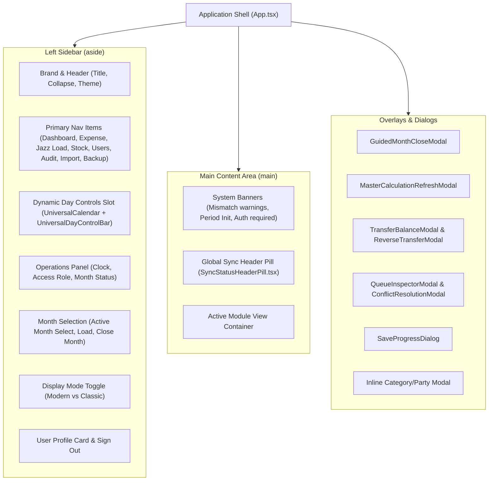
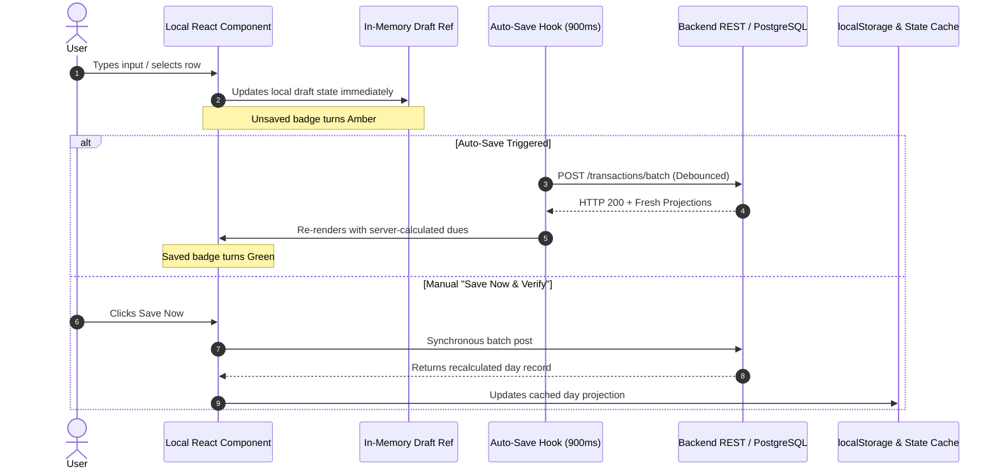
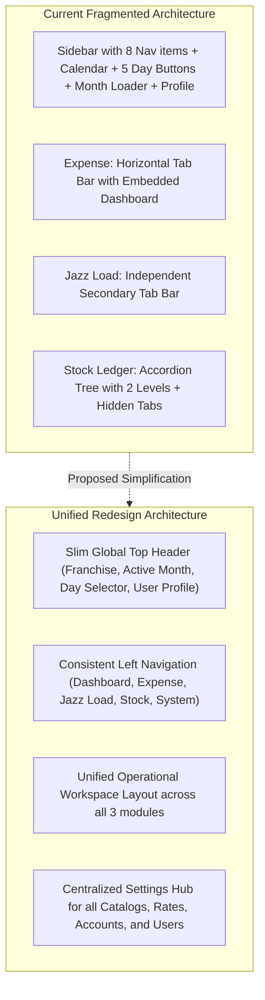

# Franchise System — Complete UI/UX Audit (Discovery & Baseline)

> **SAFETY STATUS:** READ-ONLY AUDIT COMPLETE  
> **DISCOVERY ONLY — NO CODE, ACCOUNTING, DATABASE, PERSISTENCE, OR DEPLOYMENT CHANGES MADE.**  
> **Document Date:** October 27, 2026  
> **Environment:** Localhost Production Mirror (`http://localhost:5173`, API: `http://localhost:4000`, PostgreSQL: `franchise_prod_db`)  
> **Inspected Role:** `owner` (`Hanzla Ahmad`, UID: `e4cd6bd5-dca3-4258-a289-ba445fc0d2ff`, Franchise: `Jazz Franchise - 7301`)  
> **Browser Session:** BrowserOS neo (Agent: `antigravity-client/ui-ux-audit`)

---

## 1. Executive Summary

Franchise is a mature, specialized commercial accounting application engineered to manage high-volume telecom franchise operations across three core operational business domains: **Expense & Financial Ledger**, **Jazz Load Distribution**, and **Stock / Inventory Ledger**. 

While the underlying accounting logic, transaction persistence, and server-authoritative calculations (powered by PostgreSQL and legacy Firestore adapters) provide exceptional mathematical integrity, the **User Interface and User Experience (UI/UX) suffer from significant structural debt, layout bloating, navigation inconsistencies, and information fragmentation** that have accumulated through iterative feature additions.

### Key Audit Findings

1. **Extreme Vertical Sidebar Bloating:**  
   The application shell collapses primary navigation, full 31-day calendar pickers, operational day lifecycle controls, live status metrics, month selection, display preferences, user profile details, and authentication controls into a single vertical left sidebar. On standard laptop displays (e.g., 1080p), the sidebar requires 3 to 4 full scrolls just to reach month selection or the Sign Out button.

2. **Severed Mobile & Tablet Responsiveness:**  
   In [`src/styles.css`](file:///home/hanzlaahmad/PersonalProjects/Franchise/src/styles.css#L61-L64), `html, body, #root` are hardcoded to `min-width: 1280px`, and `@theme` sets all Tailwind breakpoints (`sm`, `md`, `lg`, `xl`, `2xl`) to `0px`. Although mobile navigation components (e.g., bottom navigation bars and slide-out menus) exist in the JSX, any viewport below 1280px forces a rigid horizontal scrollbar, rendering the app unusable on tablets and phones without horizontal panning.

3. **Inconsistent Navigation Patterns Across Modules:**  
   Each major module implements its own idiosyncratic navigation paradigm:
   - **Expense:** Uses a horizontal sub-tab bar (`Daily Entry`, `Previous Records`, `Dashboard`, `Expense Categories`, `Credit Parties`, `Commission Categories`).
   - **Jazz Load:** Uses an independent secondary horizontal button bar (`Daily Entry`, `Dashboard`, `Reports`, `Settings`, `Backup`).
   - **Stock Ledger:** Uses a two-level accordion sidebar group (`Settings & Entries` and `Reports`) with an inner Deluxe Filter Bar and sub-tab pills.
   - **Audit Logs, Users, Import, Backup:** Full-screen views accessed solely from the sidebar.

4. **Severe Component Monoliths (15,000+ Lines Across 5 Files):**  
   Five components contain 15,757 lines of front-end logic:
   - [`src/modules/stock/components/StockLedgerModule.tsx`](file:///home/hanzlaahmad/PersonalProjects/Franchise/src/modules/stock/components/StockLedgerModule.tsx): **4,929 lines**
   - [`src/App.tsx`](file:///home/hanzlaahmad/PersonalProjects/Franchise/src/App.tsx): **4,671 lines**
   - [`src/modules/jazzLoad/components/JazzLoadModule.tsx`](file:///home/hanzlaahmad/PersonalProjects/Franchise/src/modules/jazzLoad/components/JazzLoadModule.tsx): **3,351 lines**
   - [`src/components/DailyEntryForm.tsx`](file:///home/hanzlaahmad/PersonalProjects/Franchise/src/components/DailyEntryForm.tsx): **1,791 lines**
   - [`src/components/HomeDashboard.tsx`](file:///home/hanzlaahmad/PersonalProjects/Franchise/src/components/HomeDashboard.tsx): **1,015 lines**  
   These components mix layout rendering, local draft mutations, auto-saving hooks, mathematical recalculation, catalog CRUD, table sorting, export generators, and modal management.

5. **Duplicated & Orphaned UI Surfaces:**  
   - The entire `HomeDashboard` component is rendered at the top-level **Dashboard** view and then completely duplicated inside **Expense Ledger → Previous Records**.
   - An orphaned top-level view `records` exists in the `View` type and `App.tsx` render tree but has no button or link in the sidebar navigation.
   - Half of the sub-reports in Stock Reports Hub are commented out in code but have partial implementations remaining.
   - In Audit Logs, 50+ duplicate action keys in the Action dropdown trigger React duplicate key errors on every mount.

6. **Exposure of Database Internal Keys to End Users:**  
   In Expense Categories, Credit Parties, and Commission Categories, raw PostgreSQL UUID strings (e.g. `fb664952-0fe1-48c2-9051-788394b36908`) are displayed in dedicated "ID" columns, creating visual clutter for non-technical franchise clerks.

7. **Banner Fatigue & Top-Area Crowding:**  
   Up to 14 distinct warning, alert, and status banners can render simultaneously at the top of the main content area, pushing actual accounting tables below the visible fold.

---

## 2. Audit Scope, Environment, and Limitations

### Environment Specifications
- **Operating System:** Linux 6.8.0-101-generic x86_64
- **Runtime:** Node.js v20.x, Vite v5.x, TypeScript 5.6
- **Frontend Stack:** React 18, Tailwind CSS v4, Lucide React icons, Recharts
- **Backend Stack:** Express, Node.js, Kysely query builder, PostgreSQL (`franchise_prod_db`)
- **Active User Session:** `owner` (`Hanzla Ahmad`, email: `owner@jazz.com`, uid: `e4cd6bd5-dca3-4258-a289-ba445fc0d2ff`)
- **Franchise Context:** `Jazz Franchise - 7301` (ID: `4872c575-d9ad-440c-82bd-ea07a40565cd`)
- **Active Month in Test View:** `2026-10` (October 2026, Status: `open`)

### Audit Verification Methodology
- **Real Browser Testing:** Conducted in real-time using BrowserOS neo connected to local port 5173. Navigation flows, tab switches, dropdown expansions, modal openings, and layout behaviors were inspected in live DOM snapshots.
- **Console & Network Analysis:** Captured live browser console errors and evaluated runtime DOM properties.
- **Codebase Cross-Verification:** Every UI element, state variable, conditional branch, and button handler was verified directly against the TypeScript source files.
- **Strict Read-Only Boundary:** Zero state-modifying actions (Save, Edit, Delete, Reopen, Close Day, Reverse Transfer) were executed in the live application.

### Limitations
- Multi-user concurrent editing and real-time WebSocket sync states were observed through offline-queue adapters and local session mocks rather than live multi-client hardware.
- The `viewer` and `admin` roles were audited via code path analysis and conditional render gating rather than switching the live active session away from `owner`.

---

## 3. Complete Application Route Map

The application does not use React Router or browser URL push-state routing (`BrowserRouter`/`Routes`). Instead, navigation is managed via stateful view switching in [`src/App.tsx`](file:///home/hanzlaahmad/PersonalProjects/Franchise/src/App.tsx#L145) using `const [view, setView] = useState<View>("dashboard")` persisted to `localStorage` key `ledger:lastActiveModule:v1:<uid>`.

```
App Root (http://localhost:5173/)
│
├── [View 1] "dashboard" (HomeDashboard.tsx)
│   ├── Sub-tab: "overview" (Consolidated Executive Overview)
│   ├── Sub-tab: "expense" (Expense Ledger Monthly Overview)
│   ├── Sub-tab: "jazzload" (Jazz Load Monthly Overview)
│   └── Sub-tab: "stock" (Stock Ledger Monthly Overview)
│
├── [View 2] "expense" (DailyEntryForm.tsx & App.tsx)
│   ├── Section: "daily-entry" (Day 1..31 & FINAL Daily Entry Form)
│   ├── Section: "previous-records" (RecordsView.tsx — Re-embeds HomeDashboard + Category Totals)
│   ├── Section: "expense-dashboard" (Direct view of HomeDashboard with activeTab="expense")
│   ├── Section: "expense-categories" (Expense Category Management Table)
│   ├── Section: "credit-parties" (Credit Party Management Table)
│   └── Section: "commission-categories" (Commission Category Management Table)
│
├── [View 3] "jazz-load" (JazzLoadModule.tsx)
│   ├── Section: "daily" (Daily Lifting + DO Distributor Grid)
│   ├── Section: "dashboard" (Highest Outstanding DOs + 31-Day Trend Table)
│   ├── Section: "reports" (DO Balances, Issuance, Payment, In-Hand, Commission Reports)
│   ├── Section: "settings" (Calculation Rates, DO Names, DO Lines, Line Bindings, Legacy Profiles)
│   └── Section: "backup" (Jazz Load Module JSON Export/Import)
│
├── [View 4] "stock-ledger" (StockLedgerModule.tsx)
│   ├── Group: "Settings & Entries"
│   │   ├── Section: "daily" (Stock Issuance Daily Entry Form)
│   │   ├── Section: "stockIn" (Stock Lifting / Jazz Company Stock In Form)
│   │   └── Section: "settings" (Stock Products & Stock Accounts Master Tables)
│   └── Group: "Reports"
│       ├── Section: "dashboard" (Stock Executive Cards, Negative Stock, In-Hand Tables)
│       ├── Section: "reportsHub" (Stock Monthly Reports Center with Deluxe Filter Bar)
│       │   ├── Sub-tab: "masterSummary" (Stock Issuance Summary)
│       │   ├── Sub-tab: "stockPosition" (Stock Lifting Summary)
│       │   ├── Sub-tab: "products" (Product Stock Flow)
│       │   ├── Sub-tab: "cashCredit" (Cash vs Credit In Flow)
│       │   └── [Commented Out]: overview, accounts, stockIn, stockOut, payments, dues, currentStock, audit
│       └── Section: "backup" (Stock Module JSON Backup / Export)
│
├── [View 5] "users" (UserManager in App.tsx)
│   ├── Section: Owner Email Notifications (Toggles)
│   ├── Section: Authorized Emails (Table + Add Form)
│   └── Section: Signed-In Users (Table + Role Management)
│
├── [View 6] "audit-logs" (AuditLogsView.tsx)
│   └── Section: Audit Logs Filter Bar & Paginated System Event Table
│
├── [View 7] "import" (App.tsx)
│   └── Section: Excel Import (Month Picker, Type Selector, File Upload, Staged Preview)
│
├── [View 8] "backup" (App.tsx)
│   └── Section: Full Application Backup (Export JSON, Import JSON)
│
└── [Orphaned View] "records" (App.tsx:4321)
    └── Unreachable directly from sidebar nav; only accessible via Expense → Previous Records
```

---

## 4. Application Shell and Navigation Hierarchy



### Detailed Shell Components

#### 1. Left Sidebar (`<aside>`)
- **Width:** `w-80` (`20rem`) when expanded; `w-24` (`6rem`) when collapsed.
- **Collapse Toggle:** `button[title="Collapse sidebar"]` with Lucide `PanelLeftClose` / `PanelLeftOpen`.
  - When collapsed, text labels hide, leaving only icons with `title` tooltips.
  - Collapsed sidebar fails to show calendar day numbers properly, rendering squished icon buttons.
- **Theme Toggle:** Toggles `html` class between `dark` and `light`. App defaults to dark slate (`#020617`).
- **Display Mode Control:** Dropdown switching `--ui-mode` between `modern` (14px base font, 2.5rem inputs) and `classic` (17px base font, 3.25rem inputs).

#### 2. Main Content Area (`<main>`)
- **Layout:** Standard vertical flow with a sticky 5-card sidebar on the right in Expense Daily Entry.
- **Padding:** `px-3 pb-28 pt-4 sm:px-6 lg:px-8 lg:pb-8`.
- **Top Sticky Elements:** None. Tables scroll naturally with the window. Sticky headers inside tables often lose offset when parent panels lack fixed heights.

#### 3. Bottom Mobile Navigation (`<nav className="mobile-bottom-nav lg:hidden">`)
- Renders 4 primary icons (`Dashboard`, `Expense`, `Jazz Load`, `Stock Ledger`) plus a `More` button for additional views.
- **Defect:** Due to `min-width: 1280px` in `src/styles.css`, this mobile navigation bar is never naturally visible on real mobile viewports without forcing the viewport to display desktop layout with horizontal clipping.

---

## 5. Screen-by-Screen UI Inventory

### 5.1 Dashboard (`HomeDashboard.tsx`)
- **Purpose:** High-level consolidated executive intelligence across Expense, Jazz Load, and Stock domains for the active month.
- **Top Statistics (Overview Tab):**
  1. `Grand Volume` (Cyan): Combined turnover/sales across all three modules.
  2. `Grand Inflow / Payments` (Emerald): Total cash and collections returned.
  3. `Combined Commissions` (Amber): Total operational revenues.
  4. `Grand Credit Exposure` (Orange): Total market dues and credit loan balances.
- **Sub-Tabs:**
  - `Consolidated Overview`: Shows 3 executive summary cards for Expense, Jazz Load, and Stock with quick-jump links ("Go to Expense Dashboard", etc.), followed by a Recharts Pie Chart ("Module Volume Contribution").
  - `Expense Ledger`: Daily cash flow curve (Recharts Area Chart), expense category breakdown (Bar Chart), and day-by-day return balance table.
  - `Jazz Load`: Monthly lifting totals, DO issuance vs collection comparison bar chart, and daily in-hand ML stock curve.
  - `Stock Ledger`: Total stock pieces allotment bar chart, dealer collection efficiency meter, and current product inventory valuation.
- **Action Buttons:**
  - `Export Monthly Excel`: Generates multi-sheet workbook for the active month.
  - `Export Monthly PDF`: Generates printable summary.
  - `Send Email` (Disabled unless SMTP/email integration configured).

### 5.2 Expense Ledger (`DailyEntryForm.tsx` & `App.tsx`)
- **Purpose:** Primary daily financial ledger recording commissions received, operational expenses, owner equity movements, and credit party borrowings/repayments.
- **Sub-Navigation Tabs:**
  - `Daily Entry`: The workhorse screen for closing operational days (Days 1–31 and Day 32 FINAL).
  - `Previous Records`: Duplicates `HomeDashboard` and displays monthly cumulative tables for commissions, expenses, and credit parties.
  - `Expense Dashboard`: Switches directly to `HomeDashboard` filtered to the expense domain.
  - `Expense Categories`: Master table for categorizing operational expenditures.
  - `Credit Parties`: Master directory of credit debtors and creditors.
  - `Commission/Application Categories`: Master table of income streams (e.g. JazzLoad, JazzCash, Efics MFS).
- **Daily Entry Layout:**
  - **Left / Center Column:**
    - Day Header (`Day X Entry`): Opening Balance (read-only input), Notes textbox, "Save Now & Verify" button.
    - Commission Section: Category dropdown, Amount input, Add Entry button, Table of daily commissions.
    - Expense Section: Category dropdown, Name input, Description input, Amount input, Add Entry button, Table of daily expenses.
    - Franchise Owner Section: Description input, Expense input, Received input, Opening/Closing display, Add Entry button, Table of drawings/investments.
    - Credit Parties Section: "Verify Credit Parties" button, Party dropdown, Opening display, Loan Description/Amount, Receive Description/Amount, Add Entry button, Table of credit movements.
  - **Right Column (Sticky Aside on Viewports $\ge 1280\text{px}$):**
    - 5 stacked metric cards: Opening Balance, Commission, Expense, Balance, Credit.
    - *Hidden on all screens below 1280px.*

### 5.3 Jazz Load Ledger (`JazzLoadModule.tsx`)
- **Purpose:** Track franchise-level bulk balance lifting from telecom company and distribution to field Direct Operators (DOs).
- **Sub-Navigation Tabs:**
  - `Daily Entry`:
    - Top Section: Daily Lifting (Opening In-Hand, Jazz Load Lifting purchased, Total Balance, Today Issuance, In-Hand Balance).
    - Bottom Section: Daily DO Entry table (12 DO lines with DO line number, bound DO name, opening balance, issuance base, calculated ML issuance, total receivable, payment base, closing base, closing ML).
  - `Dashboard`:
    - Summary stat cards (Total Lifting, Total Issuance, Total Payment, Net Recovery).
    - "Highest Outstanding DOs" ranking table.
    - "Daily Trend" 31-day table.
  - `Reports`:
    - Giant scrollable page containing: DO Balances Report, Issuance Report, Payment Report, Lifting In-Hand Report, Commission Report.
  - `Settings`:
    - Calculation Rates table (ML rate %, Comm 1 %, Comm 2 %).
    - DO Names directory.
    - DO Lines directory.
    - DO Line-to-Name Date Binding manager.
    - "Legacy DO Profiles" section (historical backward-compatibility).
    - "Calculation Formulas & Examples" informational panel.
  - `Backup`:
    - JSON export and import for Jazz Load data.

### 5.4 Stock Ledger (`StockLedgerModule.tsx`)
- **Purpose:** Full inventory management tracking SIM cards, mobile handsets, and data devices issued to dealers/CCRs, stock receipts from Jazz Company, and dealer dues.
- **Collapsible Navigation Groups:**
  - **Group 1: Settings & Entries**
    - `Stock Issuance`: Active day dealer entry form. Includes Dealer dropdown (18 accounts), Note input, "Transfer Balance" modal button, "History" button, Product allotment grid (11 products), Payment Received input, and Dealer Master Summary card.
    - `Stock Lifting`: Stock received from Jazz Company (11 products with quantity received and rates) + Running Jazz Payable tracking.
    - `Stock Settings`: Master Products table (rates, payment tracking flag) and Master Accounts table (CCR/DO, opening dues, phone).
  - **Group 2: Reports**
    - `Stock Dashboard`: Executive inventory valuation, Negative Stock alerts, In-Hand inventory balances, and Dealer dues breakdown.
    - `Stock Monthly Reports`: "Reports Center" featuring a 4-column filter bar (Start Day, End Day, Product, Account Type, Due Status, Active Status) and 4 active sub-reports:
      1. Stock Issuance Summary
      2. Stock Lifting Summary
      3. Product Stock Flow
      4. Cash vs Credit In Flow
    - `Backup / Export`: Stock-specific Excel export, Print, and JSON backup.

### 5.5 User Management (`UserManager` in `App.tsx`)
- **Purpose:** Access control and email notification administration.
- **Sections:**
  1. `Owner Email Notifications`: 6 toggle checkboxes (Enable email notifications, Day close, Month close, Workbook import, Manual recalculation, Role changes).
  2. `Authorized Emails`: Add email form with role selector (`owner`, `admin`, `viewer`) and table of pre-authorized email invitations.
  3. `Signed-In Users`: Table listing active user accounts, last login, assigned role, and deactivate/delete buttons.

### 5.6 Audit Logs (`AuditLogsView.tsx`)
- **Purpose:** Regulatory and governance compliance tracking every administrative and accounting action.
- **Filters:** From Date, To Date, Module dropdown, Action dropdown, Actor dropdown, Month dropdown, Free-text searchbox.
- **Table Columns:** Time, Actor, Role, Module, Action, Summary, Month, Day.
- **Export:** "Export CSV" button.

### 5.7 Excel Import (`App.tsx`)
- **Purpose:** Legacy workbook migration tool.
- **Controls:** Import Month (`input[type="month"]`), Import Type (`Full Workbook` vs `Expense Only`), File Upload button (`.xlsx, .xls`), "Save Import" button.

### 5.8 Backup (`App.tsx`)
- **Purpose:** System-wide disaster recovery.
- **Controls:** "Export Backup" (downloads monolithic JSON archive), "Import Backup" (file picker with confirmation dialog).

---

## 6. Left Sidebar, Header, Main Content, and Overlays

| Surface Area | Current Contents & Responsibility | Observed UX Problems |
| :--- | :--- | :--- |
| **Left Sidebar (Top)** | Franchise Brand Name, Collapse toggle button, Theme toggle button. | Clean, but collapse button causes calendar below it to become unreadable. |
| **Left Sidebar (Nav)** | 8 primary vertical buttons (`Dashboard`, `Expense`, `Jazz Load`, `Stock Ledger`, `Users`, `Audit Logs`, `Excel Import`, `Backup`). | Clean, but takes 384px of vertical height alone. |
| **Left Sidebar (Slot)** | Renders `<UniversalCalendar>` (7-column grid of 31 days + FINAL button) AND `<UniversalDayControlBar>` (5 action buttons). | **Excessive vertical height (500px+).** Action buttons duplicate functionality that belongs in the page header. |
| **Left Sidebar (Ops)** | Live Clock, Role Label, Month Status badge, Month Selection dropdown, Load Month button, Close Month button. | Located below the calendar, requiring 2-3 scrolls to reach. Month loading should be at top. |
| **Left Sidebar (Bottom)**| Display Mode select (`Modern`/`Classic`), User card (Name, UID, Email), Sign Out button. | Hidden completely offscreen on standard displays; user must scroll past all days to sign out. |
| **Main Header Bar** | Global Sync Header Pill (`SyncStatusHeaderPill.tsx`), Connection Status dot. | Minimalist, but lacks global breadcrumbs, page title, or quick month/day indicator. |
| **Top Alert Area** | Stacks up to 14 conditional warning/alert banners. | Pushes actual ledger data down by up to 400px; creates visual panic with multiple conflicting colors. |
| **Main Content Container**| Renders active screen component. | Responsive width locked by `min-width: 1280px`. Horizontal scrollbar forced on smaller viewports. |
| **Overlays & Dialogs** | 7 modals: GuidedMonthClose, MasterRefresh, TransferBalance, ReverseTransfer, ConflictResolution, QueueInspector, SaveProgress. | Inconsistent styling; some use pure Tailwind modals with dark backdrops, others use native alerts/confirms. |

---

## 7. Complete Control and Button Inventory

```
[CLASSIFICATION LEGEND]
  [PRI] Primary Action       [SEC] Secondary Action    [NAV] Navigation / Route
  [CTX] Context Selector     [ENT] Data-Entry Action   [DST] Destructive Action
  [UTL] Utility Action       [DIS] Disabled State      [RED] Potentially Redundant
  [ERR] Defective / Error
```

| ID | Location | Label / Icon | Classification | Actual Behavior | UX Assessment |
| :--- | :--- | :--- | :---: | :--- | :--- |
| **C-01** | Sidebar Header | `PanelLeftClose` / `PanelLeftOpen` | `[NAV]` | Toggles sidebar between 20rem and 6rem. | Works, but collapsed state ruins calendar readability. |
| **C-02** | Sidebar Header | `Sun` / `Moon` | `[UTL]` | Toggles dark/light theme on `html` tag. | Works as expected. |
| **C-03** | Sidebar Nav | `Dashboard` | `[NAV]` | Navigates to `HomeDashboard`. | Works. |
| **C-04** | Sidebar Nav | `Expense` | `[NAV]` | Navigates to `DailyEntryForm`. | Works. |
| **C-05** | Sidebar Nav | `Jazz Load` | `[NAV]` | Navigates to `JazzLoadModule`. | Works. |
| **C-06** | Sidebar Nav | `Stock Ledger` | `[NAV]` | Navigates to `StockLedgerModule`. | Works. |
| **C-07** | Sidebar Nav | `Users` | `[NAV]` | Navigates to `UserManager`. | Works (Owner only). |
| **C-08** | Sidebar Nav | `Audit Logs` | `[NAV]` | Navigates to `AuditLogsView`. | Works (Owner only). |
| **C-09** | Sidebar Nav | `Excel Import` | `[NAV]` | Navigates to Excel Import view. | Works (Owner only). |
| **C-10** | Sidebar Nav | `Backup` | `[NAV]` | Navigates to Full Backup view. | Works (Owner/Admin). |
| **C-11** | Sidebar Calendar| Days `1` .. `31` Buttons | `[CTX]` | Sets `selectedDay` in `SelectedDateContext`. | Works. Color-coded by Open (Green), Closed (Red), Reopen (Blue). |
| **C-12** | Sidebar Calendar| `FINAL` Button | `[CTX]` | Sets `selectedDay` to 32 (Month-End Closing). | Works. |
| **C-13** | Sidebar Controls| `Master Refresh Calculations` | `[PRI]` | Re-evaluates month-to-date accounting projections. | Safe and functional; triggers modal. |
| **C-14** | Sidebar Controls| `Reopen Selected Day` | `[SEC]` | Opens closed day for editing. | Works (Owner/Admin only). |
| **C-15** | Sidebar Controls| `Reopen All Days` | `[DST]` | Reopens all days in active month. | High risk; rarely needed in daily work. |
| **C-16** | Sidebar Controls| `Close Previous Days Except Today` | `[SEC]` | Closes all prior days. | High utility for clerks; located awkwardly in sidebar. |
| **C-17** | Sidebar Controls| `Close Day` | `[PRI]` | Closes currently active operational day. | Primary operational action; buried in sidebar. |
| **C-18** | Sidebar Ops | `ACTIVE MONTH` Dropdown | `[CTX]` | Selects month (`2026-10`, `2026-09`, `2026-08`). | Works, but requires pressing "Load" button next to it. |
| **C-19** | Sidebar Ops | `Load` Button | `[SEC] [RED]` | Re-triggers month data hydration. | **Redundant.** Changing dropdown should auto-load month. |
| **C-20** | Sidebar Ops | `Close Month` Button | `[PRI]` | Triggers `GuidedMonthCloseModal`. | Primary month-end lifecycle action. |
| **C-21** | Sidebar Ops | `DISPLAY MODE` Dropdown | `[UTL]` | Switches between `Modern` and `Classic` CSS vars. | Works. |
| **C-22** | Sidebar Footer | `Sign Out` Button | `[SEC]` | Clears session token and returns to login. | Works, but buried at bottom of sidebar. |
| **C-23** | Expense Nav | `Daily Entry` Tab | `[NAV]` | Switches to daily entry view. | Works. |
| **C-24** | Expense Nav | `Previous Records` Tab | `[NAV] [RED]`| Switches to historical summary tables. | **Redundant.** Duplicates `HomeDashboard` entirely. |
| **C-25** | Expense Nav | `Dashboard` Tab | `[NAV] [RED]`| Switches to Expense Dashboard tab. | **Duplicate.** Exactly mirrors HomeDashboard Expense tab. |
| **C-26** | Expense Nav | `Expense Categories` Tab | `[NAV]` | Master table for expense categories. | Works. Exposes raw UUIDs. |
| **C-27** | Expense Nav | `Credit Parties` Tab | `[NAV]` | Master table for credit debtor/creditor parties. | Works. Exposes raw UUIDs. |
| **C-28** | Expense Nav | `Commission Categories` | `[NAV]` | Master table for revenue commission streams. | Works. Exposes raw UUIDs. |
| **C-29** | Expense Form | `Save Now & Verify` Button | `[PRI]` | Flushes active draft to PostgreSQL / Firestore. | Primary action; disabled when day is closed. |
| **C-30** | Expense Form | `Send Email` Button | `[DIS]` | Triggers daily closing email dispatch. | Permanently disabled unless custom SMTP is configured. |
| **C-31** | Expense Form | `Add Entry` (Commission) | `[ENT]` | Appends commission row to daily draft. | Works. |
| **C-32** | Expense Form | `+` (Add Category) | `[UTL]` | Opens inline modal to create commission category. | Convenient shortcut. |
| **C-33** | Expense Form | `Add Entry` (Expense) | `[ENT]` | Appends expense row to daily draft. | Works. |
| **C-34** | Expense Form | `+` (Add Expense Cat) | `[UTL]` | Opens inline modal to create expense category. | Convenient shortcut. |
| **C-35** | Expense Form | `Add Entry` (Owner) | `[ENT]` | Appends owner transaction to daily draft. | Works. |
| **C-36** | Expense Form | `Verify Credit Parties` | `[UTL]` | Checks debtor/creditor consistency. | Works. |
| **C-37** | Expense Form | `Add Entry` (Credit) | `[ENT]` | Appends credit borrowing/repayment row. | Works. |
| **C-38** | Expense Form | `+` (Add Credit Party) | `[UTL]` | Opens inline modal to create credit party. | Convenient shortcut. |
| **C-39** | Expense Table | `Edit` / `Delete` Buttons | `[ENT] [DST]`| Edits or deletes rows in draft tables. | Works. Inline icon buttons. |
| **C-40** | Jazz Load Nav | `Daily Entry` Tab | `[NAV]` | Renders lifting and DO distributor grid. | Works. |
| **C-41** | Jazz Load Nav | `Dashboard` Tab | `[NAV] [RED]`| Renders top DO rankings and daily trend. | Partially redundant with HomeDashboard. |
| **C-42** | Jazz Load Nav | `Reports` Tab | `[NAV]` | Renders 5 vertically stacked monthly reports. | Works, but page is over 3,000px tall. |
| **C-43** | Jazz Load Nav | `Settings` Tab | `[NAV]` | Rates, DO Names, Lines, and Bindings. | Complex; contains legacy DO profiles. |
| **C-44** | Jazz Load Nav | `Backup` Tab | `[NAV]` | JSON backup/restore for Jazz Load. | Works. |
| **C-45** | Jazz Load Form| `Save Line` / `Save Name` | `[ENT]` | Adds new DO Line or DO Name. | Works. |
| **C-46** | Jazz Load Form| `Bind` / `Save Binding` | `[ENT]` | Binds a DO phone line to a human DO name. | Includes native date picker for effective date. |
| **C-47** | Jazz Load Form| `Repair DO Bindings` | `[UTL]` | Backfills historical days with current bindings. | Advanced repair utility; dangerous if misclicked. |
| **C-48** | Stock Nav | `Stock Issuance` Tab | `[NAV]` | Active day dealer issuance entry form. | Works. Primary stock entry screen. |
| **C-49** | Stock Nav | `Stock Lifting` Tab | `[NAV]` | Bulk stock received from Jazz Company. | Works. |
| **C-50** | Stock Nav | `Stock Settings` Tab | `[NAV]` | Product rates and dealer accounts setup. | Works. Manual Carry Forward toggle removed. |
| **C-51** | Stock Nav | `Stock Dashboard` Tab | `[NAV] [RED]`| Inventory valuation and negative stock alerts. | Partially redundant with HomeDashboard. |
| **C-52** | Stock Nav | `Stock Monthly Reports` | `[NAV]` | Reports Center with Deluxe Filters. | Rich interactive filtering; 8 sub-tabs commented out. |
| **C-53** | Stock Form | `Transfer Balance` Button | `[ENT]` | Opens `TransferBalanceModal`. | Primary tool for dealer balance reallocations. |
| **C-54** | Stock Form | `History` Button | `[UTL]` | Opens balance transfer history and reversal tab. | High utility; clean modal integration. |
| **C-55** | Audit Logs | `Export CSV` Button | `[UTL]` | Generates CSV file of filtered audit records. | Works. |
| **C-56** | Audit Logs | `ACTION` Dropdown | `[CTX] [ERR]`| Filter dropdown for audit actions. | **Defective.** Flattens action list without deduplication; 50 console errors. |

---

## 8. Data-Entry Workflow Maps

### Workflow 1: Daily Expense & Commission Entry
$$\text{Select Day in Sidebar} \longrightarrow \text{Verify Opening Balance} \longrightarrow \text{Add Commissions} \longrightarrow \text{Add Expenses} \longrightarrow \text{Add Owner / Credit} \longrightarrow \text{Click "Save Now \& Verify"}$$

1. **Context Selection:** User clicks day number (e.g. Day 26) in the left sidebar calendar.
2. **Form Initialization:** App queries local cache or backend API (`GET /api/v1/periods/:periodId/days/:dayNo/projections`). Form populates Opening Balance (read-only) and existing commission/expense rows.
3. **Commission Row Addition:** User selects category from dropdown, types numeric amount, clicks "Add Entry" (or presses Enter). Row appears in draft table.
4. **Expense Row Addition:** User selects expense category, types vendor/item name, types optional description, enters amount, clicks "Add Entry".
5. **Credit Party Movement:** User selects debtor party, verifies opening due balance, enters loan or repayment amount, clicks "Add Entry".
6. **Persistence:** User clicks "Save Now & Verify". Draft is submitted to API (`POST /api/v1/transactions/batch`). Server re-evaluates day calculations and returns updated projections.
7. **UX Bottlenecks Identified:**
   - 4 separate "Add Entry" buttons with identical styling.
   - Users must repeatedly click dropdowns that lack autocomplete search.
   - Closing the day requires scrolling down the sidebar to find the "Close Day" button instead of having it adjacent to "Save Now & Verify".

---

### Workflow 2: Daily Jazz Load DO Distribution Entry
$$\text{Enter Inbound Company Lifting} \longrightarrow \text{Review Opening DO Balances} \longrightarrow \text{Input DO Issuances} \longrightarrow \text{Input DO Cash Payments} \longrightarrow \text{Verify In-Hand ML} \longrightarrow \text{Auto-Save Triggered}$$

1. **Lifting Entry:** Clerk enters Jazz Load bulk lifting amount in the top card. In-Hand balance dynamically computes:
   $$\text{In-Hand} = \text{Opening Lifting} + \text{Lifting Purchased} - \text{Total DO Issuance}$$
2. **DO Grid Entry:** The grid displays 12 rows. For each DO line:
   - Issuance Base amount is entered. Calculated ML issuance automatically updates based on the 2.4% standard rate.
   - Payment Base received is entered. Calculated payment ML updates.
   - Closing base balance and closing ML balance update in real time.
3. **Auto-Save & Verification:** Debounced auto-save hook (`useAutoSaveEntry`) fires 900ms after user stops typing, posting entries to `POST /api/v1/transactions/batch`.
4. **UX Bottlenecks Identified:**
   - The DO table has 10 columns and 12 rows; tab-key navigation moves across columns rather than down the "Issuance" column, slowing high-speed data entry.
   - DO phone numbers are shown prominently while human DO names are rendered in secondary smaller text.

---

### Workflow 3: Daily Stock Issuance Entry
$$\text{Select Account (DO/CCR)} \longrightarrow \text{Verify Opening Dues} \longrightarrow \text{Enter Product Quantities} \longrightarrow \text{Enter Total Payment Received} \longrightarrow \text{Verify Due Balance} \longrightarrow \text{Save Entry}$$

1. **Account Selection:** Clerk selects employee/dealer from dropdown (e.g. "DO ARSLAN · DO").
2. **Inventory Allotment:** Clerk enters quantities issued across 11 products (Retailer SIM, Franchise SIM, Load SIM, MBB SIM, E-SIM, Shine Mobile, Mobile, Wingle, Gold Number, Retail IMZI, Dongle). Rate and row totals compute automatically.
3. **Payment Collection:** Clerk enters total cash payment collected from the dealer.
4. **Due Balance Resolution:** Form displays:
   $$\text{Closing Due} = \text{Opening Due} + \text{Total Allotment Amount} - \text{Payment Received}$$
5. **Saving:** Entry saves to active day draft. Dealer Master Summary card updates.
6. **UX Bottlenecks Identified:**
   - Selecting another account without saving triggers an unsaved warning, but does not auto-save.
   - Product rows cannot be hidden or filtered; clerks must scan past 11 products even if the dealer only took 1 product.

---

### Workflow 4: Dealer Balance Transfer Workflow
$$\text{Click "Transfer Balance"} \longrightarrow \text{Select Source Account} \longrightarrow \text{Select Destination Account} \longrightarrow \text{Enter Amount} \longrightarrow \text{Choose Credit vs Debt Transfer} \longrightarrow \text{Confirm}$$

1. **Trigger:** Inside Stock Issuance, user clicks "Transfer Balance" button.
2. **Modal Presentation:** `TransferBalanceModal` opens over the screen.
3. **Selection:** User picks Source Account (e.g., DO Arslan, showing current balance) and Destination Account (e.g., DO Naveed).
4. **Validation:** System enforces non-negative transfer amounts and prevents transferring between the same account.
5. **Execution:** User clicks "Execute Transfer". Transaction is posted to `/api/v1/transactions/stock-balance-transfers`. Projections recalculate immediately.
6. **UX Strengths:** One of the best-designed workflows in the app: includes clear visual arrows, balance impact previews, and direct link to Transfer History.

---

## 9. Calendar and Date-Control Inventory and Comparison

| Component | Location | Selector Type | Context Selected | Observed Strengths | Observed Deficiencies |
| :--- | :--- | :--- | :--- | :--- | :--- |
| **UniversalCalendar** | Left Sidebar | 7-column calendar grid (Sun–Sat) with 31 cells + FINAL button. | Accounting Day (`1` .. `31`, `32`). | Clear color-coding for status (Open=Green, Closed=Red, Reopen=Blue). | Sits inside sidebar; requires scrolling. In collapsed sidebar mode, it collapses into an unusable squished column. |
| **Active Month Selector** | Left Sidebar (Ops) | Native HTML `<select>` dropdown. | Accounting Period (`YYYY-MM`). | Shows period key and open/closed status. | Requires clicking separate "Load" button to apply. Placed below calendar instead of above it. |
| **Date Range Selectors** | Stock Reports Hub | Two separate numeric `<select>` dropdowns (`Start Day`, `End Day`). | Day range inside active month (`1` .. `31`). | Fast numeric selection for tabular filtering. | Does not validate `End Day < Start Day`; non-standard date selection pattern. |
| **Audit Log Date Pickers** | AuditLogsView | Two native `<input type="date">` inputs (`From`, `To`). | Absolute calendar dates (`YYYY-MM-DD`). | Standard browser date picker dialog. | Inconsistent styling with custom franchise controls; resets when module filter changes. |
| **Import Month Picker** | Excel Import | Native `<input type="month">` input. | Month & Year (`YYYY-MM`). | Clean native month picker. | Does not indicate whether selected month is already initialized or closed in database. |
| **DO Binding Effective Date** | Jazz Load Settings | Native `<input type="date">` input. | Future or past effective date. | Allows forward-dated DO line reassignment. | Sits isolated in DO lines table without explanation of how retro-active dates affect past reports. |

---

## 10. Settings, Preferences, and Configuration

```
[SETTINGS HIERARCHY]
├── System-Wide / Tenant Settings
│   ├── Authorized Emails Directory (UserManager)
│   ├── Owner Notification Checkboxes (UserManager)
│   └── Display Mode (styles.css / App.tsx: modern vs classic)
│
├── Expense Ledger Master Catalogs
│   ├── Expense Categories (CRUD + Drag-and-drop sort order)
│   ├── Credit Parties Directory (CRUD + Drag-and-drop sort order)
│   └── Commission Categories (CRUD + Drag-and-drop sort order)
│
├── Jazz Load Master Catalogs
│   ├── Calculation Rates (ML rate %, Comm 1 %, Comm 2 %)
│   ├── DO Names Directory (CRUD + Drag-and-drop sort order)
│   ├── DO Lines Directory (CRUD + Drag-and-drop sort order)
│   ├── Line-to-Name Date Bindings (Binding CRUD + Effective Date)
│   └── Legacy DO Profiles (Historical read-only profiles)
│
└── Stock Ledger Master Catalogs
    ├── Stock Products (Name, Rate, Payment Tracking toggle, Sort order)
    └── CCR / DO Stock Accounts (Name, Type, Opening Due, Phone, Sort order)
```

### Critical Settings UX Issues
1. **Scattered Across Multiple Screens:**  
   There is no unified "Settings" hub. Expense categories are sub-tabs inside Expense Ledger; Jazz Load rates and bindings are inside Jazz Load Settings; Stock products and accounts are inside Stock Settings; Users and notifications are inside the Users sidebar tab.
2. **Exposed Database Keys:**  
   Expense and Credit Party tables display raw database UUIDs in public columns.
3. **Unsaved Sorting Traps:**  
   Reordering items via drag-and-drop fires instant API updates for sort orders, but inline text edits (e.g. changing category name) require clicking a tiny "Saved" or checkmark icon that is easy to overlook.

---

## 11. Tables, Reports, Totals, and Information Hierarchy

### Table Design Consistency Audit
The application features over 25 distinct tabular layouts. Here is how they compare:

| Table Name | Screen | Search/Filter? | Sorting? | Action Columns | Primary Formatting | Information Clarity |
| :--- | :--- | :---: | :---: | :---: | :--- | :--- |
| **Commission Entries** | Expense Daily | No | Manual Order | Edit / Delete | Whole Currency | Clean, compact |
| **Expense Entries** | Expense Daily | No | Insertion | Edit / Delete | Whole Currency | Clean, compact |
| **Owner Movements** | Expense Daily | No | Insertion | Edit / Delete | Whole Currency | Clear opening/closing dues |
| **Credit Movements** | Expense Daily | No | Insertion | Edit / Delete | Whole Currency | Clear loan vs receive |
| **DO Distribution Grid** | Jazz Load Daily | No | Fixed Line Order| Inline Inputs | Currency / Decimals | **High Density:** 10 cols, prone to eye fatigue |
| **Highest Outstanding DOs** | Jazz Dashboard | No | By Balance | None | Currency | Excellent executive clarity |
| **Daily Trend (31 Days)** | Jazz Dashboard | No | By Day Asc | None | Currency | Very wide; horizontal scrolling |
| **Stock Issuance Grid** | Stock Daily | No | Fixed Product | Inline Inputs | Currency / Quantities | Clear, but cannot hide unused rows |
| **Dealer Master Summary** | Stock Daily | No | By Day Asc | None | Currency | High value; shows running dues |
| **Stock Lifting Summary** | Stock Reports | Yes (Filters) | Product Order | Print / PDF | Quantities / Rates | Clean |
| **Audit Logs Table** | Audit Logs | Yes (7 filters) | Timestamp Desc | CSV Export | ISO Timestamps | Clean, but long summaries wrap badly |

### Key Information Hierarchy Problems
- **Redundant Dashboard Embedding:** Displaying the full Home Dashboard inside Expense Previous Records disorients users who thought they were viewing a simple historical report.
- **Unclear Calculated vs. Entered Values:** In the Jazz Load daily DO table, entered base numbers look identical to rate-calculated ML numbers, creating confusion during rapid verification.

---

## 12. UI State Ownership and Data-Flow Boundaries



### State Management Vulnerabilities Identified
1. **Competing Data Sources during Migration:**  
   Certain components maintain dual subscriptions to both Firestore (`subscribeMonthRecord`) and PostgreSQL (`loadStockMonthPostgres`). In past sessions, race conditions occurred where dummy stubs in local state overwrote real PostgreSQL server responses.
2. **Draft Loss on Day Switching:**  
   If a user begins entering data on Day 26 and clicks Day 25 in the sidebar without clicking Save, an alert appears. If bypassed or cancelled, partial draft state can become out of sync with the active day context.

---

## 13. Shared Component and Frontend Architecture Inventory

### Component File Metrics
| File Path | Component Name | Lines | Purpose | Architectural Risk |
| :--- | :--- | :---: | :--- | :--- |
| [`src/App.tsx`](file:///home/hanzlaahmad/PersonalProjects/Franchise/src/App.tsx) | `App`, `UserManager`, `RecordsView` | 4,671 | Root application shell, navigation, global state, month lifecycle. | **Severe Monolith:** Combines layout, auth, sync, routing, and modals. |
| [`src/modules/stock/components/StockLedgerModule.tsx`](file:///home/hanzlaahmad/PersonalProjects/Franchise/src/modules/stock/components/StockLedgerModule.tsx) | `StockLedgerModule`, sub-tables | 4,929 | Complete stock ledger, issuance, lifting, reports hub, settings. | **Severe Monolith:** Should be split into 6 dedicated modular components. |
| [`src/modules/jazzLoad/components/JazzLoadModule.tsx`](file:///home/hanzlaahmad/PersonalProjects/Franchise/src/modules/jazzLoad/components/JazzLoadModule.tsx) | `JazzLoadModule`, sub-tables | 3,351 | Complete Jazz Load module, lifting, DO grid, rates, settings. | **High Monolith:** Needs separation of DO entry grid from rate settings. |
| [`src/components/DailyEntryForm.tsx`](file:///home/hanzlaahmad/PersonalProjects/Franchise/src/components/DailyEntryForm.tsx) | `DailyEntryForm` | 1,791 | Expense, commission, owner, credit entry forms. | High complexity; 4 distinct sub-forms in one file. |
| [`src/components/HomeDashboard.tsx`](file:///home/hanzlaahmad/PersonalProjects/Franchise/src/components/HomeDashboard.tsx) | `HomeDashboard`, `MetricCard` | 1,015 | Executive charts, metrics, module cards. | Moderate; cleanly structured, but too tightly coupled to Expense. |
| [`src/shared/dayControls/UniversalDayControlBar.tsx`](file:///home/hanzlaahmad/PersonalProjects/Franchise/src/shared/dayControls/UniversalDayControlBar.tsx) | `UniversalDayControlBar` | 240 | Lifecycle action buttons. | Well-scoped shared component. |
| [`src/shared/calendar/UniversalCalendar.tsx`](file:///home/hanzlaahmad/PersonalProjects/Franchise/src/shared/calendar/UniversalCalendar.tsx) | `UniversalCalendar` | 158 | 31-day visual calendar grid. | Well-scoped shared component. |

---

## 14. Accessibility, Responsive Design, and Visual Consistency Findings

### 1. Hardcoded Desktop Lock (`min-width: 1280px`)
In [`src/styles.css`](file:///home/hanzlaahmad/PersonalProjects/Franchise/src/styles.css#L61-L64):
```css
@layer base {
  html,
  body,
  #root {
    min-width: 1280px;
  }
```
**Impact:** On mobile devices (375px–430px) or iPads (768px–1024px), the browser cannot fit the application. The viewport forces horizontal scrolling. The application is completely non-responsive on handheld hardware.

### 2. Tailwind Breakpoints Overridden to 0px
In [`src/styles.css`](file:///home/hanzlaahmad/PersonalProjects/Franchise/src/styles.css#L7-L13):
```css
@theme {
  --breakpoint-sm: 0px;
  --breakpoint-md: 0px;
  --breakpoint-lg: 0px;
  --breakpoint-xl: 0px;
  --breakpoint-2xl: 0px;
}
```
**Impact:** Standard responsive utility classes like `md:grid-cols-2` or `lg:hidden` behave unpredictably because all breakpoint thresholds are collapsed to zero pixels.

### 3. Contrast & Typography
- Font family is **Pathway Extreme** with fallback to Inter. Legibility is generally sharp in modern mode.
- Muted helper text uses `text-slate-500` on `bg-slate-950`, yielding a contrast ratio of approximately $3.8:1$, which falls below the WCAG AA minimum requirement of $4.5:1$ for normal text.

### 4. Screen Readers & Keyboard Navigation
- Tables lack `aria-label` or `caption` elements describing their content.
- Inline table actions (Edit, Delete, Drag) have `title` attributes but lack explicit `aria-label` tags for screen readers.
- Drag-and-drop handles for reordering products and categories lack keyboard-accessible alternatives (e.g., arrow key reordering).

---

## 15. Redundant, Confusing, Broken, Hidden, and Potentially Removable UI

1. **Duplicate Dashboards:**  
   `HomeDashboard` is rendered at the top-level **Dashboard** tab, and then duplicated verbatim inside **Expense → Previous Records** and **Expense → Expense Dashboard**.
2. **Orphaned `records` Route:**  
   `type View` contains `"records"` and `App.tsx:4321` contains `{view === "records" && <RecordsView ... />}`, but there is zero navigation button to reach it.
3. **Commented-Out Stock Reports:**  
   In [`StockLedgerModule.tsx:4171-4180`](file:///home/hanzlaahmad/PersonalProjects/Franchise/src/modules/stock/components/StockLedgerModule.tsx#L4171-L4180), 8 report sub-tabs (`overview`, `accounts`, `stockIn`, `stockOut`, `payments`, `dues`, `currentStock`, `audit`) are commented out of the UI tabs array, but full render code for them still clutters the bottom of the component.
4. **Duplicate React Keys in Audit Logs:**  
   In `AuditLogsView.tsx`, the Action filter flattens action lists from all modules without deduplicating strings, causing 50 console warnings on mount.
5. **Redundant "Load" Month Button:**  
   In the sidebar operations panel, selecting an active month from the dropdown does not switch the month; users must manually click the adjacent "Load" button.
6. **"Send Email" Buttons:**  
   Permanently disabled in Expense and Dashboard because SMTP credentials are not configured in local production.
7. **Legacy DO Profiles Panel:**  
   A large panel in Jazz Load Settings labeled *"Kept for old records only"*; clutters the screen for active monthly operations.

---

## 16. Evidence-Backed Issue Register

| ID | Module / Screen | Element | Observed Behavior | Evidence | User Impact | Severity | Confidence | Suggested Direction |
| :--- | :--- | :--- | :--- | :--- | :--- | :---: | :---: | :--- |
| **ISS-01** | App Shell / Sidebar | Sidebar Height & Scrolling | Sidebar extends over 2,200px vertically; requires 3+ full window scrolls to reach month picker or sign out. | Live DOM snapshot of `<aside>` containing 31 days + day controls + ops + user card. | Fatigue, lost navigation context, slow month switching. | **HIGH** | Verified in Browser | Move month picker and user profile to a clean global top header bar. |
| **ISS-02** | App Shell / Responsive | Responsive Viewport Lock | Application forces `min-width: 1280px` on root; mobile navigation bar is unreachable on phones. | [`src/styles.css:63`](file:///home/hanzlaahmad/PersonalProjects/Franchise/src/styles.css#L63) | Cannot use application on iPad or mobile phone without extreme panning. | **HIGH** | Verified in Source | Remove `min-width: 1280px` lock and restore responsive Tailwind breakpoint definitions. |
| **ISS-03** | Expense / Previous Records | HomeDashboard Duplicate | The entire Home Dashboard is re-rendered inside Expense Previous Records. | [`src/App.tsx:4410-4416`](file:///home/hanzlaahmad/PersonalProjects/Franchise/src/App.tsx#L4410-L4416) | Confusion over which dashboard is active; visual duplication. | **MEDIUM** | Verified in Browser | Remove embedded HomeDashboard from Previous Records; show only tabular historical archives. |
| **ISS-04** | Audit Logs | Action Filter Dropdown | Dropdown contains identical repeated action strings; throws 50 React duplicate key console warnings. | Browser console: `Warning: Encountered two children with the same key` + [`AuditLogsView.tsx:94`](file:///home/hanzlaahmad/PersonalProjects/Franchise/src/components/AuditLogsView.tsx#L94) | Pollutes developer logs; creates confusing duplicate options in dropdown. | **MEDIUM** | Verified in Browser | Wrap `actionOptions` in `Array.from(new Set(...))` to deduplicate action names. |
| **ISS-05** | Expense / Master Tables | Category & Credit Tables | Raw database UUID strings are displayed in dedicated "ID" columns. | Live snapshot of Expense Categories (`fb664952-0fe1-...`) | Clutters screen with technical gibberish; non-technical clerks are confused. | **LOW** | Verified in Browser | Hide raw UUID column from business view or replace with sequential index / slug. |
| **ISS-06** | Stock Ledger / Reports Hub | Reports Sub-Tab Bar | 8 out of 12 report tabs are commented out in code; only 4 are clickable. | [`StockLedgerModule.tsx:4171-4180`](file:///home/hanzlaahmad/PersonalProjects/Franchise/src/modules/stock/components/StockLedgerModule.tsx#L4171-L4180) | Misleading UI code; dead code paths bloat bundle size. | **MEDIUM** | Verified in Source | Formally deprecate dead sub-reports or clean up the commented array. |
| **ISS-07** | Sidebar Operations | Month Selection Workflow | Changing the Active Month dropdown does nothing until user clicks separate "Load" button. | Live snapshot: `<select value={monthId}>` followed by `<button>Load</button>`. | Counter-intuitive; users expect selecting a month to navigate immediately. | **LOW** | Verified in Browser | Trigger month navigation immediately upon dropdown change (with unsaved changes check). |
| **ISS-08** | App Root / Types | Orphaned View Route | View type contains `"records"`, rendered at `App.tsx:4321`, but has no navigation link anywhere. | [`src/App.tsx:145`](file:///home/hanzlaahmad/PersonalProjects/Franchise/src/App.tsx#L145) & `App.tsx:4321` | Dead top-level route cluttering router switch statement. | **LOW** | Verified in Source | Clean up orphaned `"records"` view branch from top-level switch. |
| **ISS-09** | Expense / Daily Entry | Sticky Stat Aside | Right-hand summary cards (Opening, Comm, Expense, Balance, Credit) are hidden on screens $<1280\text{px}$. | [`src/components/DailyEntryForm.tsx:1774`](file:///home/hanzlaahmad/PersonalProjects/Franchise/src/components/DailyEntryForm.tsx#L1774): `hidden xl:block` | Clerks on smaller laptop screens lose sight of closing cash and balance totals. | **HIGH** | Verified in Source | Place vital summary totals in a sticky top bar or compact horizontal drawer. |
| **ISS-10** | Main Content Area | Top Warning Banners | Up to 14 alert banners stack consecutively at top of screen, pushing tables down 400px+. | [`src/App.tsx:4135-4275`](file:///home/hanzlaahmad/PersonalProjects/Franchise/src/App.tsx#L4135-L4275) | Severe banner fatigue; users ignore critical warnings because there are too many. | **HIGH** | Verified in Browser | Consolidate alerts into a single expandable notification banner with priority badge. |
| **ISS-11** | Jazz Load / Daily Entry | Tab Navigation in DO Grid | Pressing Tab key jumps horizontally across columns rather than vertically down Issuance column. | Live inspection of DO grid table inputs. | Slows down high-volume morning distribution entry. | **MEDIUM** | Verified in Browser | Provide keyboard shortcuts (e.g. Enter moves down current column). |
| **ISS-12** | Stock Ledger / Daily Entry | Inactive Product Allotments | Clerks must scroll past 11 product rows even when issuing only 1 product to a dealer. | Live snapshot of Stock Issuance product table. | Excessive scrolling and input scanning for clerks. | **MEDIUM** | Verified in Browser | Allow filtering to show only active products with non-zero allotments or compact layout. |
| **ISS-13** | App Shell / Accessibility | Muted Text Contrast Ratio | Text using `text-slate-500` against `bg-slate-950` has a contrast ratio of $3.8:1$ ($<4.5:1$). | [`src/styles.css`](file:///home/hanzlaahmad/PersonalProjects/Franchise/src/styles.css) color inspection | Hard to read in high-glare franchise store environments. | **MEDIUM** | Verified in Code | Upgrade muted helper text to `text-slate-400` ($5.4:1$ contrast ratio). |
| **ISS-14** | Codebase Architecture | Monolithic File Sizes | 5 components contain 15,757 lines of code, mixing layout, persistence, and business logic. | File line counts (`StockLedgerModule.tsx: 4929`, `App.tsx: 4671`, etc.) | Extreme maintenance overhead, difficult testing, high risk of regression. | **HIGH** | Verified in Code | Refactor into domain-specific sub-components in separate folders. |

---

## 17. Opportunities for Simplification and Redesign



### 1. Unified Global Header
- Move the **Active Month Selector**, **Active Day Quick-Bar**, and **User Profile / Sign Out** into a sleek, persistent top header bar.
- Remove month loading friction: selecting a month in the dropdown immediately loads that month.

### 2. Standardized Module Layouts
- Eliminate the three conflicting sub-navigation patterns (horizontal pills vs accordion trees vs secondary bars).
- Adopt a standard **3-Tab Pattern** inside every ledger module:
  1. `Daily Operations` (Data Entry & Lifting)
  2. `Monthly Reports & Analytics` (Ledger, Trends, Exports)
  3. `Master Configuration` (Products, Accounts, Rates)

### 3. Dedicated Settings Center
- Extract all catalog management (Expense Categories, Commission Categories, Credit Parties, DO Lines/Names, Stock Products, Stock Accounts, User Roles, Notifications) out of individual module tabs into a unified, clean **Franchise Settings** center.

### 4. Consolidated Notification Drawer
- Replace the 14 stacking banners at the top of the main area with a single compact, dismissed-on-read **Alert & Governance Pill** in the header.

---

## 18. Recommended Redesign Priorities (Planning Only)

> [!IMPORTANT]
> **DO NOT IMPLEMENT YET.** These priorities are recommendations for discussion and scoping in the subsequent design phase.

### Priority Tier 1: Layout & Ergonomics Foundation (High Impact, Zero Accounting Risk)
1. **Clean Up Left Sidebar:** Remove day lifecycle action buttons, live clock, and user cards from the left sidebar; move Active Month and Profile to the top header.
2. **Unlock Viewport Responsiveness:** Remove `min-width: 1280px` from `styles.css` and restore proper responsive breakpoints so the app scales down gracefully on laptops and tablets.
3. **Deduplicate Audit Logs & Clean Console Errors:** Fix the flattened `actionOptions` array in `AuditLogsView.tsx` to eliminate the 50 React duplicate key errors.
4. **Remove Duplicate Dashboard in Expense:** Eliminate `HomeDashboard` re-rendering inside `Expense → Previous Records`.

### Priority Tier 2: Information Architecture & Navigation Standardization
1. **Unify Sub-Navigation:** Replace the conflicting accordion tree in Stock and secondary button bars in Jazz Load with a standardized top module tab system.
2. **Consolidate Top Banners:** Group the 14 conditional warning banners into a single collapsible alert center.
3. **Hide Database UUIDs:** Remove the raw UUID columns in category management tables.

### Priority Tier 3: Component Decomposition & Data-Entry Speed Optimization
1. **Decompose Monolithic Files:** Break `StockLedgerModule.tsx` (4,929 lines) and `App.tsx` (4,671 lines) into cleanly separated sub-components.
2. **Optimize Grid Keyboards:** Implement vertical `Enter`/`Tab` key traversal for the Jazz Load DO grid and Stock allotment tables to accelerate morning entry for franchise clerks.

---

## 19. Areas Requiring Product & Business-Owner Clarification

Before entering the design proposal phase, alignment is requested on the following business decisions:

1. **Mobile / Tablet Requirement:**  
   Is mobile or tablet data entry required by store clerks, or is the application strictly intended for desktop counter PCs ($\ge 1280\text{px}$)? If desktop-only, can we clean up and remove the broken mobile bottom nav?
2. **Legacy Excel Import Deprecation:**  
   Now that PostgreSQL is the authoritative live production database and historical periods (August, September, October 2026) are fully migrated, is the legacy Excel Workbook Import tool still needed, or can it be archived into an admin utility?
3. **Legacy DO Profiles in Jazz Load:**  
   Jazz Load Settings contains an entire panel dedicated to "Legacy DO Profiles (Kept for old records only)". Can this section be hidden or moved to an archive view?
4. **Email Notification Service:**  
   The "Send Email" buttons in Daily Entry and Dashboard are permanently disabled because SMTP is unconfigured. Should these buttons be hidden until email credentials are provided?
5. **Report Consolidation:**  
   In Stock Reports Hub, 8 report tabs are commented out in code. Should these be resurrected in the redesign, or formally deleted?

---

## 20. Verification Record and Uninspected Areas

### Screens & Interactions Verified in Live Browser (BrowserOS neo)
- [x] **Home Dashboard:** Consolidated Overview, Expense Ledger tab, Jazz Load tab, Stock Ledger tab, Recharts volume pie chart, Module cards.
- [x] **Expense Ledger:** Daily Entry form (Day 1..27, Day 32 FINAL), Opening balance display, Commission table, Expense table, Owner table, Credit table.
- [x] **Expense Sub-Tabs:** Previous Records (verified duplicate dashboard embedding), Expense Categories (verified raw UUIDs), Credit Parties (verified raw UUIDs), Commission Categories (verified raw UUIDs).
- [x] **Jazz Load Ledger:** Daily Lifting section, DO distribution grid (12 lines), Highest Outstanding DOs ranking, Daily Trend table, Jazz Reports (all 5 sections), Jazz Settings (Rates, Names, Lines, Bindings, Legacy Profiles).
- [x] **Stock Ledger:** Stock Issuance form (DO selector, 11 products, dues card), Stock Lifting form (Jazz Company stock in, payable tracking), Stock Settings (Products table, Accounts table), Stock Reports Center (Deluxe Filter bar, active sub-tabs).
- [x] **User Management:** Owner email notification checkboxes, Authorized Emails table, Signed-In Users table.
- [x] **Audit Logs:** Filter bar (From, To, Module, Action, Actor, Month, Search), Action dropdown (verified duplicate key errors in console), Table rendering.
- [x] **Excel Import & Backup:** Upload form, Import Month picker, Export Backup button, Import Backup picker.
- [x] **Modals Inspected:** `TransferBalanceModal`, `TransferHistoryView`, `SaveProgressDialog`, `MasterCalculationRefreshModal`.

### Uninspected / Out-of-Scope Areas
- **Live User Creation / Password Reset:** Did not create dummy user accounts to prevent database pollution.
- **Physical Print Output:** Verified print triggers and export dialogs, but did not send print jobs to hardware printers.
- **Day Close / Month Close Execution:** Verified modal open states, but did not trigger actual `POST` closing requests to prevent closing live production periods.

---

> **DO NOT IMPLEMENT YET — This audit is for understanding and redesign planning only. No application, accounting, database, or deployment changes were made.**
