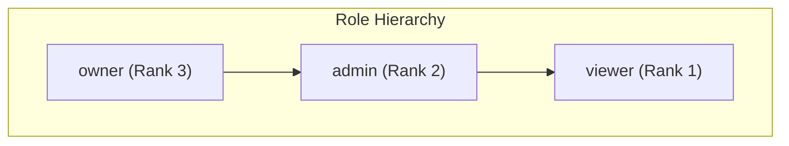
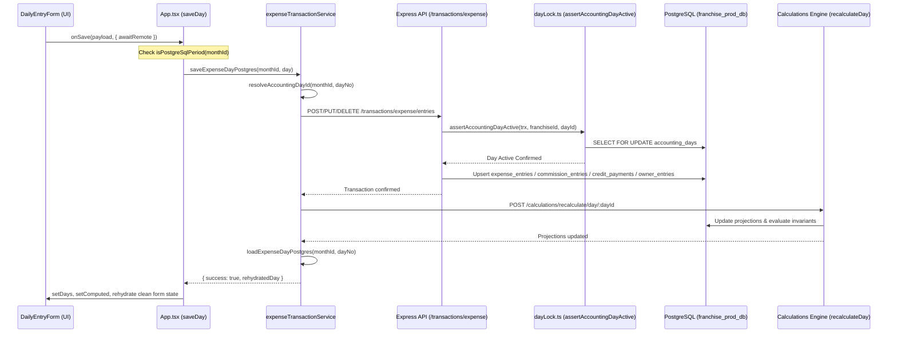
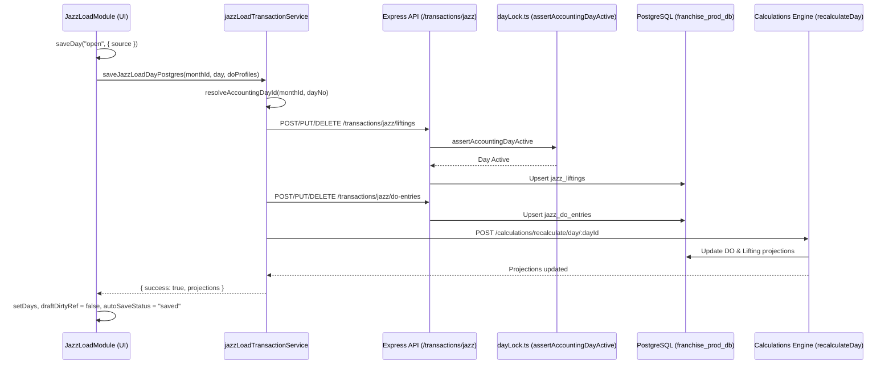
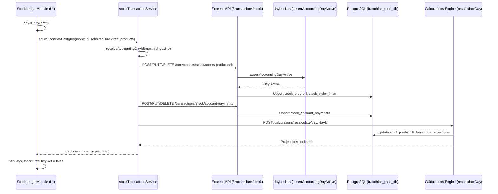
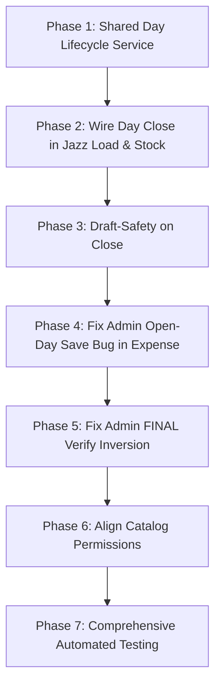

# TFX — Complete Permissions, Save Reliability, and Day-Close Audit Report

**Document Date:** October 12, 2026  
**Auditor:** Antigravity Advanced Agentic System  
**Audit Scope:** Entire Franchise Accounting Application (Frontend React/Vite/TypeScript, Backend Express/Kysely/Node.js, PostgreSQL `franchise_prod_db`)  
**Status:** Read-Only Forensic Audit Complete — No Implementation Changes Made  

---

## Executive Summary

A comprehensive architectural and forensic code audit was conducted across the entire TFX/Franchise codebase, evaluating role-based permissions, transaction save pipelines, and accounting lifecycle operations (specifically Day Closing and Reopening).

The investigation tracked every user action from the UI button down through React hooks, client services, HTTP network boundaries, Express routing, RBAC middleware, Zod validation schemas, Kysely database queries, and PostgreSQL row-level locks and constraints.

### Core Discoveries:
1. **Day Close is Architecturally Module-Agnostic on the Backend, but Restricted in Frontend Code:**  
   The backend endpoint `POST /api/v1/periods/:periodId/days/:dayNo/close` is a unified, atomic, multi-module ledger close operation. It does not belong to the Expense module; it locks the day for the entire franchise and validates invariants across Financial, Jazz Lifting, Jazz DOs, Stock, and Credit Party projections. However, in the frontend, `closeSelectedDay` in both `JazzLoadModule.tsx` (line 1479) and `StockLedgerModule.tsx` (line 1708) contains hardcoded early-return guards that display a warning popup (`"Day status for PostgreSQL operational periods is managed authoritatively via PostgreSQL."`) without executing the API call. As a result, users are artificially forced to navigate to the Expense module to close a day.
2. **Admin Operational Edit Blocker on Non-Calendar-Today Open Days in Expense:**  
   In `src/App.tsx` (lines 2389–2392 and 2414–2418), `canAdminEditSelectedExpenseDay` restricts Admins to editing either `isSelectedLiveDay` (where `dayNo` matches `new Date().getDate()`) or an owner-reopened day. If an operational day (e.g. Day 9) is active and `open` in PostgreSQL, but the user is working on a different calendar date (e.g. October 12), an Admin attempting to save receives a runtime error: `"Admins can only edit the current running day or an owner-reopened previous day while it is manually open."` This restriction does NOT exist in Jazz Load, Stock, or the backend database.
3. **FINAL Month-End Settlement (Day 32) Permission Inversion:**  
   In `src/App.tsx` (line 2466), Day 32 verification allows any user who satisfies `roleCan(role, "daily")` (which includes `admin`). However, the backend endpoint `POST /api/v1/periods/:periodId/final/verify` strictly enforces `requireRole("owner")`. When an Admin attempts to verify FINAL, the UI allows the action but the backend rejects it with an HTTP 403 `INSUFFICIENT_ROLE` error.
4. **Draft-State Loss Vulnerability on Day Close:**  
   If a user modifies an entry in Expense, Jazz Load, or Stock and immediately initiates a Day Close before the 900ms autosave debounce elapses, the backend executes the Day Close using previously committed data. Once closed, the in-flight or subsequent autosave triggers `DayClosedError` (HTTP 423/422), discarding the user's uncommitted edits.

---

## 1. Existing Roles and Intended Permissions

The application supports exactly three roles across both frontend and backend:



### Role Definitions

| Role | Hierarchy Rank | Business Purpose & Intended Scope |
| :--- | :---: | :--- |
| **`owner`** | **3** | **Franchise Principal / Ultimate Financial Authority.** Full read and write access across all domains. Sole authority to initialize periods, verify genesis seeds, activate periods, reopen closed days, execute and verify FINAL month-end settlements, close accounting periods, initialize successor months, and manage users. |
| **`admin`** | **2** | **Franchise Operations Manager.** Daily operational authority. Can view, create, edit, and save daily operational entries across Expense, Jazz Load, and Stock for any open or reopened day. Can close operational days. Can run master recalculation refreshes. Prohibited from reopening closed days, initializing periods, verifying seeds, verifying FINAL settlements, or closing entire months. |
| **`viewer`** | **1** | **Auditor / Read-Only Stakeholder.** Read-only visibility into all operational days, closed days, reports, summaries, projections, invoices, and exports. Strictly prohibited from mutating transactions, saving drafts, closing/reopening days, or modifying configuration. |

---

## 2. Role-Permission Matrix by Page and Action

The following matrix compares intended permissions against actual frontend and backend enforcement.

| Domain | Page / Component | Action | Expected (`owner` / `admin` / `viewer`) | Frontend Enforcement | Backend Enforcement | Discrepancy / Status |
| :--- | :--- | :--- | :---: | :---: | :---: | :--- |
| **Expense** | `DailyEntryForm` | View daily entries & history | `ALLOW` / `ALLOW` / `ALLOW` | Allowed (`roleCan(role, 'read')`) | Allowed (`requireRole('viewer')`) | None. Working as intended. |
| **Expense** | `DailyEntryForm` | Edit Daily Entries (Live Calendar Day) | `ALLOW` / `ALLOW` / `DENY` | Allowed / Allowed / Denied | Allowed / Allowed / Denied (403) | None. Working as intended. |
| **Expense** | `DailyEntryForm` | Edit Daily Entries (Open Day $\neq$ Calendar Today) | `ALLOW` / `ALLOW` / `DENY` | Allowed / **BLOCKED** / Denied | Allowed / Allowed / Denied (403) | **CONFIRMED DEFECT:** Admin blocked in `App.tsx:2414`. Backend permits it. |
| **Expense** | `DailyEntryForm` | Edit Closed Day Entries | `DENY` / `DENY` / `DENY` | Blocked for all (unless reopened) | Blocked in `dayLock.ts` (423/422) | None. Invariant preserved. |
| **Expense** | `DailyEntryForm` | Add/Edit/Delete Expense rows | `ALLOW` / `ALLOW` / `DENY` | Allowed / Allowed* / Denied | Allowed / Allowed / Denied (403) | Subject to open-day defect above. |
| **Expense** | `DailyEntryForm` | Add/Edit/Delete Commission rows | `ALLOW` / `ALLOW` / `DENY` | Allowed / Allowed* / Denied | Allowed / Allowed / Denied (403) | Subject to open-day defect above. |
| **Expense** | `DailyEntryForm` | Add/Edit Daily Credit Loan/Receive | `ALLOW` / `ALLOW` / `DENY` | Allowed / Allowed* / Denied | Allowed / Allowed / Denied (403) | Subject to open-day defect above. |
| **Expense** | `CatalogManager` | Manage Credit Party Catalog | `ALLOW` / `ALLOW` / `DENY` | Allowed / **DENIED** / Denied | Allowed / Allowed / Denied (403) | **DISCREPANCY:** Frontend hides from Admin; Backend `mutateMin` permits Admin. |
| **Expense** | `CatalogManager` | Manage Expense / Commission Categories | `ALLOW` / `ALLOW` / `DENY` | Allowed / **DENIED** / Denied | Allowed / Allowed / Denied (403) | **DISCREPANCY:** Frontend hides from Admin; Backend `mutateMin` permits Admin. |
| **Expense** | `DailyEntryForm` | Add/Edit Owner Drawing / Injection | `ALLOW` / `ALLOW` / `DENY` | Allowed / Allowed* / Denied | Allowed / Allowed / Denied (403) | Subject to open-day defect above. |
| **Expense** | `DailyEntryForm` | Save Daily Entry | `ALLOW` / `ALLOW` / `DENY` | Allowed / Allowed* / Denied | Allowed / Allowed / Denied (403) | Subject to open-day defect above. |
| **Expense** | `UniversalDayControlBar` | Close Selected Operational Day | `ALLOW` / `ALLOW` / `DENY` | Allowed / Allowed / Denied | Allowed / Allowed / Denied (403) | None. Working in Expense. |
| **Expense** | `UniversalDayControlBar` | Reopen Closed Day | `ALLOW` / `DENY` / `DENY` | Allowed / Denied / Denied | Allowed / Denied (403) / Denied (403) | None. Working as intended. |
| **Expense** | Day 32 (FINAL) | View FINAL Settlement | `ALLOW` / `ALLOW` / `ALLOW` | Allowed / Allowed / Denied | Allowed / Allowed / Allowed | Working as intended. |
| **Expense** | Day 32 (FINAL) | Edit FINAL Settlement Entries | `ALLOW` / `DENY` / `DENY` | Allowed / Allowed / Denied | Allowed / Denied (403) / Denied (403) | **DISCREPANCY:** Frontend permits Admin to click; Backend rejects with 403. |
| **Expense** | Day 32 (FINAL) | Verify & Close FINAL | `ALLOW` / `DENY` / `DENY` | Allowed / **ALLOWED (BUG)** / Denied | Allowed / Denied (403) / Denied (403) | **CONFIRMED DEFECT:** Frontend attempts verify for Admin, Backend returns 403. |
| **Jazz Load** | `JazzLoadModule` | View Calendar & DO Records | `ALLOW` / `ALLOW` / `ALLOW` | Allowed / Allowed / Allowed | Allowed / Allowed / Allowed | None. Working as intended. |
| **Jazz Load** | `JazzLoadModule` | Edit Daily Lifting & DO Entries | `ALLOW` / `ALLOW` / `DENY` | Allowed / Allowed / Denied | Allowed / Allowed / Denied (403) | Working as intended on open days. |
| **Jazz Load** | `JazzLoadModule` | Save Daily Jazz Load Data | `ALLOW` / `ALLOW` / `DENY` | Allowed / Allowed / Denied | Allowed / Allowed / Denied (403) | Working as intended on open days. |
| **Jazz Load** | `JazzLoadModule` | Manage Rates in Settings | `ALLOW` / `ALLOW` / `DENY` | Allowed / **DENIED** / Denied | Allowed / Allowed / Denied (403) | **DISCREPANCY:** Frontend restricts to Owner; Backend allows Admin. |
| **Jazz Load** | `UniversalDayControlBar` | Close Selected Day | `ALLOW` / `ALLOW` / `DENY` | **BLOCKED (STUB)** / **BLOCKED (STUB)** / Denied | Allowed / Allowed / Denied (403) | **CRITICAL DEFECT:** UI button displays warning popup; does not execute backend close. |
| **Jazz Load** | `UniversalDayControlBar` | Reopen Closed Day | `ALLOW` / `DENY` / `DENY` | **BLOCKED (STUB)** / Denied / Denied | Allowed / Denied (403) / Denied (403) | **CRITICAL DEFECT:** UI button displays warning popup; does not execute backend reopen. |
| **Stock** | `StockLedgerModule` | View Products, Accounts & Orders | `ALLOW` / `ALLOW` / `ALLOW` | Allowed / Allowed / Allowed | Allowed / Allowed / Allowed | Working as intended. |
| **Stock** | `StockLedgerModule` | Edit Outbound Stock Orders & Payments | `ALLOW` / `ALLOW` / `DENY` | Allowed / Allowed / Denied | Allowed / Allowed / Denied (403) | Working as intended on open days. |
| **Stock** | `StockLedgerModule` | Add / Delete Stock In (Inbound Purchase) | `ALLOW` / `ALLOW` / `DENY` | Allowed / Allowed / Denied | Allowed / Allowed / Denied (403) | Working as intended on open days. |
| **Stock** | `StockLedgerModule` | Manage Stock Products / Accounts Catalog | `ALLOW` / `ALLOW` / `DENY` | Allowed / **DENIED** / Denied | Allowed / Allowed / Denied (403) | **DISCREPANCY:** Frontend restricts to Owner; Backend allows Admin. |
| **Stock** | `StockLedgerModule` | Save Daily Stock Entry | `ALLOW` / `ALLOW` / `DENY` | Allowed / Allowed / Denied | Allowed / Allowed / Denied (403) | Working as intended on open days. |
| **Stock** | `UniversalDayControlBar` | Close Selected Day | `ALLOW` / `ALLOW` / `DENY` | **BLOCKED (STUB)** / **BLOCKED (STUB)** / Denied | Allowed / Allowed / Denied (403) | **CRITICAL DEFECT:** UI button displays status message; does not execute backend close. |
| **Stock** | `UniversalDayControlBar` | Reopen Closed Day | `ALLOW` / `DENY` / `DENY` | **BLOCKED (STUB)** / Denied / Denied | Allowed / Denied (403) / Denied (403) | **CRITICAL DEFECT:** UI button displays status message; does not execute backend reopen. |
| **System** | `MasterRecalculation` | Run Master Recalculation Refresh | `ALLOW` / `ALLOW` / `DENY` | Allowed / Allowed / Denied | Allowed / Allowed / Denied (403) | Working as intended across all modules. |
| **System** | Accounting Periods | Initialize Monthly Period | `ALLOW` / `DENY` / `DENY` | Owner only | Allowed / Denied (403) / Denied (403) | Working as intended. |
| **System** | Accounting Periods | Verify Genesis / Monthly Seeds | `ALLOW` / `DENY` / `DENY` | Owner only | Allowed / Denied (403) / Denied (403) | Working as intended. |
| **System** | Accounting Periods | Activate Period (Open Day 1) | `ALLOW` / `DENY` / `DENY` | Owner only | Allowed / Denied (403) / Denied (403) | Working as intended. |
| **System** | Accounting Periods | Close Accounting Period | `ALLOW` / `DENY` / `DENY` | Owner only | Allowed / Denied (403) / Denied (403) | Working as intended. |
| **System** | Accounting Periods | Initialize Successor Period | `ALLOW` / `DENY` / `DENY` | Owner only | Allowed / Denied (403) / Denied (403) | Working as intended. |

---

## 3. Frontend Permission Checks

### 3.1 Role Evaluator Functions
- **Expense (`src/lib/firestoreService.ts:637`):**
  ```ts
  export function roleCan(role: UserRole | null, permission: "daily" | "catalogs" | "users" | "ownerControls" | "importBackup" | typeof MASTER_REFRESH_ACCESS | "read") {
    if (!role) return false;
    if (permission === "read") return true;
    if (permission === MASTER_REFRESH_ACCESS) return canRunMasterRefresh(role);
    if (role === "owner") return true;
    if (role === "admin") return permission === "daily";
    return false;
  }
  ```
  *Consequence:* For `admin`, `catalogs`, `users`, `ownerControls`, and `importBackup` evaluate to `false`.

- **Jazz Load (`src/modules/jazzLoad/services/jazzLoadFirestore.ts:397`):**
  ```ts
  export function roleCanJazzLoad(role: UserRole | null, permission: "read" | "daily" | "settings" | "backup" | "monthControls" | typeof MASTER_REFRESH_ACCESS) {
    if (!role) return false;
    if (permission === "read") return true;
    if (permission === MASTER_REFRESH_ACCESS) return canRunMasterRefresh(role);
    if (role === "owner") return true;
    if (role === "admin") return permission === "daily";
    return false;
  }
  ```

- **Stock (`src/modules/stock/services/stockFirestore.ts:471`):**
  ```ts
  export function roleCanStock(role: UserRole | null, permission: "read" | "daily" | "settings" | "backup" | "monthControls" | typeof MASTER_REFRESH_ACCESS) {
    if (!role) return false;
    if (permission === "read") return true;
    if (permission === MASTER_REFRESH_ACCESS) return canRunMasterRefresh(role);
    if (role === "owner") return true;
    if (role === "admin") return permission === "daily";
    return false;
  }
  ```

### 3.2 Operational Daily Edit Permission
- **Shared Service (`src/shared/services/dayEditPermissions.ts:28`):**
  ```ts
  export function canEditOperationalDailyEntry(input: {
    role: UserRole | null;
    canWriteDaily: boolean;
    monthClosed: boolean;
    isFutureDay?: boolean;
    isLiveDay: boolean;
    dayClosed: boolean;
    day?: ReopenedDayState | null;
    nowMs?: number;
  }) {
    if (!input.canWriteDaily || input.monthClosed || input.isFutureDay) return false;
    const activeReopen = isActiveReopenWindow(input.day, input.nowMs);
    const dayClosed = input.dayClosed || isOperationalDayClosed(input.day, input.nowMs);
    if (dayClosed && !activeReopen) return false;
    if (input.role === "owner") return input.isLiveDay || !dayClosed || activeReopen;
    if (input.role === "admin") return input.isLiveDay || !dayClosed || isAdminEditableReopenedDay(input.day, input.nowMs);
    return false;
  }
  ```
  *Analysis:* `canEditOperationalDailyEntry` correctly permits `admin` to edit when `!dayClosed` is true!

- **Expense Over-Constraint Defect (`src/App.tsx:2389 & 2414`):**
  ```ts
  // Line 2389:
  const canAdminEditSelectedExpenseDay = role === "admin" && (
    isSelectedLiveDay ||
    (!isSelectedLiveDay && isAdminEditableReopenedDay(selectedDayInput, now.getTime()))
  );
  // Line 2414:
  if (role === "admin" && !canAdminEditSelectedExpenseDay) {
    const message = "Admins can only edit the current running day or an owner-reopened previous day while it is manually open.";
    setStatus(message);
    throw new Error(message);
  }
  ```
  *Root Cause:* Unlike `canEditOperationalDailyEntry`, `canAdminEditSelectedExpenseDay` completely omits `!selectedDayLocked` / `!dayClosed`. This prevents Admins from editing operational days that are legally open in PostgreSQL if the day number does not match today's system clock date.

---

## 4. Backend Authorization Checks

### 4.1 RBAC Mechanism
Backend authorization is defined in `backend/src/auth/rbacMiddleware.ts`:
```ts
const ROLE_RANK: Record<UserRole, number> = {
  viewer: 1,
  admin: 2,
  owner: 3
};

export function hasRequiredRole(currentRole: UserRole, requiredRole: UserRole): boolean {
  return (ROLE_RANK[currentRole] ?? 0) >= (ROLE_RANK[requiredRole] ?? 0);
}

export function requireRole(requiredRole: UserRole) {
  return (req: Request, res: Response, next: NextFunction): void => {
    if (!req.auth || !req.auth.franchise) {
      res.status(403).json({ error: "FRANCHISE_CONTEXT_REQUIRED", ... });
      return;
    }
    const currentRole = req.auth.franchise.role;
    if (!hasRequiredRole(currentRole, requiredRole)) {
      res.status(403).json({
        error: "INSUFFICIENT_ROLE",
        message: `Operation requires '${requiredRole}' role or higher. Current role: '${currentRole}'.`
      });
      return;
    }
    next();
  };
}
```

### 4.2 Endpoint Security Matrix

| API Route Group | Endpoint Pattern | HTTP Method | Minimum Required Role | Handled In |
| :--- | :--- | :---: | :---: | :--- |
| **Authentication** | `/api/v1/auth/login` | `POST` | Public | `auth/routes.ts:43` |
| **Authentication** | `/api/v1/auth/me` | `GET` | Authenticated Tenant | `auth/routes.ts:161` |
| **Catalogs** | `/api/v1/catalogs/*` | `GET` | `viewer` (Rank 1) | `catalogs/routes.ts:91` |
| **Catalogs** | `/api/v1/catalogs/*` | `POST`/`PUT`/`DELETE` | `admin` (Rank 2) | `catalogs/routes.ts:92` |
| **Transactions** | `/api/v1/transactions/*` | `GET` | `viewer` (Rank 1) | `transactions/routes.ts:108` |
| **Transactions** | `/api/v1/transactions/*` | `POST`/`PUT`/`DELETE` | `admin` (Rank 2) | `transactions/routes.ts:109` |
| **Calculations** | `/api/v1/calculations/projections/*` | `GET` | `viewer` (Rank 1) | `calculations/routes.ts:168` |
| **Calculations** | `/api/v1/calculations/recalculate/*` | `POST` | `admin` (Rank 2) | `calculations/routes.ts:84` |
| **Periods** | `/api/v1/periods` | `GET` | `viewer` (Rank 1) | `periods/routes.ts:150` |
| **Periods** | `/api/v1/periods/:id/days` | `GET` | `viewer` (Rank 1) | `periods/routes.ts:188` |
| **Periods** | `/api/v1/periods/:id/seeds` | `GET` | `viewer` (Rank 1) | `periods/routes.ts:420` |
| **Periods** | `/api/v1/periods/:id/days/:dayNo/close` | `POST` | `admin` (Rank 2) | `periods/routes.ts:320` |
| **Periods** | `/api/v1/periods/:id/days/:dayNo/open` | `POST` | `admin` (Rank 2) | `periods/routes.ts:356` |
| **Periods** | `/api/v1/periods/initialize` | `POST` | `owner` (Rank 3) | `periods/routes.ts:127` |
| **Periods** | `/api/v1/periods/:id/activate` | `POST` | `owner` (Rank 3) | `periods/routes.ts:290` |
| **Periods** | `/api/v1/periods/:id/verify-seeds` | `POST` | `owner` (Rank 3) | `periods/routes.ts:269` |
| **Periods** | `/api/v1/periods/:id/days/:dayNo/reopen` | `POST` | `owner` (Rank 3) | `periods/routes.ts:392` |
| **Periods** | `/api/v1/periods/:id/final/verify` | `POST` | `owner` (Rank 3) | `periods/routes.ts:537` |
| **Periods** | `/api/v1/periods/:id/close` | `POST` | `owner` (Rank 3) | `periods/routes.ts:569` |
| **Periods** | `/api/v1/periods/:id/initialize-next` | `POST` | `owner` (Rank 3) | `periods/routes.ts:598` |

### 4.3 Database Day Concurrency & Immutability Lock
Every transaction mutation endpoint unconditionally calls `assertAccountingDayActive` (`backend/src/transactions/dayLock.ts:25`):
```sql
SELECT id, franchise_id, period_id, day_no, status, calendar_date, label
FROM accounting_days
WHERE id = $dayId AND franchise_id = $franchiseId
FOR UPDATE;
```
If `status === "closed"`, it throws `DayClosedError` (HTTP 423/422). No writes can bypass this check.

---

## 5. Complete Save Paths for Expense, Jazz Load, and Stock

### 5.1 Expense Save Path



1. **UI Control:** `DailyEntryForm.tsx` (Auto-save debounce 900ms, `handleManualSave`, or `handleVerifiedSave`).
2. **Event Handler:** `DailyEntryForm:handleManualSave` calls `props.onSave(payload)` (`App.tsx:saveDay`).
3. **Client Service:** `saveExpenseDayPostgres(periodKey, input)` in `src/services/api/expenseTransactionService.ts:45`.
4. **API Route:** REST requests to `/api/v1/transactions/expense/entries`, `/commission-entries`, `/credit-payments`, `/owner-entries`, `/bank-entries`.
5. **Auth & RBAC:** `requireAuth`, `requireFranchise`, `requireRole("admin")`.
6. **Validation:** Zod schemas (`CreateExpenseSchema`, `UpdateExpenseSchema`, etc.).
7. **Day Lock:** `assertAccountingDayActive` acquires `FOR UPDATE` lock; asserts `status !== 'closed'`.
8. **Database Transaction:** Kysely transaction upserts/deletes records in `franchise_prod_db`.
9. **Recalculation:** `recalculateDayPostgres(dayId)` re-runs the calculation engine.
10. **Rehydration & UI State:** Calls `loadExpenseDayPostgres`, replaces day in `days` state, recomputes month summary, marks draft clean.

---

### 5.2 Jazz Load Save Path



1. **UI Control:** `JazzLoadModule.tsx` (`useAutoSaveEntry` line 2038, manual Save line 2177, `handleVerifiedSave` line 2089).
2. **Event Handler:** `saveDay("open", options)` in `JazzLoadModule.tsx:1312`.
3. **Client Service:** `saveJazzLoadDayPostgres(periodKey, day, doProfiles)` in `src/services/api/jazzLoadTransactionService.ts:37`.
4. **API Route:** REST requests to `/api/v1/transactions/jazz/liftings` and `/api/v1/transactions/jazz/do-entries`.
5. **Auth & RBAC:** `requireAuth`, `requireFranchise`, `requireRole("admin")`.
6. **Validation:** Zod schemas (`CreateJazzLiftingSchema`, `CreateJazzDoEntrySchema`, etc.).
7. **Day Lock:** `assertAccountingDayActive` verifies `status !== 'closed'`.
8. **Database Transaction:** Kysely transaction updates `jazz_liftings` and `jazz_do_entries`.
9. **Recalculation:** `ledgerApiClient.calculations.recalculateDay(dayId)`.
10. **Rehydration & UI State:** Merges saved day into `days`, resets dirty flags, displays confirmation.

---

### 5.3 Stock Save Path



1. **UI Control:** `StockLedgerModule.tsx` (`useAutoSaveEntry` line 1980, manual Save line 2490, `handleVerifiedSave` line 1496).
2. **Event Handler:** `saveEntry(nextDraft, options)` in `StockLedgerModule.tsx:1427`.
3. **Client Service:** `saveStockDayPostgres(periodKey, dayNo, draft, products)` in `src/services/api/stockTransactionService.ts:40`.
4. **API Route:** REST requests to `/api/v1/transactions/stock/orders` and `/api/v1/transactions/stock/account-payments`.
5. **Auth & RBAC:** `requireAuth`, `requireFranchise`, `requireRole("admin")`.
6. **Validation:** Zod schemas (`CreateStockOrderSchema`, `CreateStockAccountPaymentSchema`, etc.).
7. **Day Lock:** `assertAccountingDayActive` verifies `status !== 'closed'`.
8. **Database Transaction:** Kysely transaction updates `stock_orders`, `stock_order_lines`, and `stock_account_payments`.
9. **Recalculation:** `ledgerApiClient.calculations.recalculateDay(dayId)`.
10. **Rehydration & UI State:** Merges saved day into `days`, resets dirty flags, updates dealer rows.

---

## 6. Verified Save Blockers and Root Causes

| # | Verified Blocker | Exact File & Function | Condition / Trigger | Observed Consequence | Root Cause Category |
| :---: | :--- | :--- | :--- | :--- | :--- |
| **B1** | **Day Close blocked in Jazz Load** | `JazzLoadModule.tsx:1478`<br>`closeSelectedDay()` | User clicks "Close Day" in Jazz Load | Status popup `"Day status for PostgreSQL operational periods is managed authoritatively via PostgreSQL."` Nothing is executed. | **Frontend Code Stub** |
| **B2** | **Day Close blocked in Stock** | `StockLedgerModule.tsx:1742`<br>`closeSelectedDay()` | User clicks "Close Day" in Stock | Status popup `"Day status for PostgreSQL operational periods is managed authoritatively via PostgreSQL."` Nothing is executed. | **Frontend Code Stub** |
| **B3** | **Day Reopen blocked in Jazz Load** | `JazzLoadModule.tsx:1538`<br>`reopenDay()` | User clicks "Reopen Selected Day" in Jazz Load | Status popup `"Day reopening for PostgreSQL operational periods is managed authoritatively via PostgreSQL."` Nothing is executed. | **Frontend Code Stub** |
| **B4** | **Day Reopen blocked in Stock** | `StockLedgerModule.tsx:1776`<br>`reopenSelectedDay()` | User clicks "Reopen Selected Day" in Stock | Status popup `"Day reopening for PostgreSQL operational periods is managed authoritatively via PostgreSQL."` Nothing is executed. | **Frontend Code Stub** |
| **B5** | **Admin save blocked on open non-today days in Expense** | `src/App.tsx:2389 & 2414`<br>`canAdminEditSelectedExpenseDay` | Admin attempts to edit/save an open day when `dayNo !== today` | Error thrown: `"Admins can only edit the current running day or an owner-reopened previous day while it is manually open."` Save aborted. | **Frontend Over-Constraint** |
| **B6** | **Admin FINAL Verification 403 Forbidden** | `src/App.tsx:2466` vs `periods/routes.ts:537` | Admin clicks "Verify & Close FINAL" on Day 32 | Frontend calls API; backend rejects with HTTP 403 `INSUFFICIENT_ROLE` (`Operation requires 'owner' role or higher`). | **RBAC Policy Mismatch** |
| **B7** | **Unsaved Draft Overwrite / Loss on Day Close** | `UniversalDayControlBar.tsx:115`<br>`onCloseSelectedDay()` | User modifies form and clicks Close Day within 900ms | Day is closed on server using old state. Pending autosave fails with HTTP 423 `DayClosedError`. Unsaved user edits discarded. | **Dirty-State Race Condition** |
| **B8** | **Catalog Management Inversion for Admin** | `App.tsx:4345`, `JazzLoadModule:687`, `StockLedgerModule:1021` | Admin accesses Expense categories, Credit Parties, Jazz Rates, or Stock Products | UI hides/disables controls (`roleCan(admin, 'catalogs') === false`), but Backend routes explicitly allow Admin (`requireRole('admin')`). | **Permission Asymmetry** |

---

## 7. Exact Explanation of Why Day Closing is Restricted to Expense

### The Architectural History
When the application was initially created as a Firebase/Firestore prototype, the Expense module (`DailyEntryForm.tsx` embedded in `src/App.tsx`) served as the root view. Jazz Load and Stock were built later as separate sub-modules with independent Firestore document listeners.

When PostgreSQL was introduced as the authoritative financial ledger:
1. The developer implemented `closeAccountingDay` in `backend/src/periods/service.ts:1208` as a centralized, multi-module operation on `accounting_days`.
2. The developer wired `closeDay` inside `src/App.tsx:2463` to call `ledgerApiClient.periods.closeDay(periodData.period.id, day.dayNo, null)`.
3. However, inside `src/modules/jazzLoad/components/JazzLoadModule.tsx` and `src/modules/stock/components/StockLedgerModule.tsx`, the developers encountered existing legacy Firestore close functions (`saveJazzLoadDay` and `updateStockDaysStatusBatch`). Instead of wiring them to `ledgerApiClient.periods.closeDay`, they added temporary early-return guards:
   ```ts
   // JazzLoadModule.tsx line 1479:
   if (isPostgreSqlPeriod(monthId)) {
     pushPopup("warning", "Day status for PostgreSQL operational periods is managed authoritatively via PostgreSQL.");
     return;
   }

   // StockLedgerModule.tsx line 1708:
   if (isPostgreSqlPeriod(monthId)) {
     onStatus("Day status for PostgreSQL operational periods is managed authoritatively via PostgreSQL.");
     return;
   }
   ```
4. These temporary guards were never replaced with the real implementation.
5. Consequently, even though `UniversalDayControlBar` renders the "Close Day" button on all three pages, clicking it in Jazz Load or Stock does nothing, forcing the user to return to Expense.

---

## 8. Proposed Shared Day-Close UX and Backend Architecture

### 8.1 Unified Architectural Flow

```mermaid
sequenceDiagram
    participant User as User (Owner / Admin)
    participant UI as Module UI (Expense, Jazz Load, or Stock)
    participant Bar as UniversalDayControlBar
    participant Guard as Draft & Validation Guard
    participant Svc as dayLifecycleService (closeOperationalDay)
    participant API as POST /api/v1/periods/:id/days/:day/close
    participant DB as PostgreSQL (accounting_days)
    participant Cache as periodDayService Cache

    User->>Bar: Clicks "Close Day"
    Bar->>Guard: Check for unsaved/dirty draft in active module
    alt Has Dirty Draft
        Guard->>UI: Flush active save immediately
        UI->>API: Execute save transactions
        API-->>UI: Save confirmed
    end
    Guard->>User: Display Confirmation Modal with Metric Preview
    User->>Guard: Confirms "Yes, Close Day"
    Guard->>Svc: closeOperationalDay(monthId, dayNo, notes)
    Svc->>API: POST /api/v1/periods/:periodId/days/:dayNo/close
    Note over API: Recalculate projections & verify invariants atomically
    API->>DB: UPDATE accounting_days SET status = 'closed'
    API-->>Svc: 200 OK { closed: true, summary }
    Svc->>Cache: clearPeriodCache() & getAccountingPeriodWithDays(monthId, true)
    Svc->>UI: Broadcast DayClosedEvent (all modules set status = "closed")
    UI-->>User: Inputs lock immediately; status chip shows "Closed Day"
```

### 8.2 Client Service Architecture: `src/services/api/dayLifecycleService.ts`
Create a centralized, module-agnostic day lifecycle service:
```ts
export interface CloseDayOptions {
  notes?: string | null;
  flushDraft?: () => Promise<boolean>;
  onSuccess?: () => void;
  onError?: (error: Error) => void;
}

export async function closeOperationalDayUnified(
  monthId: string,
  dayNo: number,
  options: CloseDayOptions = {}
): Promise<{ success: boolean; message: string }> {
  // 1. If active module has an uncommitted draft, flush and await confirmation first
  if (options.flushDraft) {
    const saved = await options.flushDraft();
    if (!saved) {
      throw new Error("Cannot close day: unsaved changes could not be committed.");
    }
  }

  // 2. Resolve accounting period and day
  const periodData = await getAccountingPeriodWithDays(monthId);
  if (!periodData) {
    throw new Error(`Accounting period ${monthId} not initialized.`);
  }

  // 3. Execute authoritative backend close
  await ledgerApiClient.periods.closeDay(periodData.period.id, dayNo, options.notes ?? null);

  // 4. Force refresh cached period and day statuses
  await getAccountingPeriodWithDays(monthId, true);

  return {
    success: true,
    message: `Day ${dayNo} successfully closed across all franchise modules.`
  };
}
```

### 8.3 Reusable Confirmation Dialog
Implement a standardized confirmation dialog used by Expense, Jazz Load, and Stock:
- Displays Day number, Date, and Month.
- Summarizes the impact: *"Closing this day will lock all transactions in Expense, Jazz Load, and Stock as immutable records."*
- Requires explicit user confirmation.
- Displays a progress spinner during recalculation.
- On error, displays the exact invariant violation or reason returned by the server.

---

## 9. Missing or Inadequate Tests

1. **Frontend Day-Close Integration Tests:**  
   - Current test `src/shared/dayControls/universalWorkflowStructure.test.ts` only performs regex string checks against file contents. It does not mount components or verify button click handlers.
   - Missing test: Verifying that clicking "Close Day" in `JazzLoadModule` invokes `ledgerApiClient.periods.closeDay`.
   - Missing test: Verifying that clicking "Close Day" in `StockLedgerModule` invokes `ledgerApiClient.periods.closeDay`.
2. **Draft-Safety Tests:**  
   - Missing test: Modifying an input in `DailyEntryForm`, `JazzLoadModule`, or `StockLedgerModule` and verifying that Day Close flushes and confirms the save before closing.
3. **Role Enforcement Tests:**  
   - Missing test: Admin saving an open day where `dayNo !== today` in `DailyEntryForm`.
   - Missing test: Admin attempting to verify Day 32 (FINAL) — ensuring UI disables or gracefully blocks the button.
4. **Cross-Module State Synchronization Tests:**  
   - Missing test: Closing Day 1 in Expense and verifying that `JazzLoadModule` and `StockLedgerModule` render Day 1 as read-only/closed on navigation without page reload.

---

## 10. Ordered Remediation Plan



### Phase 1: Shared Day Lifecycle Service
- Create `src/services/api/dayLifecycleService.ts`.
- Export `closeOperationalDayUnified` and `reopenOperationalDayUnified`.
- Provide draft-flushing and cache-invalidation logic.

### Phase 2: Wire Day Close in Jazz Load & Stock
- In `src/modules/jazzLoad/components/JazzLoadModule.tsx`:
  - Replace the stub in `closeSelectedDay` (line 1478) with `closeOperationalDayUnified`.
  - Replace the stub in `reopenDay` (line 1538) with `reopenOperationalDayUnified`.
  - Update local `days` state upon completion.
- In `src/modules/stock/components/StockLedgerModule.tsx`:
  - Replace the stub in `closeSelectedDay` (line 1742) with `closeOperationalDayUnified`.
  - Replace the stub in `reopenSelectedDay` (line 1776) with `reopenOperationalDayUnified`.
  - Update local `days` state upon completion.

### Phase 3: Draft-Safety on Close
- Connect `flushDraft` callbacks in all three modules so that if dirty changes exist when "Close Day" is clicked, the save completes and confirms before the day status transitions to `closed`.

### Phase 4: Fix Admin Open-Day Save Bug in Expense
- In `src/App.tsx:2389`, update `canAdminEditSelectedExpenseDay`:
  ```ts
  const canAdminEditSelectedExpenseDay = role === "admin" && (
    isSelectedLiveDay ||
    !selectedDayLocked ||
    (!isSelectedLiveDay && isAdminEditableReopenedDay(selectedDayInput, now.getTime()))
  );
  ```
- This aligns Expense with Jazz Load, Stock, and the backend Kysely layer.

### Phase 5: Fix Admin FINAL Verify Inversion
- In `src/App.tsx:2466` and line 3760:
  - Restrict FINAL month-end settlement verification (Day 32) strictly to `role === "owner"`.
  - Ensure the UI button is disabled for Admins with the message: *"Only owner can verify FINAL month-end settlement."*

### Phase 6: Catalog Management Role Policy Alignment
- Clarify whether Admins should be permitted to manage master catalogs (Expense categories, Credit Parties, Jazz Rates, Stock Products).
- Align frontend `roleCan` functions with the backend `mutateMin` policy once approved.

### Phase 7: Verification & Test Suite
- Add integration tests covering day closing from all three modules.
- Add tests verifying draft persistence during day close.
- Verify zero regression in `npm test -- --run` and `npm run build`.

---

## 11. Risks and Regression Points

1. **Unsaved Draft Race Condition:**  
   *Risk:* Closing a day before in-flight network saves finish causes HTTP 423 `DayClosedError` rollbacks.  
   *Mitigation:* The unified day close operation must explicitly await `flushDraft()` and verify success before invoking `/close`.
2. **Cache Staleness across Modules:**  
   *Risk:* If a user closes Day 5 in Stock, switches to Jazz Load, and `periodCache` is stale, Jazz Load might still display Day 5 as `open`.  
   *Mitigation:* `closeOperationalDayUnified` will call `getAccountingPeriodWithDays(monthId, true)` (force-refresh) to purge client cache, ensuring all module navigation instantly reads the new status.
3. **FINAL Invariant Breaches:**  
   *Risk:* Accidentally allowing Day 32 to be closed via daily operational controls.  
   *Mitigation:* Both frontend service and backend route explicitly reject `dayNo >= 32` from standard day close, enforcing that Day 32 only closes via `POST /api/v1/periods/:periodId/final/verify`.

---

## 12. Decisions Requiring User Approval

Before proceeding to Phase 2 (implementation), the following design decisions require explicit user direction:

1. **Catalog Management Role Policy:**  
   - *Current State:* The backend allows Admins to create/edit Expense categories, Credit Parties, Jazz Rates, and Stock Products (`mutateMin = requireRole("admin")`). But the frontend hides these pages from Admins (`roleCan(admin, 'catalogs') === false`).  
   - *Decision:* Should Admins be allowed to manage master catalogs, or should catalogs be restricted strictly to Owners across both frontend and backend?
2. **Draft Handling on Day Close:**  
   - *Option A (Recommended):* If uncommitted edits exist when "Close Day" is clicked, automatically flush and save the draft before closing. If the save fails, abort closing.  
   - *Option B:* If uncommitted edits exist, block the "Close Day" button and force the user to click "Save" first.
3. **Sequential Day Close Enforcement:**  
   - *Decision:* Should the frontend enforce closing days strictly in sequential order (Day 1 must be closed before Day 2 can be closed), or should users be permitted to close whichever day they are currently viewing as long as the backend invariants pass?

---

## Verification Plan for Phase 2

Upon approval of the remediation plan, verification will execute:
1. Automated unit & integration tests (`npx vitest run src/services/api/dayLifecycleService.test.ts`).
2. Multi-module day closing verification (Expense, Jazz Load, Stock).
3. RBAC negative authorization tests (Viewer cannot close; Admin cannot verify FINAL).
4. Full build verification (`npm run build`).

---

**READ-ONLY AUDIT COMPLETE — NO IMPLEMENTATION CHANGES MADE. WAITING FOR APPROVAL BEFORE FIXES.**
