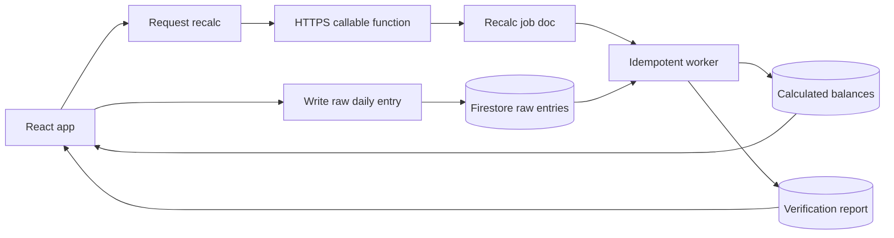
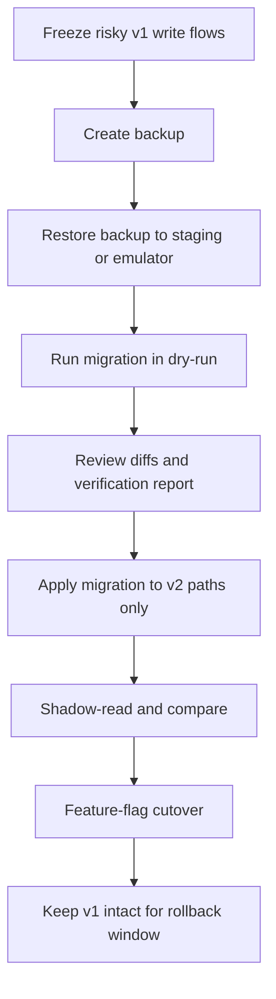

# Architecture redesign for your finance app

## Executive summary

Your Day 29 failure is best understood as an application design failure, not a random “database broke on a certain day” event. Your current model stores credit-party state in two mutable places — an embedded `credits` structure and a `credits` subcollection — and also persists derived values such as openings and closings as if they were source data. Your uploaded incident summary shows exactly how this can snap the chain: Day 28 had eight non-zero credit parties totalling 74,501, Day 29 ended up with no credit rows in either path, and Day 30 kept only one manual row for Usman Cheema, so the carry-forward chain after Day 28 was cut. fileciteturn0file0

For a finance-grade system, the opening balance for day *D* should not be an independently editable truth. It should be a derived value from the previous day’s closing, recalculated deterministically from raw facts. Once that distinction is made — **raw facts** versus **calculated projections** — the “tight coupling” you want becomes a design property instead of a repair button. If day 20 changes, days 21–31 are recomputed from the changed raw facts; no manual “refresh credits” step is needed. This is the same principle whether you stay on Firestore or move to any relational database. Changing the database alone would not solve the current weakness if you kept the same dual-path and denormalised save flow. citeturn33view0turn33view2

Firebase’s own constraints matter here. Cloud Firestore offline persistence is valuable for your offline-first requirement, but when the device comes back online it synchronises local changes with **last write wins** semantics on the same document, and client transactions fail when offline. That means an entirely client-authoritative design can be made *much safer* than what you have now, but it still cannot provide the same system-wide correctness guarantees as a server-authoritative recalculation path for a multi-user finance app. citeturn38view0turn8view1

The highest-confidence recommendation is therefore:

1. **Immediate redesign principle:** stop treating openings/closings as stored truth; make them derived.
2. **Safe migration principle:** do not mutate live v1 data in place; migrate side-by-side into v2, verify, then cut over by feature flag.
3. **Target architecture choice:**  
   - if you must remain on **Spark/no-cost**, adopt a **frontend-only safe design** that stores **only raw daily facts** and computes balances on read;  
   - if you want **finance-grade operational assurance**, move to **Blaze** and adopt a **Cloud Functions authoritative design** with idempotent recalculation jobs, server-written projections, backups, and monitoring. Cloud Functions deployment requires upgrading the project to the Blaze plan, and Firestore managed export/import, backups, and PITR also require billing. citeturn37view1turn13view0turn14view0turn15view0

Absolute “no chance to break” cannot be promised truthfully for any live migration. The closest practical equivalent is a **non-destructive side-by-side migration** with backups first, dry-runs, idempotent repair, invariant checks, preview validation, and a flag-based rollback. The architecture and migration plan below are designed around that principle. citeturn13view4turn15view0turn23view2turn22view1

## Current state and constraints

The current failure pattern is consistent with an unsafe data model. Firestore is flexible, but its own guidance distinguishes between small, fixed nested lists inside a document and data that grows over time, for which subcollections are the more scalable design. Embedded lists grow the parent document and can slow retrieval, while subcollections keep the parent document size stable and remain queryable as the list grows. Firestore also limits each document to 1 MiB. That makes a growing per-day embedded `credits` structure a poor long-term source of truth, particularly when the same information also exists in a sibling subcollection. citeturn33view0turn33view2turn30view0

That dual-path model is the heart of the current drift. Your incident summary shows that the app sometimes relied on one path, sometimes the other, and sometimes neither was rebuilt. When Day 29 became empty in both places, Day 30 had no previous balances to inherit, so the app treated it like a fresh row instead of a continuation. This is not evidence that Firestore “randomly breaks on certain days”; it is evidence that a denormalised chain of stored derived values was allowed to diverge. fileciteturn0file0

Your offline-first requirement is real and valid. Cloud Firestore supports offline persistence for web, Android, and Apple platforms, and on the web you can explicitly choose memory cache or persistent local cache with single-tab or multi-tab management. While offline, listeners receive locally cached updates; when connectivity returns, Firestore synchronises local changes. However, those synchronised changes use last-write-wins semantics for multiple edits to the same document, so overwriting mutable balance documents from more than one device is inherently risky for finance data. Firestore also advises that web persistence is not automatically cleared between sessions, so sensitive deployments should only enable it on trusted devices. citeturn38view0turn42view0

Your plan constraints are decisive. If you stay on Spark, you do **not** get the operational tools that would make this easier to harden: the Cloud Functions documentation says to upgrade to Blaze to deploy functions, and Firestore managed export/import, backups, and point-in-time recovery all require billing to be enabled. Backups are especially important because they are consistent point-in-time copies and do not affect live read/write performance, whereas a managed export is useful but is **not** an exact snapshot taken at the start of the export. citeturn37view1turn13view0turn13view1turn15view0turn14view0

There is also a hard limit to what Security Rules can enforce. Rules are server-enforced for mobile and web clients, but server/Admin clients bypass them. Rules can inspect other documents with `get()`, `exists()`, and `getAfter()`, which is useful for validating a small transaction or batch, but there are per-request limits on document access calls. Inference: that makes Rules suitable for small local invariants, not for recalculating a whole month-long carry-forward chain. citeturn17view0turn17view1turn17view2turn17view3turn30view2

## Target architecture

The right redesign is to establish **one canonical source of truth** and make all balance propagation deterministic. Below are the two viable target architectures for your stack.

| Criterion | Frontend-only safe design | Cloud Functions authoritative design |
|---|---|---|
| Canonical truth | Raw daily entry facts only. No persisted opening/closing truth. | Raw daily entry facts only, plus server-written calculated projections. |
| Where opening/closing are computed | In the React client on read, from raw facts and prior resulting balances. | In a server recalculation worker; client may show provisional local calculations. |
| Offline support | Excellent. Firestore local persistence plus local projection. citeturn38view0turn42view0 | Good. Raw edits can queue offline; authoritative projection finalises when online. citeturn38view0turn43view3 |
| Persistence of calculated data | Prefer **not** to persist; if cached, treat as disposable cache only. | Persist projection docs for fast reads, exports, and verification. |
| Multi-user consistency | Better than today, but not authoritative across devices while offline because the client remains the projector. | Best option. Central authority recomputes affected days and writes versioned results. |
| Operational tooling | No Functions deployment; no managed export/import, backups, or PITR. citeturn37view1turn13view0turn14view0turn15view0 | Functions deployable on Blaze; backups/export/PITR and Cloud Logging/alerts available. citeturn37view1turn15view0turn13view0turn18view0turn19view4 |
| Finance risk | Medium. Much safer than current state, but still limited by client authority and last-write-wins on shared docs. citeturn38view0turn8view1 | Low if implemented idempotently and non-destructively. |
| Cost | Can remain on Spark. | Requires Blaze. citeturn37view1turn35view0 |
| Recommendation | Acceptable only if you absolutely must stay free. | Recommended for a cash-critical production system. |

The **frontend-only safe design** is the safest architecture you can run on Spark. Its core rule is simple: **store only raw daily facts**. The UI reads the month’s raw entries, derives each day’s opening from the previous day’s computed closing in memory, and never trusts a stored opening/closing from Firestore. If day 20 is edited, the selector or projection service recalculates day 20 onward automatically in the client state. This entirely removes the “broken carry-forward because a saved opening was wrong or missing” failure mode from live reads.

The **Cloud Functions authoritative design** adds a server-owned projection layer on top of the same raw facts. The client writes raw entries and requests recalculation through an HTTPS callable function. Callable functions automatically include Firebase Authentication and App Check tokens when available, and the trigger validates auth tokens. App Check enforcement can be enabled so requests with missing or invalid App Check tokens are rejected. citeturn43view3turn32view1

For the backend design, do **not** build a daisy-chain of Firestore triggers that each rewrite the next day. Firestore-triggered functions are explicitly documented as **at least once** with **no guaranteed ordering**, so a direct trigger-per-day chain can still race or duplicate work. Instead, use callables or narrow triggers only to **enqueue a recalculation job**, then let a single idempotent worker recompute the affected range from the earliest changed day to month-end. citeturn40view0turn40view2



My recommendation is clear: **if this app is materially responsible for cash control across users and devices, move to Blaze and implement the Cloud Functions authoritative design**. If you must stay free, adopt the frontend-only safe design immediately and stop persisting mutable balance truth.

## Data model and algorithms

The redesigned model should separate **raw data** from **calculated data**.

| Path | Purpose | Written by |
|---|---|---|
| `creditParties/{partyId}` | Master party record, aliases, active flag, branch scope. | Admin UI / migration |
| `months/{monthId}` | Month metadata, status, verification summaries. | Client or server |
| `months/{monthId}/days/{dayId}` | Day metadata only: status, lock state, totals cache, calc status. | Client for raw status; server for calc status |
| `months/{monthId}/days/{dayId}/creditEntries/{partyId}` | **Raw manual facts** for that day and party. | Client |
| `months/{monthId}/days/{dayId}/creditBalances/{partyId}` | **Calculated projection**: opening, delta, closing, provenance. | Server only, or not stored at all in frontend-only mode |
| `calcRuns/{runId}` or `months/{monthId}/calcRuns/{runId}` | Audit trail for recalculation jobs, verification results, hashes. | Server or migration script |

The embedded day-level `credits` array should be retired as a source of truth. If you need a quick total for UI rendering, keep only a tiny denormalised summary on the day doc, such as `creditNonZeroCount` and `creditClosingTotal`, and treat those as replaceable cache. This follows Firestore’s own guidance that nested data is suitable for simple fixed lists, whereas growing data belongs in subcollections; it also helps you stay away from document growth and the 1 MiB document limit. citeturn33view0turn33view2turn30view0

A v2 raw entry should look conceptually like this:

```ts
type CreditEntryRaw = {
  partyId: string;                 // immutable canonical ID
  partyNameSnapshot: string;       // UI snapshot at time of entry
  loanToday: number;               // positive debit to company / credit given
  receiveToday: number;            // positive repayment received
  manualAdjustment: number;        // signed correction, if allowed
  notes?: string;
  source: "user" | "migration" | "repair";
  inferredFromLegacy?: boolean;    // true only for migrated rows inferred from old data
  editedByUid: string;
  editedAt: string;                // ISO timestamp
  revision: number;                // optimistic concurrency marker
};
```

A calculated projection row should look like this:

```ts
type CreditBalanceCalc = {
  partyId: string;
  openingBalance: number;
  delta: number;                   // loanToday - receiveToday + manualAdjustment
  closingBalance: number;
  calculatedFromDay: number;       // provenance / debugging
  calcVersion: number;             // algorithm version
  calcRunId: string;               // traceability
  previousDayRef?: string;         // e.g. months/2026-05/days/29/creditBalances/p123
  rowHash: string;                 // idempotence / diffing
  calculatedAt: string;
};
```

The projection rule itself should be boring and deterministic:

```ts
function projectDay(
  previousClosing: Record<string, number>,
  rawEntries: Record<string, CreditEntryRaw>
): Record<string, CreditBalanceCalc> {
  const partyIds = new Set([
    ...Object.keys(previousClosing),
    ...Object.keys(rawEntries),
  ]);

  const result: Record<string, CreditBalanceCalc> = {};

  for (const partyId of partyIds) {
    const raw = rawEntries[partyId];
    const opening = previousClosing[partyId] ?? 0;
    const loan = raw?.loanToday ?? 0;
    const receive = raw?.receiveToday ?? 0;
    const adjustment = raw?.manualAdjustment ?? 0;
    const delta = loan - receive + adjustment;
    const closing = opening + delta;

    // Policy choice:
    // keep non-zero rows always;
    // optionally keep zero rows only when they have raw activity.
    if (closing !== 0 || raw) {
      result[partyId] = {
        partyId,
        openingBalance: opening,
        delta,
        closingBalance: closing,
        calculatedFromDay: 0,   // set by caller
        calcVersion: 2,
        calcRunId: "",
        calculatedAt: new Date().toISOString(),
        rowHash: "",
      };
    }
  }

  return result;
}
```

The crucial merge rule during migration is this: **preserve manual activity, overwrite derived balances**. That means:

| Legacy pattern | Migration rule |
|---|---|
| Explicit `loan`, `today`, `receive`, or similar activity fields exist | Preserve those raw values. Recompute opening/closing from the previous day once migrated. |
| Only `opening` and `closing` exist | Infer `delta = closing - opening`, store it as `manualAdjustment` or `inferredLegacyDelta`, and mark `inferredFromLegacy: true`. |
| Same party exists in embedded path and subcollection path | Choose the richer/newer row, log a conflict, never silently merge contradictory facts. |
| Previous day had non-zero closing but current day has no row | Create a synthetic carry-forward projection row with zero activity. Never create synthetic raw activity. |
| Legacy “opening” conflicts with previous day’s recomputed closing | Treat legacy opening as non-authoritative. Keep raw facts; overwrite calculated opening in v2. |

This is exactly how you preserve Day 30’s manually entered 9,000 loan while repairing the missing Day 29 chain. Based on your incident summary, Day 30’s raw activity should remain 9,000, while the repaired Day 29 carry-forward would supply the opening. The exact resulting opening for Usman Cheema still depends on the confirmed Day 28/29 party mapping and legacy field names, but the likely intended value is the one you identified: opening 2,000 and closing 11,000 after preserving the 9,000 manual loan. fileciteturn0file0

## Migration and rollback

The safest migration is **side-by-side, idempotent, and reversible by configuration**. Do not rewrite v1 in place. The live “no chance to break” strategy is to make v2 additive until it has passed verification.



The operational sequence should be:

1. **Freeze the risky parts of v1.**  
   Disable or hide any legacy “refresh”, “verify”, or repair buttons that can write derived balances using the old logic. Continue to allow only essential raw data entry while migration is prepared. This is governance, not a Firebase feature.

2. **Create a real backup before touching production.**  
   On Blaze, prefer a **backup** or **PITR-capable recovery plan** because Firestore backups are consistent point-in-time copies and do not affect live read/write performance. Managed export/import is still useful, but Google documents that an export is not an exact snapshot taken at the start time; it may include changes made while the export was running. Export/import, backups, and PITR all require billing/Blaze. citeturn15view0turn13view1turn13view0turn14view0  
   On Spark, you do not have those managed recovery tools. In that case, create a **read-only application-level backup** of every relevant document and subcollection into versioned NDJSON/JSON files. This is where your chosen Firebase CLI-authenticated read-only REST method is appropriate.

3. **Rehearse the migration away from production.**  
   Load the backup into a staging Firebase project or, preferably for code iteration, the Local Emulator Suite. The emulator accurately mimics Firebase services for integration and QA without touching production data, and it is explicitly intended for development and CI workflows. citeturn23view2turn17view5

4. **Run the migration in `--dry-run` mode first.**  
   The dry-run should produce:
   - a count of days and parties that will be migrated,
   - every embedded/subcollection conflict,
   - every inferred legacy delta,
   - every missing carry-forward row that will be generated in projection,
   - a verification report of invariant failures,
   - a proposed cut set of affected months.  

   Example dry-run skeleton:

```ts
type Mode = "dry-run" | "apply";

async function migrateMonth(monthId: string, mode: Mode) {
  const report = {
    monthId,
    conflicts: [] as any[],
    inferredRows: 0,
    rowsWritten: 0,
    invariantFailures: [] as any[],
  };

  const legacyDays = await readLegacyMonth(monthId);        // both embedded + subcollection
  const v2Writes: Array<{path: string; data: unknown}> = [];

  const normalised = normaliseLegacy(legacyDays, report);   // dedupe and infer raw facts
  const projections = recalcWholeMonth(normalised, report); // deterministic forward pass

  for (const row of normalised.rawRows) {
    v2Writes.push({ path: row.v2Path, data: row.data });
  }
  for (const row of projections.balanceRows) {
    v2Writes.push({ path: row.v2Path, data: row.data });
  }

  if (mode === "apply") {
    await writeInChunks(v2Writes); // idempotent upserts only
    report.rowsWritten = v2Writes.length;
  }

  await writeVerificationReport(monthId, report, mode);
  return report;
}
```

5. **Write only to new v2 paths.**  
   Use paths such as `months_v2/...` or `months/{monthId}/days/{dayId}/creditEntriesV2` only during migration. Leave v1 untouched. This is the single biggest risk reducer.

6. **Verify before cutover.**  
   Each migrated month should produce a machine-readable report like:

```json
{
  "monthId": "2026-05",
  "calcVersion": 2,
  "mode": "dry-run",
  "daysChecked": 31,
  "partiesChecked": 8,
  "rowsWritten": 0,
  "conflicts": [
    {
      "dayId": 29,
      "partyId": "unknown",
      "type": "missing-carry-forward",
      "detail": "No legacy credit rows found on Day 29 while Day 28 had non-zero closings"
    }
  ],
  "invariants": {
    "openingEqualsPreviousClosing": "PASS",
    "closingEqualsOpeningPlusDelta": "PASS",
    "noDuplicatePartyRowsPerDay": "PASS"
  }
}
```

7. **Shadow-read v2 before going live.**  
   Deploy a preview build on a Hosting preview channel and expose an admin-only compare mode that shows “v1 view” versus “v2 projection” for the same month/day. Firebase preview channels let you share a temporary preview URL before going live, and you can clone a tested preview version to the live channel for higher confidence. citeturn22view1

8. **Cut over with a feature flag, not a data rewrite.**  
   Switch production reads from v1 to v2 by configuration. Keep v1 present and read-only for the rollback window.

9. **Rollback plan.**  
   The first rollback should be **logical**, not destructive: flip the feature flag back to v1.  
   If you are on Blaze and a full restore is genuinely required, restore from backup/PITR or import to a **separate** database or project first. Imports overwrite existing documents if the document already exists, and import operations do not trigger Cloud Functions. That makes separate-environment restoration safer than in-place restoration during the incident window. citeturn13view1turn13view4

For your specific live repair, the first month to backfill is the broken one in your incident summary. The repair order should be: restore Day 29 carry-forward from Day 28, then recompute Day 30 onward while preserving explicit Day 30 manual activity rows. fileciteturn0file0

## Offline behaviour and sync

For the **frontend-only safe design**, the app should initialise Firestore with persistent local cache on trusted devices and project all balances in memory from raw entries. Firestore’s web SDK supports memory cache by default and persistent local cache with single-tab or multi-tab management. Listeners can surface whether the snapshot came from local cache or the server via `fromCache`; if you depend on that metadata, use `includeMetadataChanges`. That lets you show a visible status such as “Local/offline”, “Pending sync”, or “Server confirmed”. citeturn38view0turn42view0turn42view1

```ts
import {
  initializeFirestore,
  persistentLocalCache,
  persistentMultipleTabManager,
  onSnapshot,
  query,
  collection
} from "firebase/firestore";

const db = initializeFirestore(app, {
  localCache: persistentLocalCache({
    tabManager: persistentMultipleTabManager()
  })
});

onSnapshot(
  query(collection(db, "months/2026-05/days/29/creditEntries")),
  { includeMetadataChanges: true },
  (snap) => {
    const source = snap.metadata.fromCache ? "local cache" : "server";
    renderProjection(projectMonthFromRaw());
    renderSyncBadge(source);
  }
);
```

For the **authoritative backend design**, the user experience should be dual-phase:
- **Phase one:** the client writes raw facts and immediately recomputes a provisional local projection for the UI.
- **Phase two:** once online, a callable function triggers authoritative recalculation and the UI reconciles with the returned server projection.

This gives you usable offline screens without surrendering final authority. Because Firestore synchronises local document edits with last-write-wins and client transactions fail offline, you should avoid relying on client-side multi-document transactions for finance invariants. Instead, prefer either append-only raw events or revisioned raw documents with explicit conflict checks when the client comes back online. citeturn38view0turn8view1

A pragmatic policy for offline conflict handling is:

- raw entries get a `revision` field;
- the client caches the revision it last read;
- when online save occurs, the callable checks the current stored revision;
- if revisions differ, the server rejects with a conflict payload and the UI shows a merge screen;
- if the correction is intentional, create a new correction event instead of silently overwriting.

That policy is a design recommendation rather than a Firebase requirement, but it aligns well with Firestore’s documented offline semantics.

## Logging, verification and security

For observability, log both **technical execution** and **domain verification**. In Cloud Functions, use the Functions logger SDK so logs land in Cloud Logging with structured data. Firebase documents that the logger SDK supports structured data and that execution IDs can be used to correlate interleaved logs for concurrent 2nd gen executions. Structured logs also support severity, labels, and operation grouping in Cloud Logging. citeturn19view1turn19view2turn19view3

Every recalculation run should log at least:
- `calcRunId`, `monthId`, `startDay`, `endDay`,
- caller UID / branch / role,
- rows scanned, inferred, written, skipped,
- carry-forward gaps discovered,
- party conflicts resolved,
- invariant failures,
- checksum of raw inputs and calculated outputs,
- duration, retry count, final status.

Store the human/audit version of that in Firestore at `calcRuns/{runId}` and the machine/searchable version in Cloud Logging. For alerts, create log-based or metric-based alerting policies and attach email/Slack notification channels through Cloud Monitoring. Unhandled server exceptions should also surface in Error Reporting; Cloud Run functions process error-level logs with stack traces for Error Reporting automatically. citeturn19view4turn20view2

Your verification suite should be part of production operations as well as testing. Minimum invariants:

- `opening(D, P) == closing(D-1, P)` for every day after the first.
- `closing == opening + loanToday - receiveToday + manualAdjustment`.
- no duplicate party rows per day.
- no client-writable projection documents.
- same raw input hash gives the same projection hash.
- repair runs are idempotent.

Use the Emulator Suite for integration tests and the Firestore Rules unit testing library for rules tests. Firebase explicitly recommends the Emulator Suite for testing without affecting live data, and the rules-testing library initialises an isolated environment, supports authenticated and unauthenticated contexts, and can clear Firestore between tests. It also exposes rule-coverage reports from the emulator. citeturn23view2turn41view0turn41view1

Security should change materially from today:

- **Clients may write only raw entry docs** and only if authorised for that branch/month/day.
- **Clients may never write calculated balance docs**.
- Closed days should be immutable except for an explicit admin reopen flow.
- Use `rules_version = '2';`.
- Use `getAfter()` only for small invariants, such as requiring a day summary doc to be updated in the same batch if you keep a summary cache. Do not attempt month-wide balance propagation in Rules; the request inspection limits make that the wrong tool. citeturn17view1turn17view3turn30view2
- For backend mode, prefer HTTPS callable functions, because callables automatically carry Authentication and App Check tokens when available, and enable `enforceAppCheck: true`. citeturn43view3turn32view1
- Remember that Admin/server clients bypass Firestore Security Rules, so migration scripts and repair workers must be controlled with IAM, not Rules. citeturn17view1

## Delivery plan, CI/CD and recommendation

A sensible delivery plan is a short, phased rollout rather than a big-bang rewrite.

| Phase | Outcome |
|---|---|
| Week one | Freeze unsafe v1 repair flows, write schema normaliser, write month projector, prepare backup procedure. |
| Week two | Build v2 reader, migration dry-run, verification report, rule changes, emulator tests. |
| Week three | Shadow migration for historical months, admin diff screens, preview-channel validation. |
| Week four | Feature-flag cutover for one branch/month cohort, monitor, then full cutover. |

Your CI/CD should gate deploys with both code tests and data-integrity tests:

1. `npm ci` for frontend and functions.
2. `npm run lint` and `npm test` for React/Vitest.
3. Functions/unit tests for the projector and migration normaliser.
4. Emulator integration suite with Firestore/Auth/Functions emulators.
5. Rules tests using `@firebase/rules-unit-testing`.
6. Migration dry-run against a fixed fixture reproducing the Day 29 incident.
7. Deploy a preview build to a Hosting preview channel.
8. Promote the tested preview to live, or deploy live only after preview approval. Firebase CLI supports partial deployment, predeploy/postdeploy hooks, and Hosting preview channels. citeturn22view1turn22view4turn23view2

For Codex safety, use both a global and a repository-level `AGENTS.md`. OpenAI’s Codex documentation says Codex reads `AGENTS.md` before doing work, layering global guidance with project-specific overrides. citeturn26view0turn26view1

A repository-level `AGENTS.md` for this app should include something like:

```md
# AGENTS.md

## Safety rules for this repository

- Never print Firebase tokens, refresh tokens, or raw `firebase login:list --json` output.
- For read-only Firestore inspection, prefer the Firebase CLI-authenticated REST method already approved by the project owner:
  - use the logged-in Firebase CLI account,
  - use internal CLI auth helpers to attach auth headers,
  - make read-only calls to Firestore REST,
  - do not write to Firestore.
- All migration scripts must support:
  - `--dry-run`
  - `--apply`
  - `--month`
  - `--resume-from`
  - `--output-report`
- Never modify v1 production data in place.
- Always write migrated data to v2 paths first.
- After modifying recalculation code, run:
  - frontend tests
  - functions tests
  - emulator integration tests
  - migration dry-run fixture tests
```

A safe Codex prompt for inspection and migration work would be:

```txt
Inspect Firestore read-only using the approved Firebase CLI-authenticated REST method.
Do not print tokens.
Do not call `firebase login:list --json`.
Do not write to Firestore.
Read both legacy paths:
- embedded credits on day docs
- credits subcollections
Create a dry-run-only migration report for month 2026-05.
Detect:
- rows present in only one legacy path
- inferred legacy deltas
- broken carry-forward days
- duplicate party rows
Output:
- invariant check results
- proposed v2 writes
- no apply step
```

The cost/operations decision is straightforward:

| Option | Cost posture | Operational capability | Recommendation |
|---|---|---|---|
| Stay on Spark | Lowest direct cost | No Functions deploy; no managed export/import, backups, or PITR; weaker finance guarantees. citeturn37view1turn13view0turn14view0turn15view0 | Only if budget is absolute and you accept client-side authority. |
| Move to Blaze | Pay-as-you-go, with no-cost tiers for Firestore and Functions usage bands, plus the ability to set budget alerts. citeturn35view0turn35view1 | Authoritative Functions, backups/PITR/export, better logging and alerting, far safer operations. | Recommended for production finance. |
| Migrate fully to relational later | Larger redesign cost | Firebase SQL Connect exists as a fully managed PostgreSQL service, but it is itself a paid-tier product and does not remove the need for proper projection/audit design. citeturn34view0turn35view0 | Possible future evolution, not the first fix. |

The final recommendation is therefore:

- **Immediate strategic fix:** redesign the app so openings and closings are derived, never primary stored truth.
- **If you stay free:** implement the **frontend-only raw-only design** and stop storing duplicated balance state.
- **If you want production-grade financial control:** move to **Blaze** and implement the **authoritative callable + idempotent recalculation worker** design.
- **For migration safety:** do a **backup-first, dry-run, side-by-side v2 migration with invariant verification and feature-flag cutover**.

**Open questions / limitations.** The architecture above assumes a few specifics that should be confirmed before implementation: exact legacy field names for daily credit activity; whether amounts are stored as whole currency units or minor units; whether day IDs are numeric or zero-padded strings; month boundary policy for day 1 openings; whether party identity is stable by ID or only by name; whether “edit” should remain mutable-in-place or move to append-only corrections; and whether closed historical days may ever be reopened. These do not change the recommended architecture, but they do affect the migration normaliser and the exact verification rules.